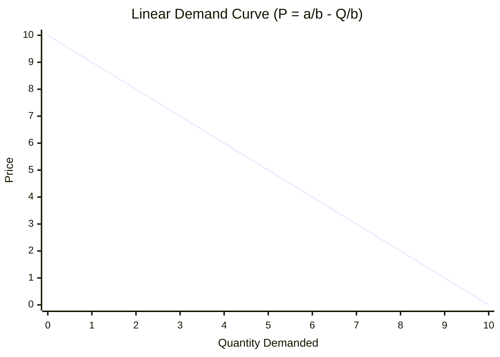
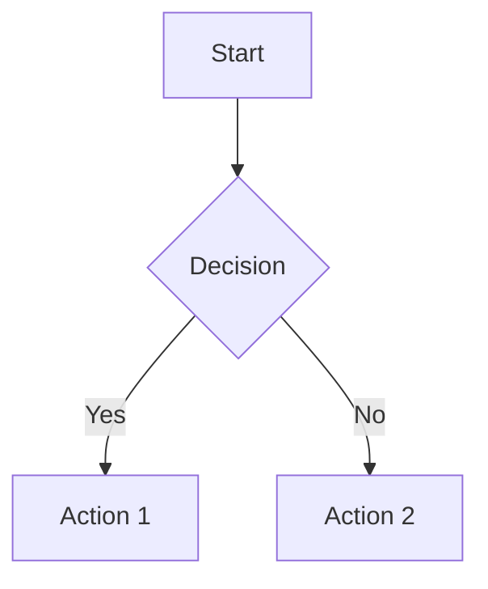

Here's the extracted format specification:

---

## Short Notes Format Guide

### 1. Document Structure

```
## MODULE {n}: {Module Title}

---

### {Topic Name}

{Content Block: Tables / Formulas / Bullets}

{Question Block}

---

### {Next Topic}
...

---

## Quick Reference: {Summary Title}
## Key Decision Rules Summary
```

---

### 2. Content Block Patterns

**Pattern A — Concept Table** (most common; for definitions, classifications, comparisons):

```markdown
| Column1 | Column2 | Column3 |
|---------|---------|---------|
| **Bold Term** | Description | Key detail |
```

**Pattern B — Formula Block** (quantitative subjects):

```markdown
$$\text{Formula Name} = \frac{\text{Numerator}}{\text{Denominator}}$$

#### Sub-case or Variant
$$\text{Another formula}$$
```

**Pattern C — Bullet Points** (for single-line facts, mnemonics, rules):

```markdown
- **Bold Key Term:** One-line explanation
- **Bold Key Term:** One-line explanation
```

**Pattern D — Hybrid** (formula + table for special cases):

```markdown
$$\text{General Formula}$$

| Case | Mean | Variance |
|------|------|----------|
| $X + Y$ | ... | ... |
```

---

### 3. Question Block Formats

**Format A — Conceptual / MCQ-style** (after concept tables, for qualitative subjects):

Each question sits inside a `>` blockquote, immediately after the relevant content block. Answer is **bolded** with a `✓` checkmark. Multiple questions stack as separate `>` lines.

```markdown
> **Q:** Question stem / keyword = **Answer** ✓
> **Q:** Another question = **Answer** ✓
> **Q:** Statement is TRUE/FALSE = **True/False** ✓
> **Q:** Fill-in-the-blank ______ = **Answer** ✓
```

Variations:
- `**Q:** X is done by the **Receiver** ✓` — direct fact recall
- `**Q:** X is **NOT** a feature of Y ✓` — negation/exception
- `**Q:** Missing step = **Answer** ✓` — scenario-based
- `**Q:** Factor NOT significantly influencing X = **Answer** ✓` — "odd one out"

**Format B — Numerical / Problem-solving** (quantitative subjects):

Question number and problem statement appear **outside** the blockquote in bold. The solution sits inside the `>` block with a reasoning line, step-by-step working, table lookups, and final answer.

```markdown
**Q{n}:** Problem statement with given values.

> *Why: One-line rationale explaining which method/formula applies and why.*
> $\text{Step 1 calculation}$
> $\text{Step 2 calculation}$
> 📋 **{Table Name}:** Lookup details (Row X, Col Y → value)
> $\text{Final computation}$
> **Answer = value** ✓
> *(Parenthetical key takeaway or common-mistake warning)*
```

**Format C — Conceptual but numbered** (theory questions in quantitative subjects):

```markdown
**Q{n}:** What does X mean / Which statement is true?

> One-to-two sentence answer in plain text.
```

---

### 4. Formatting Conventions

| Element | Convention |
|---------|-----------|
| **Key terms** | Always **bold** on first/primary mention |
| **Answers** | **Bold** + `✓` checkmark |
| **Negations** | Use **NOT** in bold caps: `**NOT**` |
| **Formulas** | Inline `$...$` for within text; `$$...$$` for standalone |
| **Table lookups** | Prefix with `📋 **Table Name:**` |
| **Tips/warnings** | `*(Italicized in parentheses at end of solution)*` |
| **Rationale line** | `*Why: ...*` in italics as first line of numerical solution |
| **Section dividers** | `---` between topics |
| **Cross-references** | Slash-separated Q numbers: `**Q44/Q131/Q181:**` |
| **TRUE/FALSE** | State claim → `**True/False**` + explain if False: `(it's actually X)` |
| **Checkmarks** | Every answer ends with `✓` — no exceptions |

---

### 5. End-of-Document Summaries

**Quick Reference Table** — condenses "which method to use" or "what to exclude":

```markdown
## Quick Reference: {Title}

| Situation | Action/Answer |
|-----------|---------------|
| Condition A | Method X |
| Condition B | Method Y |
```

**Key Decision Rules Summary** — one-liner rules for exam recall:

```markdown
## Key Decision Rules Summary

| Rule | Detail |
|------|--------|
| Rule name | One-line rule |
```

**Rapid-Fire Q&A** (for large subjects with 50+ questions) — pattern-answer pairs:

```markdown
## RAPID-FIRE: Most Repeated Q&A Patterns

| Question Pattern | Answer |
|-----------------|--------|
| Keyword/stem | One-phrase answer |
```

---

### 6. Content Density Rules

| Principle | Detail |
|-----------|--------|
| **Everything but in revision form** | Full syllabus coverage, zero filler prose — every line is either a fact, formula, table row, or question |
| **Tables over paragraphs** | If 3+ related items exist, use a table |
| **One concept → its questions** | Never separate a concept from its questions; they form an atomic block |
| **Bold = examinable** | If it's bold, it's been tested or is a likely answer |
| **Formulas with variable definitions** | Every formula includes what each symbol means (inline or in adjacent table) |
| **Special cases & exceptions highlighted** | Use `**NOT**`, `**≠**`, parenthetical warnings |
| **No redundant explanation** | If the table says it, don't repeat it in bullets below |

---

### 7. Input → Output Workflow

**Inputs required:**
1. Detailed/verbose lecture notes (full explanations)
2. All classroom questions (CLAs, quizzes)
3. All exam questions (past papers)

**Transformation rules:**
1. Compress each concept into the smallest correct representation (table/formula/bullets)
2. Attach **every** question that tests that concept directly below it
3. For numerical Qs: show full working with table lookups and a `*Why:*` line
4. For conceptual Qs: collapse to `stem = **answer** ✓` one-liner
5. Merge duplicate questions using slash notation (`Q12/Q45:`)
6. Add Quick Reference and Decision Rules at the end
7. Add Rapid-Fire table if total questions exceed ~40

---

### 8. Diagrams (Mermaid)

Diagrams are rendered using **Mermaid** syntax inside fenced code blocks with the `mermaid` language tag. The renderer uses a dark theme with transparent backgrounds, white text/borders, and an emerald-based color palette for charts.

**Supported diagram types:** flowcharts, sequence diagrams, xychart (line/bar), pie charts, class diagrams, etc.

**Rendering details:**
- Background is always transparent (no box or container around the diagram)
- All text, labels, axes, and borders render in white (`#ffffff`)
- Node fills are transparent; only borders are visible
- XY chart plot colors: `#10b981, #6366f1, #f59e0b, #ef4444, #8b5cf6`
- Max width is constrained to `max-w-sm` (~384px), centered
- Diagrams are rendered inline on the page without any surrounding box or border

**Usage in notes:**

````markdown

````

````markdown

````

**Guidelines for generating diagrams:**
- Use `xychart-beta` for any supply/demand curves, cost curves, or quantitative relationships
- Use `flowchart` for decision trees, process flows, circular flows
- Keep labels short (they render small at max-w-sm)
- Do not add background color directives — the renderer forces transparent
- Prefer simple diagrams; avoid overly complex multi-node charts that become unreadable at small sizes