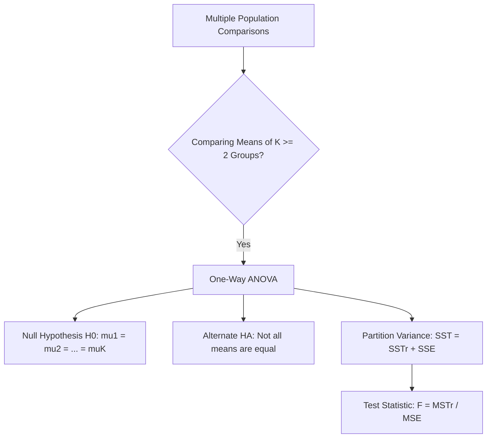
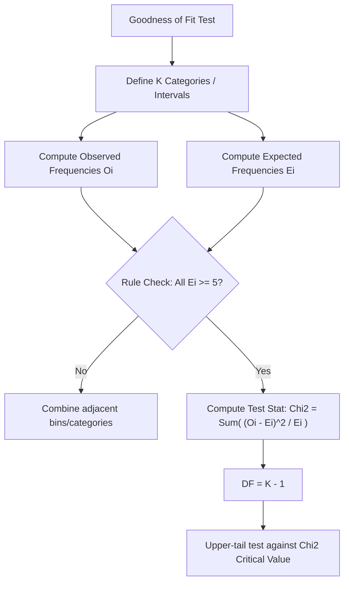
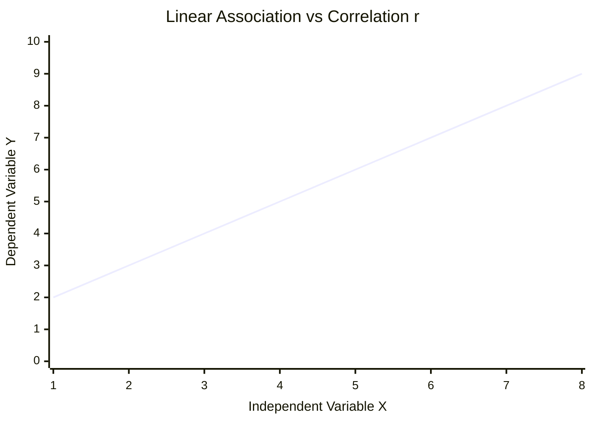
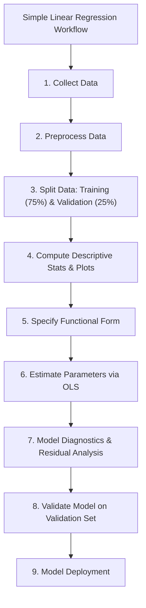
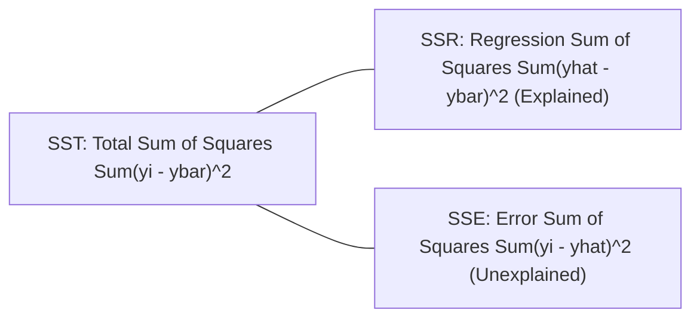
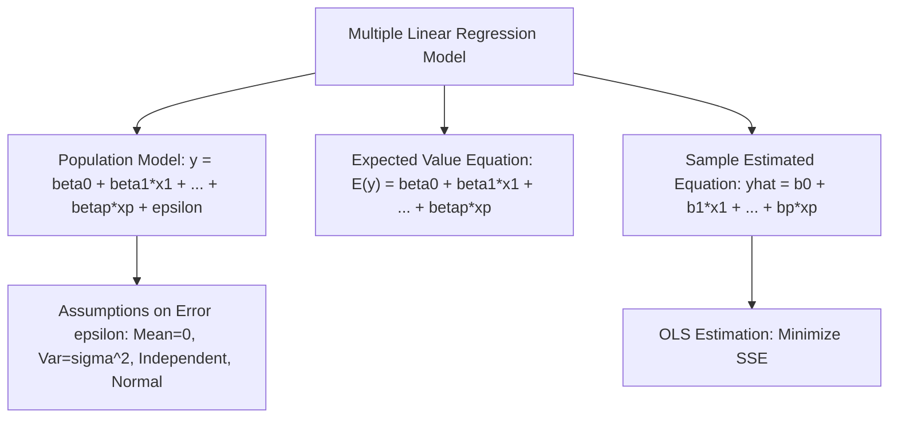
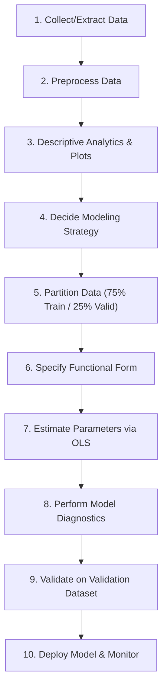
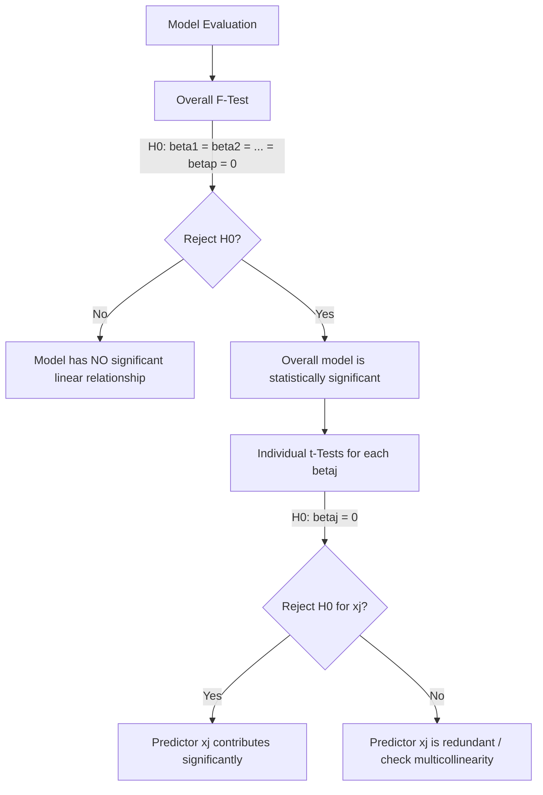

## MODULE 1: Analysis of Variance (ANOVA), Goodness of Fit, and Covariance/Correlation

---

### One-Way Analysis of Variance (ANOVA) Overview

**One-Way ANOVA** is a hypothesis testing procedure used to compare the means of $K \ge 2$ independent populations (or treatments) based on sample data using a single quantitative response variable $X$.

| Term / Notation | Definition / Description |
|---|---|
| **Factor Level / Treatment** | The specific population, group, or condition being compared ($K$ total levels) |
| **Response Variable ($X$)** | The quantitative measurement collected from each sample |
| **Sample Sizes** | $n_1, n_2, \dots, n_K$ (group sample sizes); $N_T = \sum_{i=1}^K n_i$ (total sample size) |
| **Null Hypothesis ($H_0$)** | $H_0: \mu_1 = \mu_2 = \dots = \mu_K$ (All population means are equal) |
| **Alternate Hypothesis ($H_A$)** | $H_A:$ Not all population means are equal (At least two means are different) |

> **Q:** In One-Way ANOVA with $K$ populations, the alternate hypothesis $H_A$ states that all population means are different from each other = **FALSE** ✓ *(It states that **NOT** all means are equal; at least one pair is different)*
> **Q:** Lower-tail and upper-tail test versions exist under ANOVA = **FALSE** ✓ *(ANOVA always uses an upper-tail $F$-test)*
> **Q:** Why is a test comparing population means called "Analysis of Variance"? = **It determines differences between means by analyzing sample variances and their composition** ✓
> **Q:** Each population being compared in an experiment is formally referred to as a **Treatment** ✓

---

### ANOVA Assumptions & Mathematical Formulas

#### Assumptions of One-Way ANOVA
1. **Normality:** For each population, the response variable $X$ is **normally distributed**.
2. **Equal Variances (Homogeneity of Variance):** The variance of $X$, denoted by $\sigma^2$, is the **same for all populations**.
3. **Independence:** Observations within and across sample groups are **independent**.

#### Sum of Squares & Mean Squares Partitioning
$$\text{SST} = \text{SSTr} + \text{SSE}$$

| Source of Variation | Sum of Squares (SS) Formula | Degrees of Freedom (DF) | Mean Square (MS) Formula | Test Statistic ($F$) |
|---|---|---|---|---|
| **Between Treatments (SSTr)** | $\sum_{i=1}^K n_i (\bar{X}_i - \bar{X})^2$ | $K - 1$ | $\text{MSTr} = \frac{\text{SSTr}}{K - 1}$ | $F = \frac{\text{MSTr}}{\text{MSE}}$ |
| **Within Groups / Error (SSE)** | $\sum_{i=1}^K \sum_{j=1}^{n_i} (X_{ij} - \bar{X}_i)^2$ | $N_T - K$ | $\text{MSE} = \frac{\text{SSE}}{N_T - K}$ | — |
| **Total Variation (SST)** | $\sum_{i=1}^K \sum_{j=1}^{n_i} (X_{ij} - \bar{X})^2$ | $N_T - 1$ | — | — |

where $\bar{X}_i$ is the sample mean of group $i$, and $\bar{X}$ is the overall (grand) mean across all $N_T$ data points.

#### Properties of Estimates & Test Statistic
- **MSE** is **always** an unbiased estimate of population variance $\sigma^2$, regardless of whether $H_0$ is true.
- **MSTr** is an unbiased estimate of $\sigma^2$ **only when $H_0$ is true**. If $H_0$ is false, MSTr **overestimates** $\sigma^2$.
- When $H_0$ is true, the ratio $F = \frac{\text{MSTr}}{\text{MSE}}$ follows an $F$-distribution with $K - 1$ numerator degrees of freedom and $N_T - K$ denominator degrees of freedom.
- **Decision Rule:** Reject $H_0$ if $F > F_{\alpha, K-1, N_T-K}$ or $p\text{-value} \le \alpha$.

> **Q:** Under ANOVA, which quantity is **ALWAYS** an unbiased estimator of population variance $\sigma^2$? = **MSE** ✓
> **Q:** When the null hypothesis $H_0$ is false, MSTr will **overestimate** the population variance $\sigma^2$ ✓
> **Q:** The numerator degrees of freedom for the ANOVA $F$-test is **$K - 1$** ✓
> **Q:** The denominator degrees of freedom for the ANOVA $F$-test is **$N_T - K$** ✓

---

### ANOVA Numerical Problem Solving & Case Studies

**Q1 (Palnadu District Investment Study):** Srinivas Rao compares average investment amounts across 3 age groups ($K=3$): Young ($n_1=4, \bar{X}_1=60$), Middle ($n_2=5, \bar{X}_2=57.2$), Senior ($n_3=6, \bar{X}_3=54.8$). Total sample size $N_T = 15$. Grand mean $\bar{X} = 57$. Given $\text{SST} = 132$ and $\text{SSTr} = 64.37$, test $H_0: \mu_1 = \mu_2 = \mu_3$ at $\alpha = 0.05$.

> *Why: One-way ANOVA applies because we are comparing means of $K=3$ independent populations.*
> $\text{SSE} = \text{SST} - \text{SSTr} = 132 - 64.37 = 67.63$
> $\text{DF}_{\text{treatment}} = K - 1 = 3 - 1 = 2$
> $\text{DF}_{\text{error}} = N_T - K = 15 - 3 = 12$
> $\text{MSTr} = \frac{64.37}{2} = 32.18$
> $\text{MSE} = \frac{67.63}{12} = 5.64$
> $F = \frac{32.18}{5.64} = 5.71$
> 📋 **F-Distribution Table:** Lookup $F_{0.05, 2, 12} \rightarrow 3.88$ (or $p\text{-value} = 0.018$)
> Since $F = 5.71 > 3.88$ ($p = 0.018 \le 0.05$), reject $H_0$.
> **Answer = Reject $H_0$; average investments across the 3 age groups are NOT all equal** ✓
> *(Sample means alone are not conclusive; within-group variance puts differences in X-bar in context)*

---

**Q2 (Bapatla District Investment Study):** In Bapatla district, $K=3, N_T=15$ ($n_1=4, n_2=5, n_3=6$). Sample means are $\bar{X}_1=41, \bar{X}_2=42, \bar{X}_3=41.67$. Sample standard deviations are high ($S_1=24.08, S_2=21.12, S_3=18.61$). Given $\text{SST} = 5257.6$, $\text{SSTr} = 2.27$, and $\text{SSE} = 5255$, conduct the test at $\alpha = 0.05$.

> *Why: High within-group variability reduces the ability to distinguish differences between population means.*
> $\text{DF}_{\text{treatment}} = 2, \quad \text{DF}_{\text{error}} = 12$
> $\text{MSTr} = \frac{2.27}{2} = 1.13$
> $\text{MSE} = \frac{5255}{12} = 438$
> $F = \frac{1.13}{438} = 0.0026 \approx 0$
> 📋 **F-Distribution Table:** Lookup $F_{0.05, 2, 12} \rightarrow 3.88$ ($p\text{-value} = 0.997$)
> Since $F = 0.0026 < 3.88$ ($p = 0.997 > 0.05$), do not reject $H_0$.
> **Answer = Do NOT reject $H_0$; insufficient evidence to claim mean investment levels differ** ✓
> *(High internal variance causes MSE to dwarf MSTr, driving F statistic close to zero)*

---

**Q3 (NTR District Investment Study):** In NTR district, $K=3, N_T=15$ ($n_1=4, n_2=5, n_3=6$). Sample means are $\bar{X}_1=60, \bar{X}_2=37.2, \bar{X}_3=20$. Sample standard deviations are small ($S_1=2.31, S_2=2.28, S_3=2.31$). Given $\text{SST} = 3345.6$, $\text{SSTr} = 3287$, and $\text{SSE} = 58.8$, test at $\alpha = 0.05$.

> *Why: Large separation between group means combined with low within-group variability produces a massive F-statistic.*
> $\text{MSTr} = \frac{3287}{2} = 1643.5$
> $\text{MSE} = \frac{58.8}{12} = 4.9$
> $F = \frac{1643.5}{4.9} = 335.4$
> 📋 **F-Distribution Table:** Lookup $F_{0.05, 2, 12} \rightarrow 3.88$ ($p\text{-value} \approx 0.000$)
> Since $F = 335.4 > 3.88$, reject $H_0$.
> **Answer = Reject $H_0$; strong evidence that population means are significantly different** ✓

---

**Q4 (Kia Transmission Assembly Methods):** Lakshmamma tests $K=4$ assembly methods with $N_T=34$ ($n_1=8, n_2=11, n_3=9, n_4=6$). Overall mean $\bar{X}=107.2$. Sample means: $\bar{X}_1=117, \bar{X}_2=100, \bar{X}_3=102.6, \bar{X}_4=114.2$. Given $\text{SST} = 11588$, $\text{SSTr} = 1800.3$, and $\text{SSE} = 9787.7$, test at $\alpha = 0.05$.

> *Why: Evaluating performance across 4 assembly method treatments using One-Way ANOVA.*
> $\text{DF}_{\text{treatment}} = 4 - 1 = 3$
> $\text{DF}_{\text{error}} = 34 - 4 = 30$
> $\text{MSTr} = \frac{1800.3}{3} = 600.1$
> $\text{MSE} = \frac{9787.7}{30} = 326.3$
> $F = \frac{600.1}{326.3} = 1.84$
> 📋 **F-Distribution Table:** Lookup $F_{0.05, 3, 30} \rightarrow 2.92$
> Since $F = 1.84 < 2.92$, do not reject $H_0$.
> **Answer = Do NOT reject $H_0$; assembly method differences are NOT statistically significant** ✓
> *(Never rush to claim a superior process based solely on sample means without hypothesis testing)*

---

**Q5 (Vijayawada Biryani Meal Prices):** Sujata tests meal prices across $K=3$ restaurant locations: Shopping ($n_1=13, \bar{X}_1=390.7$), Office ($n_2=9, \bar{X}_2=393.3$), Station ($n_3=8, \bar{X}_3=460$). $N_T = 30$, $\bar{X} = 410$. Given $\text{SST} = 172600$, $\text{SSTr} = 27307$, and $\text{SSE} = 145293$, conduct ANOVA at $\alpha = 0.05$.

> *Why: Testing location effect on average price across 3 areas.*
> $\text{DF}_{\text{treatment}} = 3 - 1 = 2, \quad \text{DF}_{\text{error}} = 30 - 3 = 27$
> $\text{MSTr} = \frac{27307}{2} = 13653.5$
> $\text{MSE} = \frac{145293}{27} = 5381.2$
> $F = \frac{13653.5}{5381.2} = 2.54$
> 📋 **F-Distribution Table:** Lookup $F_{0.05, 2, 27} \rightarrow 3.35$
> Since $F = 2.54 < 3.35$, do not reject $H_0$.
> **Answer = Do NOT reject $H_0$; price differences are not statistically significant** ✓
> *(Although Station mean was high, small $n_3=8$ and high internal variance prevented rejection)*

---

**Q6 (Audit Team Composition Study):** Ram tests audit completion days across $K=3$ team types: Local ($n_1=7, \bar{X}_1=25.3$), Corporate ($n_2=6, \bar{X}_2=20.8$), Both ($n_3=7, \bar{X}_3=17$). $N_T = 20$, $\bar{X} = 21.05$. Given $\text{SST} = 324.95$, $\text{SSTr} = 240.6$, and $\text{SSE} = 84.3$, test at $\alpha = 0.05$.

> *Why: Testing team structure effect on audit completion time.*
> $\text{DF}_{\text{treatment}} = 2, \quad \text{DF}_{\text{error}} = 20 - 3 = 17$
> $\text{MSTr} = \frac{240.6}{2} = 120.3$
> $\text{MSE} = \frac{84.3}{17} = 4.96 \approx 4.9$
> $F = \frac{120.3}{4.9} = 24.55 \quad (\text{or } 24.3)$
> 📋 **F-Distribution Table:** Lookup $F_{0.05, 2, 17} \rightarrow 3.59$
> Since $F = 24.3 > 3.59$, reject $H_0$.
> **Answer = Reject $H_0$; audit completion times differ significantly by team composition** ✓

---

### Post-Hoc Analysis in ANOVA

When $H_0$ is rejected in ANOVA, **Post-Hoc Analysis** is performed to determine *which* specific population means differ from each other.

- **Method:** Pairwise comparisons (e.g., conducting One-Way ANOVA on two groups at a time).
- **Palnadu Post-Hoc Results Summary ($\alpha = 0.05$):**
  - **Young ($\mu_1$) vs. Middle ($\mu_2$):** $F = 3.96, p = 0.09 \implies$ Do **NOT** reject ($\mu_1$ and $\mu_2$ could be equal).
  - **Middle ($\mu_2$) vs. Senior ($\mu_3$):** $p = 0.16 \implies$ Do **NOT** reject ($\mu_2$ and $\mu_3$ could be equal).
  - **Young ($\mu_1$) vs. Senior ($\mu_3$):** $\text{MSTr} = 64.1, \text{MSE} = 5.86, p = 0.01 \implies$ **Reject $H_0$** ($\mu_1 \neq \mu_3$ significantly).

> **Q:** What is the primary purpose of post-hoc analysis following an ANOVA test? = **To identify which specific treatment means are significantly different after rejecting $H_0$** ✓

---

### Goodness-of-Fit (GOF) Tests

**Goodness-of-Fit (GOF) Test** uses a Chi-Square ($\chi^2$) test statistic to determine whether observed sample data conforms to a hypothesized historical or theoretical probability distribution.

#### Key Rules & Test Statistic
$$\chi^2 = \sum_{i=1}^K \frac{(O_i - E_i)^2}{E_i}$$

- **Always an Upper-Tail Test:** Any discrepancy between observed ($O_i$) and expected ($E_i$) frequencies inflates $\chi^2$.
- **Degrees of Freedom:** $\text{DF} = K - 1$ ($K = \text{number of categories/bins}$).
- **Rule of Thumb:** Expected frequency in each bin/category **MUST** be at least 5 ($E_i \ge 5$). Sample observed values $O_i$ have **NO** such restriction.

> **Q:** Chi-square goodness-of-fit tests are always upper-tail tests = **TRUE** ✓
> **Q:** The restriction $E_i \ge 5$ in a Chi-square test applies to observed frequencies $O_i$ = **FALSE** ✓ *(It applies strictly to expected frequencies $E_i$)*
> **Q:** What happens to the $\chi^2$ statistic if observed frequencies perfectly match expected frequencies? = **$\chi^2 = 0$** ✓

---

### GOF Applications: Multinomial, Binomial, Normal, and Exponential Distributions

| Distribution Type | Categorization Method | Expected Frequency Formula ($E_i$) | Degrees of Freedom ($\text{DF}$) |
|---|---|---|---|
| **Multinomial (Discrete)** | Historical categories ($K$) | $E_i = n \cdot p_i$ | $K - 1$ |
| **Binomial (Discrete)** | Bins for success counts $X = 0, 1, \dots, n_{trials}$ | $E_i = N_{samples} \cdot \binom{n}{x} p^x (1-p)^{n-x}$ | $K - 1$ |
| **Normal (Continuous)** | $k$ equal-probability demand intervals | $E_i = N_{samples} \cdot P(\text{Interval}) = \frac{N}{k}$ | $k - 1$ |
| **Exponential (Continuous)** | $k$ equal-probability time intervals using CDF $F(x) = 1 - e^{-\lambda x}$ | $E_i = N_{samples} \cdot P(\text{Interval}) = \frac{N}{k}$ | $k - 1$ |

#### GOF Numerical Case Studies

**Q7 (TV Viewership - Subba Rao):** Survey of $N=600$ households across $K=4$ channels. Historical probabilities: ETV ($0.29$), Zee ($0.28$), Star Maa ($0.25$), Gemini ($0.18$). Observed counts: $O = [195, 170, 189, 46]$. Test if historical distribution still holds at $\alpha = 0.05$.

> *Why: Goodness-of-fit for a multinomial discrete distribution with known historical probabilities.*
> $E_1 = 600(0.29) = 174, \quad E_2 = 600(0.28) = 168, \quad E_3 = 600(0.25) = 150, \quad E_4 = 600(0.18) = 108$
> $\chi^2 = \frac{(195-174)^2}{174} + \frac{(170-168)^2}{168} + \frac{(189-150)^2}{150} + \frac{(46-108)^2}{108}$
> $\chi^2 = 2.53 + 0.02 + 10.14 + 35.59 = 48.29$
> $\text{DF} = 4 - 1 = 3$
> 📋 **Chi-Square Table:** Lookup $\chi^2_{0.05, 3} \rightarrow 7.81$
> Since $\chi^2 = 48.29 > 7.81$, reject $H_0$.
> **Answer = Reject $H_0$; viewership percentages have changed significantly** ✓

---

**Q8 (TV Viewership - Revised Hypothesis):** Same $N=600$ and $O = [195, 170, 189, 46]$, test $H_0: p_A=0.3, p_B=0.3, p_C=0.3, p_D=0.1$ at $\alpha = 0.05$.

> *Why: Testing a new candidate multinomial distribution.*
> $E_1 = 180, \quad E_2 = 180, \quad E_3 = 180, \quad E_4 = 60$
> $\chi^2 = \frac{(195-180)^2}{180} + \frac{(170-180)^2}{180} + \frac{(189-180)^2}{180} + \frac{(46-60)^2}{60} = 1.25 + 0.56 + 0.45 + 3.27 = 5.52$
> 📋 **Chi-Square Table:** Lookup $\chi^2_{0.05, 3} \rightarrow 7.81$ ($p\text{-value} = 0.14$)
> Since $\chi^2 = 5.52 < 7.81$, do not reject $H_0$.
> **Answer = Do NOT reject $H_0$; population could follow the revised distribution** ✓

---

**Q9 (Eye Surgeries - Dr. Srinivasan):** Sample of $N=365$ days, each day $n=6$ surgeries. Test if daily child surgeries follow $\text{Binomial}(n=6, p=0.5)$ at $\alpha = 0.05$. Bins $X=0,1,2,3,4,5,6$ ($K=7$).
Observed counts $O = [3, 25, 92, 105, 93, 39, 8]$.

> *Why: Binomial goodness-of-fit test across $K=7$ outcome bins.*
> $E_0 = 365 \cdot \binom{6}{0}(0.5)^6 = 5.7, \quad E_1 = 365 \cdot \binom{6}{1}(0.5)^6 = 34.2, \quad E_2 = 85.5, \quad E_3 = 114.4, \quad E_4 = 85.5, \quad E_5 = 34.2, \quad E_6 = 5.7$
> $\chi^2 = \frac{(3-5.7)^2}{5.7} + \frac{(25-34.2)^2}{34.2} + \frac{(92-85.5)^2}{85.5} + \frac{(105-114.4)^2}{114.4} + \frac{(93-85.5)^2}{85.5} + \frac{(39-34.2)^2}{34.2} + \frac{(8-5.7)^2}{5.7}$
> $\chi^2 = 1.28 + 2.48 + 0.49 + 0.72 + 0.65 + 0.67 + 0.93 = 7.21$
> $\text{DF} = 7 - 1 = 6$
> 📋 **Chi-Square Table:** Lookup $\chi^2_{0.05, 6} \rightarrow 12.59$
> Since $\chi^2 = 7.21 < 12.59$, do not reject $H_0$.
> **Answer = Do NOT reject $H_0$; child surgeries follow a Binomial distribution with $p=0.5$** ✓

---

**Q10 (Khaja Demand - Venkatesh Babu):** Sample of $N=25$ days. Test $H_0: X \sim \text{Normal}(\mu=70, \sigma=20)$ at $\alpha = 0.05$. Divide normal distribution into $k=5$ equal probability intervals ($P=0.20$ each $\implies E_i = 25 \times 0.20 = 5$).
Z-cutoffs for probabilities $0.2, 0.4, 0.6, 0.8$: $Z = -0.842, -0.253, +0.253, +0.842$.
Demand cutoffs ($X = 70 + 20Z$): $53.17, 64.93, 75.07, 86.83$.
Observed counts in 5 intervals: $O = [4, 8, 8, 2, 3]$.

> *Why: Normal distribution GOF using equal probability intervals.*
> $\chi^2 = \frac{(4-5)^2}{5} + \frac{(8-5)^2}{5} + \frac{(8-5)^2}{5} + \frac{(2-5)^2}{5} + \frac{(3-5)^2}{5} = 0.2 + 1.8 + 1.8 + 1.8 + 0.8 = 6.4$
> $\text{DF} = 5 - 1 = 4$
> 📋 **Chi-Square Table:** Lookup $\chi^2_{0.05, 4} \rightarrow 9.48$
> Since $\chi^2 = 6.4 < 9.48$, do not reject $H_0$.
> **Answer = Do NOT reject $H_0$; demand data is consistent with Normal(70, 20)** ✓

---

**Q11 (Call Center Duration - Madhavi):** Sample of $N=50$ calls. Test $H_0: X \sim \text{Exponential}(\text{mean}=6 \text{ min} \implies \lambda = 1/6)$ at $\alpha = 0.05$.
Construct $k=10$ equal probability intervals ($P=0.10$ each $\implies E_i = 50 \times 0.10 = 5$).
Formula for cutoff $x$: $1 - e^{-x/6} = P \implies x = -6 \ln(1 - P)$.
Cutoffs: $0.632, 1.34, 2.14, 3.06, 4.16, 5.50, 7.22, 9.66, 13.82$.
Observed counts in 10 intervals: $O = [4, 1, 3, 4, 5, 5, 8, 5, 7, 8]$.

> *Why: Exponential GOF using inverse CDF cutoffs.*
> $\chi^2 = \frac{(4-5)^2}{5} + \frac{(1-5)^2}{5} + \frac{(3-5)^2}{5} + \frac{(4-5)^2}{5} + \frac{(5-5)^2}{5} + \frac{(5-5)^2}{5} + \frac{(8-5)^2}{5} + \frac{(5-5)^2}{5} + \frac{(7-5)^2}{5} + \frac{(8-5)^2}{5}$
> $\chi^2 = 0.2 + 3.2 + 0.8 + 0.2 + 0 + 0 + 1.8 + 0 + 0.8 + 1.8 = 8.8$
> $\text{DF} = 10 - 1 = 9$
> 📋 **Chi-Square Table:** Lookup $\chi^2_{0.05, 9} \rightarrow 16.92$
> Since $\chi^2 = 8.8 < 16.92$, do not reject $H_0$.
> **Answer = Do NOT reject $H_0$; call durations are consistent with Exponential(mean=6)** ✓

---

### Covariance and Correlation

#### Sample Covariance ($s_{xy}$)
$$\text{Sample Covariance } s_{xy} = \frac{\sum_{i=1}^n (x_i - \bar{x})(y_i - \bar{y})}{n - 1}$$

- **Excel Function:** `=COVARIANCE.S(Array1, Array2)`
- Measures direction of linear association between two variables.
- **Quadrant Interpretation:**
  - $s_{xy} > 0$: Points in Quadrants 1 & 3 dominate $\implies$ positive association ($x \uparrow, y \uparrow$).
  - $s_{xy} < 0$: Points in Quadrants 2 & 4 dominate $\implies$ negative association ($x \uparrow, y \downarrow$).
  - $s_{xy} \approx 0$: Points evenly scattered across all 4 quadrants.
- **Special Case:** Covariance of $x$ with itself is the sample variance: $s_{xx} = s_x^2$.
- **Major Limitation:** Value depends on units of measurement (scale-dependent).

#### Sample Correlation Coefficient ($r_{xy}$)
$$\text{Pearson Correlation Coefficient } r_{xy} = \frac{s_{xy}}{s_x s_y}$$

- **Excel Function:** `=CORREL(Array1, Array2)`
- **Scale-Free:** Unitless measure bounded by $-1 \le r_{xy} \le +1$.
- **Interpretation:**
  - $r_{xy} = +1$: Perfect positive linear relationship.
  - $r_{xy} = -1$: Perfect negative linear relationship.
  - $r_{xy} = 0$: **NO linear association** present.

#### Critical Concepts & Pitfalls
1. **Linearity Only:** $r_{xy} = 0$ does **NOT** mean no relationship exists; a strong **non-linear** relationship may exist!
   *(Example: $y = 1/x^2$ with symmetric $x = [-3, -2, -1, 1, 2, 3] \implies s_{xy} = 0, r_{xy} = 0$ despite perfect functional association).*
2. **Correlation $\neq$ Causation:** High correlation does not imply a cause-and-effect relationship.
3. **Explainable vs. Spurious Correlation:**
   - **Explainable Correlation:** Logical causal/indirect link exists.
   - **Spurious Correlation:** Artificial correlation driven by an unobserved **hidden/latent variable** or sheer coincidence.
     - *Ice cream sales vs. Crime rate:* Driven by latent variable **Temperature**.
     - *Doctors in villages vs. Village deaths:* Driven by overall **Poor Public Health**.
     - *Maine Divorce rate vs. Margarine consumption ($r = 0.99$):* Purely coincidence.
     - *Skirt length vs. Economic performance:* Hemline theory.

> **Q:** The covariance between variable $x$ and itself equals the **Sample Variance $s_x^2$** ✓
> **Q:** A sample correlation coefficient $r_{xy} = 0$ proves that there is no relationship between $x$ and $y$ = **FALSE** ✓ *(It only proves no **linear** relationship; a non-linear relationship may exist)*
> **Q:** Which Excel function calculates the sample covariance? = **`=COVARIANCE.S`** ✓
> **Q:** Correlation coefficient depends on the units of measurement of $x$ and $y$ = **FALSE** ✓ *(It is unitless/scale-free)*
> **Q:** What causes the spurious correlation between ice cream sales and crime rate? = **A hidden/latent variable (Temperature)** ✓

---

## Quick Reference: Summary Table

| Technique | Primary Purpose | Test Statistic | Key Parameters / DF | Rejection Condition |
|---|---|---|---|---|
| **One-Way ANOVA** | Compare means of $K \ge 2$ populations | $F = \frac{\text{MSTr}}{\text{MSE}}$ | $\text{DF}_1 = K - 1, \quad \text{DF}_2 = N_T - K$ | $F > F_{\alpha}$ or $p \le \alpha$ |
| **Multinomial GOF** | Test fit to historical categorical probabilities | $\chi^2 = \sum \frac{(O - E)^2}{E}$ | $\text{DF} = K - 1$ | $\chi^2 > \chi^2_{\alpha}$ or $p \le \alpha$ |
| **Binomial GOF** | Test fit to Binomial counts | $\chi^2 = \sum \frac{(O - E)^2}{E}$ | $\text{DF} = K - 1$ | $\chi^2 > \chi^2_{\alpha}$ or $p \le \alpha$ |
| **Normal GOF** | Test fit to Normal distribution | $\chi^2 = \sum \frac{(O - E)^2}{E}$ | $\text{DF} = k - 1$ ($k$ equal probability intervals) | $\chi^2 > \chi^2_{\alpha}$ or $p \le \alpha$ |
| **Exponential GOF** | Test fit to Exponential distribution | $\chi^2 = \sum \frac{(O - E)^2}{E}$ | $\text{DF} = k - 1$ ($k$ equal probability intervals) | $\chi^2 > \chi^2_{\alpha}$ or $p \le \alpha$ |
| **Covariance** | Direction of linear association | $s_{xy} = \frac{\sum (x-\bar{x})(y-\bar{y})}{n-1}$ | Scale-dependent | N/A |
| **Correlation** | Strength & direction of linear relationship | $r_{xy} = \frac{s_{xy}}{s_x s_y}$ | Bounded $[-1, +1]$ | Tested using $t$-distribution |

---

## Key Decision Rules Summary

| Rule Name | Operational Rule / Formula |
|---|---|
| **ANOVA $H_0$ Statement** | Always set as $H_0: \mu_1 = \mu_2 = \dots = \mu_K$ |
| **ANOVA $H_A$ Statement** | Always set as $H_A:$ Not all means are equal (at least one pair differs) |
| **Sum of Squares Total Identity** | $\text{SST} = \text{SSTr} + \text{SSE}$ holds universally |
| **Unbiased Variance Estimates** | MSE is **ALWAYS** unbiased; MSTr is unbiased **ONLY IF $H_0$ IS TRUE** |
| **ANOVA Test Direction** | ANOVA $F$-test is strictly an **upper-tail** test |
| **GOF Bin Size Rule** | Expected frequency $E_i \ge 5$ for all categories; sample $O_i$ has no minimum limit |
| **GOF Test Direction** | Chi-Square Goodness-of-Fit is strictly an **upper-tail** test |
| **Correlation Range** | Pearson correlation $r_{xy}$ satisfies $-1 \le r_{xy} \le +1$ |
| **Correlation vs. Causation** | High correlation $r \approx 1$ does **NOT** imply $x$ causes $y$ |

## MODULE 2: Simple Linear Regression (SLR)

---

### Foundations of Simple Linear Regression

**Simple Linear Regression (SLR)** is a supervised learning technique used in predictive analytics to model a linear relationship between a single continuous quantitative dependent variable $y$ and a single independent variable $x$.

| Regression Component | Symbol / Term | Definition & Role |
|---|---|---|
| **Dependent Variable** | $y$ | Response, outcome, or target variable being predicted (continuous numeric) |
| **Independent Variable** | $x$ | Predictor, explanatory variable, or feature used to predict $y$ |
| **Population Regression Model** | $y_i = \beta_0 + \beta_1 x_i + \epsilon_i$ | True relationship in the population including random error term $\epsilon_i$ |
| **Population Regression Equation** | $E(y) = \beta_0 + \beta_1 x$ | Expected / mean value of $y$ for a given value of $x$ (error term drops out) |
| **Sample Estimated Equation** | $\hat{y} = b_0 + b_1 x$ | Estimated regression line fitted using sample statistics $b_0$ and $b_1$ |
| **Regression Parameters** | $\beta_0, \beta_1$ | Unknown population parameters ($\beta_0 = \text{intercept}$, $\beta_1 = \text{slope}$) |
| **Sample Estimators** | $b_0, b_1$ | Point estimators of $\beta_0$ and $\beta_1$ computed from sample data |

> **Q:** Linearity in linear regression is defined with respect to the explanatory variable $x$ = **FALSE** ✓ *(Linearity is strictly defined with respect to the regression coefficients $\beta_0$ and $\beta_1$)*
> **Q:** Is $y_i = \beta_0 + \beta_1 x_i^2 + \epsilon_i$ classified as a linear regression model? = **YES** ✓ *(Because $y$ is linear with respect to parameters $\beta_0$ and $\beta_1$, even though $x$ is squared)*
> **Q:** Is $y_i = \beta_0 + e^{\beta_1 x_i} + \epsilon_i$ a linear regression model? = **NO** ✓ *(Parameter $\beta_1$ appears non-linearly in the exponent)*
> **Q:** What is the standard recommended train-validation split ratio for model building? = **75% Training and 25% Validation** ✓
> **Q:** Performing well on the training data set but performing poorly on the validation set is known as **Overfitting** ✓

---

### Ordinary Least Squares (OLS) Parameter Estimation

The **Ordinary Least Squares (OLS)** method computes sample statistics $b_0$ and $b_1$ by minimizing the sum of squared residual deviations between observed values $y_i$ and predicted values $\hat{y}_i$.

$$\text{Minimize } \text{SSE} = \sum_{i=1}^n (y_i - \hat{y}_i)^2 = \sum_{i=1}^n [y_i - (b_0 + b_1 x_i)]^2$$

#### OLS Estimator Formulas
$$b_1 = \frac{\sum_{i=1}^n (x_i - \bar{x})(y_i - \bar{y})}{\sum_{i=1}^n (x_i - \bar{x})^2} = \frac{s_{xy}}{s_x^2}$$

$$b_0 = \bar{y} - b_1 \bar{x}$$

- **Interpretation of Slope ($b_1$):** Marginal change in the expected value of $y$ associated with a 1-unit increase in $x$.
- **Extrapolation Warning:** Regression equations are **NOT** valid for predicting $y$ values outside the range of $x$ values present in the training data set.

> **Q:** What objective criterion is minimized by the Ordinary Least Squares (OLS) method? = **Sum of Squared Errors / Residuals (SSE)** ✓
> **Q:** What property makes OLS estimates desirable under Gauss-Markov assumptions? = **BEST Linear Unbiased Estimator (BLUE)** ✓
> **Q:** Can an estimated regression equation be used to predict $y$ for $x$ values outside the sample data range? = **NO** ✓ *(Extrapolation beyond the training range is invalid)*

---

### Partitioning Variation & Coefficient of Determination ($R^2$)

Total variation in the dependent variable $y$ is partitioned into explained and unexplained components.

#### Sum of Squares Decomposition
$$\text{SST} = \text{SSR} + \text{SSE}$$

$$\sum_{i=1}^n (y_i - \bar{y})^2 = \sum_{i=1}^n (\hat{y}_i - \bar{y})^2 + \sum_{i=1}^n (y_i - \hat{y}_i)^2$$

| Variation Quantity | Symbol | Formula | Degrees of Freedom (DF) | Role / Meaning |
|---|---|---|---|---|
| **Total Sum of Squares** | $\text{SST}$ | $\sum (y_i - \bar{y})^2$ | $n - 1$ | Total variation of $y_i$ around sample mean $\bar{y}$ |
| **Regression Sum of Squares** | $\text{SSR}$ | $\sum (\hat{y}_i - \bar{y})^2$ | $1$ | Variation in $y_i$ explained by regression line |
| **Error Sum of Squares** | $\text{SSE}$ | $\sum (y_i - \hat{y}_i)^2$ | $n - 2$ | Residual unexplained variation around regression line |

#### Coefficient of Determination ($R^2$)
$$R^2 = \frac{\text{SSR}}{\text{SST}} = 1 - \frac{\text{SSE}}{\text{SST}}, \quad 0 \le R^2 \le 1$$

- **Interpretation:** Percentage / proportion of total variation in $y$ explained by the linear relationship with $x$.
- **Relationship to Correlation Coefficient ($r_{xy}$):**
  $$r_{xy} = \text{sign}(b_1) \cdot \sqrt{R^2}$$

> **Q:** What value does $R^2$ take when every sample observation lies perfectly on the estimated regression line? = **1.0 (or 100%)** ✓
> **Q:** If $b_1 = -2.5$ and $R^2 = 0.64$, what is the Pearson correlation coefficient $r_{xy}$? = **$-0.80$** ✓ *(Since $b_1$ is negative, $r_{xy} = -\sqrt{0.64} = -0.80$)*
> **Q:** Why is $R^2$ preferred over correlation $r_{xy}$ for broader model evaluation? = **$R^2$ extends to non-linear relationships and multiple regression models** ✓

---

### Error Term Assumptions & Tests for Model Significance

To conduct statistical inference ($t$-test and $F$-test) on regression parameters, four core assumptions must hold for the error term $\epsilon_i$:

1. **Zero Mean:** $E(\epsilon_i) = 0$ for all $x_i \implies E(y_i) = \beta_0 + \beta_1 x_i$.
2. **Homoscedasticity (Constant Variance):** $\text{Var}(\epsilon_i) = \sigma^2$ for all $x_i$.
3. **Independence:** Errors $\epsilon_i$ are uncorrelated across observations.
4. **Normality:** $\epsilon_i \sim N(0, \sigma^2) \implies y_i \sim N(\beta_0 + \beta_1 x_i, \sigma^2)$.

#### Estimates of Population Variance ($\sigma^2$)
$$\text{Mean Square Error (MSE)} = s^2 = \frac{\text{SSE}}{n - 2}$$

$$\text{Standard Error of Estimate} = s = \sqrt{\text{MSE}} = \sqrt{\frac{\text{SSE}}{n - 2}}$$

$$\text{Mean Square Regression (MSR)} = \frac{\text{SSR}}{1} = \text{SSR}$$

#### Hypothesis Tests for Slope Parameter $\beta_1$
$$\text{Null Hypothesis } H_0: \beta_1 = 0 \quad (\text{No linear relationship exists})$$
$$\text{Alternate Hypothesis } H_A: \beta_1 \neq 0 \quad (\text{Significant linear relationship exists})$$

| Test Type | Test Statistic Formula | Sampling Distribution | Equivalence in SLR |
|---|---|---|---|
| **$t$-Test** | $t = \frac{b_1 - 0}{s_{b_1}} \quad \text{where } s_{b_1} = \frac{s}{\sqrt{\sum (x_i - \bar{x})^2}}$ | $t$-distribution with $\text{DF} = n - 2$ | $t^2 = F$ |
| **$F$-Test** | $F = \frac{\text{MSR}}{\text{MSE}}$ | $F$-distribution with $\text{DF}_1 = 1, \text{DF}_2 = n - 2$ | $F = t^2$ |

> **Q:** What are the denominator degrees of freedom for the $F$-test in simple linear regression? = **$n - 2$** ✓
> **Q:** In simple linear regression, the $t$-test and $F$-test for parameter significance yield identical conclusions and $p$-values = **TRUE** ✓
> **Q:** The estimated standard error of $b_1$ is denoted by $s_{b_1} = \frac{s}{\sqrt{\sum (x_i - \bar{x})^2}}$ = **TRUE** ✓

---

### Residual Analysis, Outliers, and Influential Observations

A **residual** $e_i = y_i - \hat{y}_i$ represents the error in predicting $y_i$. Standardized residuals convert error values into standard deviation units: $z_{e_i} = \frac{e_i}{s_e}$.

| Diagnostic Plot | Ideal Pattern | Indication of Violation | Corrective Action |
|---|---|---|---|
| **Residuals ($e_i$) vs. Independent ($x$)** | Horizontal band of points centered around zero | **Funnel shape:** Non-constant variance (Heteroscedasticity) **U-shape / Curvilinear:** Non-linear relationship | Transform variables or add higher-order / additional variables |
| **Residuals ($e_i$) vs. Predicted ($\hat{y}$)** | Horizontal band around zero | Non-random trend or funnel pattern | Add missing independent variables (Multiple Regression) |
| **Standardized Residuals vs. $x$** | ~95% of points within $[-2, +2]$ | Points with $|z_{e_i}| > 2$ (or $|z_{e_i}| > 3$) | Identify **Outliers** |

- **Outliers:** Observations with unusually large residual values ($|z_{e_i}| > 2$). Caused by data entry errors or extreme chance occurrences.
- **Influential Observations:** Points that exert a strong leverage effect on slope $b_1$ and intercept $b_0$ (often extreme $x$ or $y$ values). Removing an influential observation substantially alters regression parameters.

> **Q:** What pattern in a plot of residuals versus $x$ indicates a violation of homoscedasticity? = **A funnel or fan-shaped pattern** ✓
> **Q:** Approximately what percentage of standardized residuals should lie within $[-2, +2]$ if errors are normally distributed? = **95%** ✓
> **Q:** A data point with a standardized residual of $+3.6$ is classified as an **Outlier** ✓

---

### Comprehensive SLR Numerical Case Studies

**Q1 (Canara Bank Credit Card Spend vs Income - Hanumantha):** Sample $n = 55$ bank customers.
Given: $\bar{x} = 32.89 \text{ lakhs}, \bar{y} = 4051 \text{ Rs}, \sum (x_i - \bar{x})^2 = 10201$.
OLS regression estimates: $b_0 = 1047.37, b_1 = 85.27$.
Sum of Squares: $\text{SST} = 114,197,923$, $\text{SSR} = 74,180,516$, $\text{SSE} = 40,017,408$.
Perform model estimation, predict spend for income $x = 35 \text{ lakhs}$, calculate $R^2$, standard error $s$, $F$-stat, and $t$-stat.

> *Why: OLS model evaluation and statistical inference for SLR.*
> $\text{Regression Equation: } \hat{y} = 1047.37 + 85.27 x$
> $\text{Prediction at } x = 35: \hat{y} = 1047.37 + 85.27(35) = 1047.37 + 2984.45 = 4031.82 \approx 4032 \text{ Rs}$
> $R^2 = \frac{\text{SSR}}{\text{SST}} = \frac{74,180,516}{114,197,923} = 0.650 \implies 65.0\% \text{ variation explained}$
> $r_{xy} = +\sqrt{0.650} = +0.806$
> $\text{DF}_{\text{residual}} = n - 2 = 55 - 2 = 53$
> $\text{MSE} = \frac{\text{SSE}}{53} = \frac{40,017,408}{53} = 755,045.43 \implies s = \sqrt{755,045.43} = 868.9$
> $\text{MSR} = \text{SSR} = 74,180,516$
> $F = \frac{\text{MSR}}{\text{MSE}} = \frac{74,180,516}{755,045.43} = 98.25 \quad (p < 0.001 \implies \text{Reject } H_0)$
> $s_{b_1} = \frac{s}{\sqrt{\sum (x_i - \bar{x})^2}} = \frac{868.9}{\sqrt{10201}} = \frac{868.9}{101} = 8.603$
> $t = \frac{b_1}{s_{b_1}} = \frac{85.27}{8.603} = 9.91 \quad (p = 1.1 \times 10^{-13} \le 0.05 \implies \text{Reject } H_0)$
> **Answer = Model $\hat{y} = 1047.37 + 85.27x$ is highly significant ($F=98.25, t=9.91, R^2=0.65$); Predicted Spend = 4032 Rs** ✓
> *(Notice that $t^2 = (9.91)^2 = 98.2$, exactly matching the F-statistic)*

---

**Q2 (BMTC Bus Fleet Maintenance vs Age - Shiva):** Sample $n = 30$ buses.
Age range $x \in [1, 5] \text{ years}$. Mean age $\bar{x} = 3$, mean cost $\bar{y} = 6.1 \text{ lakhs}$.
OLS regression equation: $\hat{y} = 2.2 + 1.32 x$.
Sum of Squares: $\text{SST} = 107.1$, $\text{SSR} = 93.5$, $\text{SSE} = 13.65$. Standard error $s = 0.69$, $s_{b_1} = 0.095$.
Evaluate $R^2$, ANOVA $F$-test, slope $t$-test, and address prediction for a brand-new bus ($x = 0$).

> *Why: SLR inference and evaluation of extrapolation boundaries.*
> $R^2 = \frac{93.5}{107.1} = 0.873 \implies 87.3\% \text{ variation explained}$
> $r_{xy} = +\sqrt{0.873} = +0.934$
> $\text{DF}_{\text{error}} = 30 - 2 = 28$
> $\text{MSE} = \frac{13.65}{28} = 0.4875 \implies s = \sqrt{0.4875} = 0.698 \approx 0.69$
> $\text{MSR} = 93.51$
> $F = \frac{93.51}{0.4875} = 191.8 \quad (\text{or } 191.7, p < 0.001 \implies \text{Reject } H_0)$
> $t = \frac{1.32}{0.095} = 13.89 \quad (\text{or } 13.85, p < 0.001 \implies \text{Reject } H_0)$
> **Extrapolation Check:** Can we predict cost for $x = 0$ (brand new bus)? **NO**, because $x=0$ lies outside training range $[1, 5]$.
> **Answer = Model is highly significant ($R^2=0.87, F=191.7$); predicting for brand-new buses is INVALID due to extrapolation** ✓
> *(Interpreting intercept $b_0=2.2$ as new bus maintenance is incorrect because training data lacked age < 1)*

---

**Q3 (Amusement Park Season Passes vs Population - Arun):** Sample $n = 30$ PIN codes.
Dependent variable $y = \text{Season Pass Holders}$, Independent variable $x = \text{Population}$.
OLS equation: $\hat{y} = -15.24 + 0.009 x$.
Given: $\text{SSR} = 158,752$, $\text{SSE} = 161,238$, $s_{b_1} = 0.0018$. Residual analysis reveals one PIN code with standardized residual $z_e = +3.6$. Evaluate model.

> *Why: Testing parameter significance and detecting outliers in SLR.*
> $\text{DF}_{\text{error}} = 30 - 2 = 28$
> $\text{MSE} = \frac{161,238}{28} = 5758.5 \approx 5759$
> $\text{MSR} = 158,752$
> $F = \frac{158,752}{5758.5} = 27.57 \approx 27.5 \quad (p < 0.001 \implies \text{Reject } H_0)$
> $t = \frac{0.009}{0.0018} = 5.0 \quad (\text{or } 5.25, p < 0.001 \implies \text{Reject } H_0)$
> **Outlier Evaluation:** $z_e = +3.6 > 2.0$ indicates an **Outlier**.
> **Answer = Population is a significant predictor ($F=27.5, t=5.25$); PIN code with $z_e=3.6$ is an outlier requiring investigation** ✓

---

**Q4 (Computer Satisfaction Score vs Price - Basaraju):** Sample $n = 36$ survey responses.
$y = \text{Satisfaction Score (0-100)}$, $x = \text{Price (in thousands Rs)}$.
OLS equation: $\hat{y} = 48.44 + 0.132 x$.
Given: $\text{SSR} = 510.8$, $\text{SSE} = 914.8$, $s = 5.19$, $s_{b_1} = 0.03$. Standardized residuals show values of $-2.48$ and $-2.12$. Conduct ANOVA and $t$-test.

> *Why: Analyzing score model diagnostics and interpreting positive price slope.*
> $R^2 = \frac{510.8}{510.8 + 914.8} = \frac{510.8}{1425.6} = 0.358 \approx 0.36 \implies r = \sqrt{0.36} = 0.598 \approx 0.59$
> $\text{DF}_{\text{error}} = 36 - 2 = 34$
> $\text{MSE} = \frac{914.8}{34} = 26.9$
> $\text{MSR} = 510.8$
> $F = \frac{510.8}{26.9} = 18.99 \approx 18.9 \quad (p < 0.001 \implies \text{Reject } H_0)$
> $t = \frac{0.132}{0.03} = 4.4 \quad (\text{or } 4.36, p < 0.001 \implies \text{Reject } H_0)$
> **Interpretation:** For every 1,000 Rs increase in price, satisfaction score increases by $0.132$ points.
> **Answer = Price is statistically significant ($F=18.9, t=4.36, R^2=0.36$); two negative outliers ($-2.48, -2.12$) over-predicted by model** ✓

---

**Q5 (Household Debt vs Income - Manjula Nayak):** Sample $n = 500$ survey records.
$y = \text{Household Debt}$, $x = \text{First Income}$.
OLS equation: $\hat{y} = 32976 + 0.04 x$.
Given: $\text{SSR} = 1.86 \times 10^{11}$, $\text{SSE} = 4.08 \times 10^{11}$, $s = 28,619$, $\text{MSE} = 819,076,096$, $s_{b_1} = 0.002$. Conduct model validation.

> *Why: Large sample size SLR evaluation.*
> $\text{SST} = 1.86 \times 10^{11} + 4.08 \times 10^{11} = 5.94 \times 10^{11}$
> $R^2 = \frac{1.86 \times 10^{11}}{5.94 \times 10^{11}} = 0.313 \approx 0.31 \implies r = +0.56$
> $\text{DF}_{\text{error}} = 500 - 2 = 498$
> $F = \frac{1.87 \times 10^{11}}{819,076,096} = 228.3 \approx 228 \quad (p < 0.001 \implies \text{Reject } H_0)$
> $t = \frac{0.04}{0.002} = 20.0 \quad (\text{or } 15.1, p < 0.001 \implies \text{Reject } H_0)$
> **Answer = First income is a significant predictor ($F=228, R^2=0.31$); low $R^2$ indicates additional predictors needed** ✓

---

## Quick Reference: Simple Linear Regression Output Summary

| Case Study / Example | Sample Size ($n$) | Estimated Equation ($\hat{y} = b_0 + b_1 x$) | $R^2$ | $r_{xy}$ | Standard Error ($s$) | $F$-Statistic | $t$-Statistic | Outliers Detected? |
|---|---|---|---|---|---|---|---|---|
| **Canara Bank (Income)** | $55$ | $\hat{y} = 1047.37 + 85.27 x$ | $0.650$ | $+0.806$ | $868.9$ | $98.25$ | $9.91$ | None |
| **Canara Bank (HH Size)** | $55$ | $\hat{y} = 2083.70 + 520.13 x$ | $0.396$ | $+0.630$ | $1140.71$ | $34.70$ | $5.89$ | $3$ outliers ($|z| > 2$) |
| **Amusement Park (Pop)** | $30$ | $\hat{y} = -15.24 + 0.009 x$ | $0.495$ | $+0.704$ | $75.88$ | $27.50$ | $5.25$ | $1$ outlier ($z = +3.6$) |
| **BMTC Bus (Age)** | $30$ | $\hat{y} = 2.20 + 1.32 x$ | $0.873$ | $+0.934$ | $0.69$ | $191.70$ | $13.85$ | None |
| **Computer (Price)** | $36$ | $\hat{y} = 48.44 + 0.132 x$ | $0.360$ | $+0.590$ | $5.19$ | $18.90$ | $4.36$ | $2$ outliers ($-2.48, -2.12$) |
| **99 Acres (Income)** | $500$ | $\hat{y} = 32976 + 0.04 x$ | $0.310$ | $+0.560$ | $28,619$ | $228.00$ | $15.10$ | Few ($|z| > 2$) |
| **99 Acres (Payment)** | $500$ | $\hat{y} = 28791 + 2.94 x$ | $0.370$ | $+0.600$ | $27,518$ | $288.00$ | $16.95$ | Few ($|z| > 2$) |

---

## Key Decision Rules Summary

| Rule Name | Operational Formula / Rule |
|---|---|
| **OLS Slope Estimator ($b_1$)** | $b_1 = \frac{\sum (x_i - \bar{x})(y_i - \bar{y})}{\sum (x_i - \bar{x})^2}$ |
| **OLS Intercept Estimator ($b_0$)** | $b_0 = \bar{y} - b_1 \bar{x}$ |
| **Sum of Squares Partitioning** | $\text{SST} = \text{SSR} + \text{SSE}$ |
| **Coefficient of Determination ($R^2$)** | $R^2 = \frac{\text{SSR}}{\text{SST}} = 1 - \frac{\text{SSE}}{\text{SST}}$ |
| **Correlation vs. $R^2$** | $r_{xy} = \text{sign}(b_1) \cdot \sqrt{R^2}$ |
| **MSE & Standard Error of Estimate** | $\text{MSE} = s^2 = \frac{\text{SSE}}{n - 2}, \quad s = \sqrt{\text{MSE}}$ |
| **Standard Error of Slope ($s_{b_1}$)** | $s_{b_1} = \frac{s}{\sqrt{\sum (x_i - \bar{x})^2}}$ |
| **SLR Significance Test ($t$-stat)** | $t = \frac{b_1}{s_{b_1}} \sim t_{n-2}$ |
| **SLR Significance Test ($F$-stat)** | $F = \frac{\text{MSR}}{\text{MSE}} \sim F_{1, n-2}$ |
| **$t$ vs $F$ Relation in SLR** | $F = t^2$ (yields identical $p$-value for testing $\beta_1 = 0$) |
| **Extrapolation Prohibition** | Predict $y$ **ONLY** for $x \in [x_{\min}, x_{\max}]$ of training data |
| **Outlier Identification** | Standardized residual $|z_{e_i}| > 2$ (or $|z_{e_i}| > 3$) |

## MODULE 3: Multiple Linear Regression (MLR)

---

### Multiple Linear Regression Model & Equations

**Multiple Linear Regression (MLR)** extends simple linear regression by modeling a single continuous numeric dependent variable $y$ as a linear function of $p \ge 2$ independent variables $x_1, x_2, \dots, x_p$.

| Term / Notation | Mathematical Form | Definition / Role |
|---|---|---|
| **Dependent Variable** | $y$ | Response, target, or outcome variable being predicted (continuous numeric) |
| **Independent Variables** | $x_1, x_2, \dots, x_p$ | Predictor variables, explanatory variables, or features ($p = \text{number of predictors}$) |
| **Population MLR Model** | $y = \beta_0 + \sum_{j=1}^p \beta_j x_j + \epsilon$ | Theoretical population relationship including random disturbance $\epsilon$ |
| **Population MLR Equation** | $E(y) = \beta_0 + \sum_{j=1}^p \beta_j x_j$ | Conditional mean / expected value of $y$ for given predictor values |
| **Estimated MLR Equation** | $\hat{y} = b_0 + \sum_{j=1}^p b_j x_j$ | Sample fitted equation where $b_0, b_1, \dots, b_p$ estimate $\beta_0, \beta_1, \dots, \beta_p$ |
| **Response Surface** | Plane in $(p+1)$-D space | Geometric representation of $E(y)$ (e.g., a 2D plane in 3D space when $p=2$) |

#### Interpretation of Regression Coefficients
- **Partial Regression Slope ($b_j$):** Represents the estimated change in the mean of $y$ per 1-unit increase in $x_j$, **holding all other independent variables constant** (*ceteris paribus*).
- **Intercept ($b_0$):** Expected value of $y$ when all $x_j = 0$. Testing $H_0: \beta_0 = 0$ is rarely of practical interest; interpreting $b_0$ is invalid if all $x_j = 0$ lies outside the training data range (**extrapolation**).

> **Q:** What is the geometric representation of a multiple linear regression equation with $p=2$ independent variables? = **A plane (Response Surface) in 3-dimensional space** ✓
> **Q:** How is the partial regression coefficient $b_1$ interpreted in MLR? = **The estimated change in $y$ for a 1-unit change in $x_1$, holding all other independent variables constant** ✓
> **Q:** Why is hypothesis testing on the intercept $\beta_0$ usually of low practical interest? = **Because predicting $y$ when all $x=0$ often requires extrapolation outside the training data range** ✓

---

### The 10 Steps of MLR Model Building

- **Step 1 — Data Collection:** Gather data from primary (surveys/interviews) or secondary (ERP, databases) sources.
- **Step 2 — Data Preprocessing:** Assess data quality, handle missing observations, remove recording errors, and transform categorical/qualitative variables.
- **Step 3 — Descriptive Analytics:** Use scatter plots, correlation matrices, and box plots to identify relationships, multicollinearity warnings, or proxy variables.
- **Step 4 — Modeling Strategy:** Select independent variables that are **controllable by decision-makers** and demonstrate consistent performance across subsets.
- **Step 5 — Data Partitioning:** Split data into training (~75%) and validation (~25%) datasets using random sampling.
- **Step 6 — Specify Functional Form:** Determine initial functional structure (linear, polynomial terms, log transformations).
- **Step 7 — Parameter Estimation:** Use **Ordinary Least Squares (OLS)** via matrix algebra to compute point estimates $b_0, b_1, \dots, b_p$ minimizing $\text{SSE}$.
- **Step 8 — Model Diagnostics:** Perform overall $F$-test, individual $t$-tests, and check for multicollinearity, heteroscedasticity, and non-normality of residuals.
- **Step 9 — Model Validation:** Assess validation metrics ($R^2$, Adjusted $R^2$, MAPE, RMSE) to ensure low bias, low variance, and avoid **overfitting**.
- **Step 10 — Deployment & Monitoring:** Formulate business decision rules and track model degradation over time.

> **Q:** Overfitting occurs when a regression model performs well on the **Training Data** but poorly on the **Validation Data** ✓
> **Q:** Why are uncontrollable variables (such as weather) less desirable in managerial regression models? = **Decision-makers cannot directly manipulate them to drive business outcomes** ✓

---

### Variation Decomposition & Adjusted $R^2$

$$\text{SST} = \text{SSR} + \text{SSE}$$

| Sum of Squares | Formula | Degrees of Freedom (DF) | Mean Square (MS) | Role / Property |
|---|---|---|---|---|
| **Total (SST)** | $\sum_{i=1}^n (y_i - \bar{y})^2$ | $n - 1$ | — | Total variation in $y$; **independent** of chosen predictors |
| **Regression (SSR)** | $\sum_{i=1}^n (\hat{y}_i - \bar{y})^2$ | $p$ | $\text{MSR} = \frac{\text{SSR}}{p}$ | Variation explained by the $p$ independent variables |
| **Error (SSE)** | $\sum_{i=1}^n (y_i - \hat{y}_i)^2$ | $n - p - 1$ | $\text{MSE} = \frac{\text{SSE}}{n - p - 1}$ | Unexplained variation; $\text{MSE} = s^2$ is an unbiased estimate of $\sigma^2$ |

#### Multiple Coefficient of Determination ($R^2$)
$$R^2 = \frac{\text{SSR}}{\text{SST}} = 1 - \frac{\text{SSE}}{\text{SST}}, \quad 0 \le R^2 \le 1$$

- **Limitation of $R^2$:** Adding any new independent variable to an MLR model will **never decrease** $R^2$ (SSR increases or stays constant; SSE decreases or stays constant), even if the variable is completely irrelevant.

#### Adjusted Multiple Coefficient of Determination ($R^2_{\text{adj}}$)
$$R^2_{\text{adj}} = 1 - \left[ (1 - R^2) \frac{n - 1}{n - p - 1} \right]$$

- **Purpose:** Penalizes the addition of uninformative independent variables by accounting for degrees of freedom.
- **Properties:**
  - $R^2_{\text{adj}} \le R^2$ always.
  - If $p$ is large relative to $n$, the term can become negative; by convention, set $R^2_{\text{adj}} = 0$.

> **Q:** Adding additional independent variables to an MLR model will **ALWAYS** increase or maintain $R^2$ = **TRUE** ✓
> **Q:** What is the denominator degrees of freedom for MSE in an MLR model with $n$ observations and $p$ predictors? = **$n - p - 1$** ✓
> **Q:** If the calculated $R^2_{\text{adj}}$ is mathematically negative due to $p > n$, its reported value is set to **0** ✓

---

### Hypothesis Testing: Overall $F$-Test vs. Individual $t$-Tests

In MLR, the $F$-test and $t$-tests serve distinctly different analytical functions:

#### 1. Overall Significance Test ($F$-Test)
- **Null Hypothesis ($H_0$):** $H_0: \beta_1 = \beta_2 = \dots = \beta_p = 0$ (No linear relationship between $y$ and the entire set of predictors).
- **Alternate Hypothesis ($H_A$):** $H_A:$ At least one $\beta_j \neq 0$ (One or more predictors are linearly related to $y$).
- **Test Statistic:**
  $$F = \frac{\text{MSR}}{\text{MSE}} = \frac{\text{SSR} / p}{\text{SSE} / (n - p - 1)} \sim F_{p, \, n - p - 1}$$
- **Decision Rule:** Reject $H_0$ if $F > F_{\alpha, p, n-p-1}$ or $p\text{-value} \le \alpha$.

#### 2. Individual Significance Test ($t$-Test)
- **Null Hypothesis ($H_0$):** $H_0: \beta_j = 0$ (Predictor $x_j$ does not contribute uniquely given other variables).
- **Alternate Hypothesis ($H_A$):** $H_A: \beta_j \neq 0$.
- **Test Statistic:**
  $$t = \frac{b_j}{s_{b_j}} \sim t_{n - p - 1}$$
- **Decision Rule:** Reject $H_0$ if $|t| > t_{\alpha/2, n-p-1}$ or $p\text{-value} \le \alpha$.

> **Q:** In MLR, the $F$-test and $t$-test always provide identical conclusions = **FALSE** ✓ *(In MLR, the $F$-test assesses overall model significance, while individual $t$-tests assess the marginal contribution of each predictor)*
> **Q:** What are the numerator and denominator degrees of freedom for the MLR $F$-test? = **Numerator $\text{DF} = p$, Denominator $\text{DF} = n - p - 1$** ✓
> **Q:** Under $H_0: \beta_1 = \dots = \beta_p = 0$, the expected value of the ratio $\frac{\text{MSR}}{\text{MSE}}$ is approximately **1** ✓

---

### Multicollinearity & Omitted Variable Bias

#### Multicollinearity
**Multicollinearity** refers to high linear correlation among two or more independent variables ($x_i, x_j$) within an MLR model.

- **Rule of Thumb Warning:** Pairwise sample correlation $|r_{x_i, x_j}| > 0.70$ (or $< -0.70$).
- **Consequences / Symptoms:**
  1. **Contradictory Significance:** Overall $F$-test is highly significant ($p < 0.001$), but individual $t$-tests fail to reject $H_0$ ($p > 0.05$) for heavily correlated variables.
  2. **Wrong Signs:** OLS estimates yield coefficient signs opposite to economic/business logic (e.g., negative slope for income).
  3. **High Variance:** Standard errors $s_{b_j}$ become heavily inflated, reducing confidence in individual coefficients.
- **Remedy:** Drop redundant collinear variables from the regression model.

#### Omitted Variable Bias (OVB)
**Omitted Variable Bias** occurs when a relevant predictor correlated with both the dependent variable $y$ and an included predictor $x$ is omitted from the model.

| Required Conditions for OVB | Observable Effects of Correcting OVB |
|---|---|
| 1. Omitted variable is correlated with $y$. 2. Omitted variable is correlated with one or more included $x$ variables. | - Substantial increase in $R^2$ and $R^2_{\text{adj}}$. - Substantial drop in standard error of estimate $s$. - Drop in standard errors $s_{b_j}$ and $p$-values of included variables. - Included variable slope adjusts to its true marginal contribution. |

> **Q:** What correlation threshold serves as a general rule of thumb for potential multicollinearity? = **$|r| > 0.70$** ✓
> **Q:** Severe multicollinearity can cause OLS slope estimates to take the **Wrong Sign** ✓
> **Q:** If an omitted variable is completely uncorrelated with all included $x$ variables, does omitted variable bias occur in $b_j$? = **NO** ✓ *(OVB requires correlation with both $y$ and at least one included $x$)*

---

### Residual Analysis in MLR

Residuals $e_i = y_i - \hat{y}_i$ are standardized via $z_{e_i} = \frac{e_i}{s_e}$.

- **Residuals vs. Predicted Values ($\hat{y}$):** Primary diagnostic plot in MLR (condenses multidimensional predictors into a single 2D plot). Ideal pattern is a random horizontal band.
- **Standardized Residuals vs. $\hat{y}$:** Under normality assumptions, ~95% of standardized residuals lie within $[-2, +2]$.
  - Points with $|z_{e_i}| > 2$ (or $|z_{e_i}| > 3$) are flagged as **outliers**.
- **Handling Outliers & Influential Observations:**
  - Verify data collection/entry accuracy; correct erroneous data and rerun regression.
  - Do **NOT** delete valid observations unless they definitively do not belong to the target population.

> **Q:** Why is the plot of residuals versus predicted values ($\hat{y}$) preferred over residuals versus individual $x_i$ in MLR? = **It provides a single condensed diagnostic plot across multiple independent variables** ✓
> **Q:** Outliers should routinely be deleted to improve $R^2$ = **FALSE** ✓ *(They should only be deleted if proven to be erroneous or unrepresentative of the population)*

---

### Comprehensive MLR Numerical Case Studies

**Q1 (Canara Bank Credit Card Spend - Hanumantha):** Sample $n = 55$ customers.
Dependent variable $y = \text{Monthly Spend (Rs)}$.
Predictors: $x_1 = \text{Annual Income (Lakhs)}$, $x_2 = \text{Household Size}$.
Regression output: $b_0 = 355.68, b_1 = 71.16, b_2 = 339.90$.
Sums of Squares: $\text{SST} = 114,197,923$, $\text{SSR} = 91,468,852$, $\text{SSE} = 22,729,071$.
Predictor standard errors: $s_{b_1} = 6.92, s_{b_2} = 54.05$. Inter-variable correlation: $r_{x_1, x_2} = 0.32$.
Compute $R^2, R^2_{\text{adj}}, s, \text{MSR}, \text{MSE}, F\text{-stat}$, and individual $t$-tests at $\alpha = 0.05$.

> *Why: Evaluating a 2-variable MLR model and conducting overall and individual hypothesis tests.*
> $\hat{y} = 355.68 + 71.16 x_1 + 339.90 x_2$
> $R^2 = \frac{\text{SSR}}{\text{SST}} = \frac{91,468,852}{114,197,923} = 0.801 \approx 0.80 \implies 80\% \text{ variation explained}$
> $R^2_{\text{adj}} = 1 - \left[ (1 - 0.801) \frac{55 - 1}{55 - 2 - 1} \right] = 1 - \left[ 0.199 \times \frac{54}{52} \right] = 1 - 0.2067 = 0.793$
> $\text{DF}_{\text{reg}} = p = 2, \quad \text{DF}_{\text{error}} = n - p - 1 = 55 - 2 - 1 = 52$
> $\text{MSR} = \frac{91,468,852}{2} = 45,734,426$
> $\text{MSE} = \frac{22,729,071}{52} = 437,097.52 \approx 437,098 \implies s = \sqrt{437,098} = 661.13$
> $F = \frac{\text{MSR}}{\text{MSE}} = \frac{45,734,426}{437,097.52} = 104.63 \quad (p < 0.001 \implies \text{Reject } H_0: \beta_1 = \beta_2 = 0)$
> $t_{\text{income}} = \frac{b_1}{s_{b_1}} = \frac{71.17}{6.92} = 10.28 \quad (p < 0.001 \implies \text{Income is significant})$
> $t_{\text{size}} = \frac{b_2}{s_{b_2}} = \frac{339.92}{54.05} = 6.29 \quad (p < 0.001 \implies \text{Household Size is significant})$
> **Answer = Model is highly significant ($R^2=0.80, R^2_{\text{adj}}=0.793, F=104.63, s=661.13$); both predictors are individually significant** ✓
> *(Adding household size increased $R^2$ from 0.65 to 0.80 and lowered standard error from 868.9 to 661.1)*

---

**Q2 (Canara Bank Multicollinearity Case):** Using Hanumantha's data, replace household size with monthly income ($x_1$) alongside annual income ($x_2$). Correlation $r_{x_1, x_2} = 0.83$. Regression output: $\hat{y} = b_0 - 202.85 x_1 + 102.74 x_2$, $R^2 = 0.66$. $F$-test is significant ($p < 0.05$), but $t$-test for monthly income gives $t = 0.18, p > 0.05$. Analyze output.

> *Why: Demonstrating diagnostic detection of severe multicollinearity.*
> 1. High correlation between predictors: $r_{x_1, x_2} = 0.83 > 0.70$.
> 2. Contradictory inference: Overall $F$-test is significant, but individual $t$-test for monthly income fails to reject $H_0$ ($t = 0.18, p > 0.05$).
> 3. Wrong coefficient sign: $b_1 = -202.85$ is negative, contradicting the economic logic that higher monthly income increases credit card spend.
> **Answer = Severe multicollinearity is present; monthly income is redundant given annual income and must be removed** ✓

---

**Q3 (99 Acres Household Debt Progression - Manjula Nayak):** Sample $n = 500$ households ($\text{SST} = 5.94 \times 10^{11}$). Compare progressive regression models for Debt ($y$):
- Model A (SLR - First Income $x_1$): $R^2 = 0.31, s = 28619, \text{SSR} = 1.86 \times 10^{11}$
- Model B (SLR - Monthly Payment $x_2$): $R^2 = 0.37, s = 27518, \text{SSR} = 2.18 \times 10^{11}$
- Model C (MLR - $x_1 + x_2$): $\hat{y} = 13081.6 + 0.0246 x_1 + 2.09 x_2$, $R^2 = 0.45, R^2_{\text{adj}} = 0.448, s = 25644, F = 203$
- Model D (MLR - Payment $x_2$ + Utilities $x_3$): $\hat{y} = -140771 + 1.44 x_2 + 168.91 x_3$, $R^2 = 0.67, R^2_{\text{adj}} \approx 0.67, s = 19839, F = 506.9$
- Model E (MLR - $x_1 + x_2 + x_3$): $\hat{y} = -140378 + 0.017 x_1 + 0.96 x_2 + 157.95 x_3$, $R^2 = 0.708, R^2_{\text{adj}} = 0.70, s = 18699, F = 401.6$

Evaluate ANOVA and individual $t$-tests for Model E ($p=3, n=500$) given $s_{b_1} = 0.002, s_{b_2} = 0.148, s_{b_3} = 7.54$.

> *Why: Analyzing multi-variable model improvements, ANOVA partitioning, and OVB elimination.*
> $\text{DF}_{\text{reg}} = 3, \quad \text{DF}_{\text{error}} = 500 - 3 - 1 = 496$
> $\text{SSR} = 4.21 \times 10^{11}, \quad \text{SSE} = 1.73 \times 10^{11}$
> $\text{MSR} = \frac{4.21 \times 10^{11}}{3} = 1.40 \times 10^{11}$
> $\text{MSE} = \frac{1.73 \times 10^{11}}{496} = 349,653,451 \implies s = 18699$
> $F = \frac{1.40 \times 10^{11}}{349,653,451} = 401.6 \quad (p \approx 0 \implies \text{Overall Model Significant})$
> $t_{\text{income}} = \frac{0.017}{0.002} = 7.96 \quad (p < 0.001)$
> $t_{\text{payment}} = \frac{0.96}{0.148} = 6.50 \quad (p < 0.001)$
> $t_{\text{utilities}} = \frac{157.95}{7.54} = 20.95 \quad (p < 0.001)$
> **Answer = Model E is the best model ($R^2=0.708, s=18699, F=401.6$); all 3 predictors are individually highly significant** ✓
> *(Progressive inclusion of omitted variables resolved OVB, increasing $R^2$ from 0.31 to 0.71 while cutting standard error by ~35%)*

---

**Q4 (Magic Bricks Flat Prices in Mysuru - Vijay Gowda):** Sample $n = 30$ apartments ($\text{SST} = 251,001$).
Dependent variable $y = \text{Selling Price (Lakhs)}$.
Model 1 (SLR - Area $x_1$): $\hat{y} = 28.37 + 0.0968 x_1$, $R^2 = 0.44, s = 70.57, F = 22.39, t = 4.73$.
Model 2 (MLR - Area $x_1$ + Bedrooms $x_2$): $\hat{y} = -29.19 + 0.085 x_1 + 23.46 x_2$, $R^2 = 0.461, R^2_{\text{adj}} = 0.42, s = 70.74, F = 11.58 (p = 0.0002)$.
Given $s_{b_1} = 0.024, s_{b_2} = 25.15, r_{x_1, x_2} = 0.542$. Perform individual significance tests for Model 2.

> *Why: Identifying collinear redundancy when adding a correlated non-significant variable.*
> $\text{DF}_{\text{error}} = 30 - 2 - 1 = 27$
> $t_{\text{area}} = \frac{0.085}{0.024} = 3.46 \quad (p = 0.002 \le 0.05 \implies \text{Reject } H_0)$
> $t_{\text{bedrooms}} = \frac{23.46}{25.15} = 0.932 \quad (p = 0.36 > 0.05 \implies \text{Do NOT Reject } H_0)$
> **Answer = Bedrooms is NOT statistically significant ($t = 0.932, p = 0.36$); adding Bedrooms does not improve the model due to collinearity with Area** ✓
> *(Notice that Adjusted $R^2$ dropped from 0.43 to 0.42, penalizing the inclusion of the redundant Bedrooms variable)*

---

**Q5 (Magic Bricks Flat Prices - Bathrooms Model):** In Vijay Gowda's dataset ($n=30$), test Model 3 (Area $x_1$ + Bathrooms $x_2$): $\hat{y} = 10.61 + 0.084 x_1 + 17.80 x_2$. Given $R^2 = 0.45, R^2_{\text{adj}} = 0.41, s = 71.18, F = 11.26 (p = 0.0003), r_{x_1, x_2} = 0.659$. Bathrooms $t$-statistic $= 0.723 (p = 0.48)$. What is the conclusion?

> *Why: Diagnostics confirm that Bathrooms is also redundant.*
> Overall model is significant ($F = 11.26, p < 0.001$), but Bathrooms is not individually significant ($t = 0.723, p = 0.48 > 0.05$).
> $R^2_{\text{adj}}$ decreases from $0.43$ (SLR) to $0.41$.
> **Answer = Bathrooms is NOT statistically significant ($p = 0.48$); neither Bedrooms nor Bathrooms should be added to Area** ✓

---

## Quick Reference: Multiple Linear Regression Case Comparison

| Case Study | Model Predictors ($p$) | Sample Size ($n$) | Estimated Equation ($\hat{y}$) | $R^2$ | $R^2_{\text{adj}}$ | Standard Error ($s$) | $F$-Stat ($p\text{-value}$) | Non-Significant Predictors ($p > 0.05$) |
|---|---|---|---|---|---|---|---|---|
| **Canara Bank (SLR)** | Income ($1$) | $55$ | $1047.37 + 85.27 x_1$ | $0.650$ | $0.640$ | $868.9$ | $98.24 \; (< 0.001)$ | None |
| **Canara Bank (MLR)** | Income + HH Size ($2$) | $55$ | $355.68 + 71.16 x_1 + 339.90 x_2$ | $0.801$ | $0.793$ | $661.1$ | $104.63 \; (< 0.001)$ | None |
| **Canara Bank (Collinear)** | Monthly Inc + Annual Inc ($2$) | $55$ | $b_0 - 202.85 x_1 + 102.74 x_2$ | $0.660$ | $0.647$ | — | Significant | Monthly Income ($t=0.18, \text{wrong sign}$) |
| **99 Acres (Model C)** | Income + Payment ($2$) | $500$ | $13081.6 + 0.025 x_1 + 2.09 x_2$ | $0.450$ | $0.448$ | $25644$ | $203.0 \; (< 0.001)$ | None |
| **99 Acres (Model D)** | Payment + Utilities ($2$) | $500$ | $-140771 + 1.44 x_2 + 168.91 x_3$ | $0.670$ | $0.670$ | $19839$ | $506.9 \; (< 0.001)$ | None |
| **99 Acres (Model E)** | Income + Payment + Util ($3$) | $500$ | $-140378 + 0.017 x_1 + 0.96 x_2 + 157.95 x_3$ | $0.708$ | $0.700$ | $18699$ | $401.6 \; (< 0.001)$ | None |
| **Magic Bricks (SLR)** | Area ($1$) | $30$ | $28.37 + 0.0968 x_1$ | $0.440$ | $0.430$ | $70.57$ | $22.39 \; (< 0.001)$ | None |
| **Magic Bricks (MLR 1)** | Area + Bedrooms ($2$) | $30$ | $-29.19 + 0.085 x_1 + 23.46 x_2$ | $0.461$ | $0.420$ | $70.74$ | $11.58 \; (0.0002)$ | Bedrooms ($t=0.932, p=0.36$) |
| **Magic Bricks (MLR 2)** | Area + Bathrooms ($2$) | $30$ | $10.61 + 0.084 x_1 + 17.80 x_2$ | $0.450$ | $0.410$ | $71.18$ | $11.26 \; (0.0003)$ | Bathrooms ($t=0.723, p=0.48$) |

---

## Key Decision Rules Summary

| Rule / Principle | Operational Formula / Criteria | Key Takeaway |
|---|---|---|
| **Overall Model Significance** | $F = \frac{\text{MSR}}{\text{MSE}} > F_{\alpha, p, n-p-1}$ | Rejects $H_0: \beta_1 = \dots = \beta_p = 0$; validates that the overall model has explanatory power |
| **Individual Predictor Significance** | $t = \frac{b_j}{s_{b_j}}$ with $\text{DF} = n - p - 1$ | Rejects $H_0: \beta_j = 0$; confirms $x_j$ uniquely contributes after controlling for other predictors |
| **Adjusted $R^2$ Formula** | $R^2_{\text{adj}} = 1 - \left[ (1 - R^2) \frac{n - 1}{n - p - 1} \right]$ | Used to compare models with different numbers of predictors; penalizes useless variables |
| **Multicollinearity Warning Rule** | $|r_{x_i, x_j}| > 0.70$ | High correlation causes inflated standard errors, insignificant $t$-tests, and wrong coefficient signs |
| **Omitted Variable Bias Test** | $r(y, x_{\text{omitted}}) \neq 0$ AND $r(x_{\text{included}}, x_{\text{omitted}}) \neq 0$ | Omitting relevant variables biases included slopes; adding them increases $R^2$ and reduces $s$ |
| **Standardized Residual Outlier Rule** | $|z_{e_i}| = \left|\frac{e_i}{s_e}\right| > 2.0$ (or $> 3.0$) | Flags potential outliers; verify data entry before deciding whether to retain or re-evaluate |