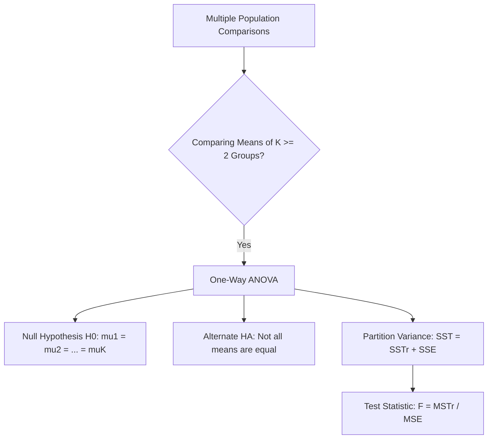
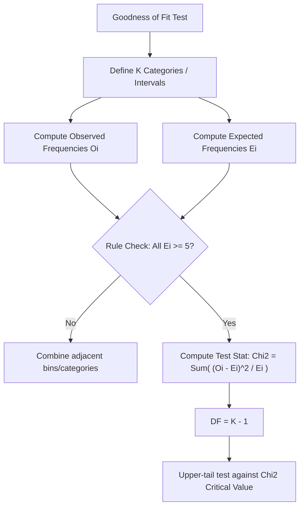
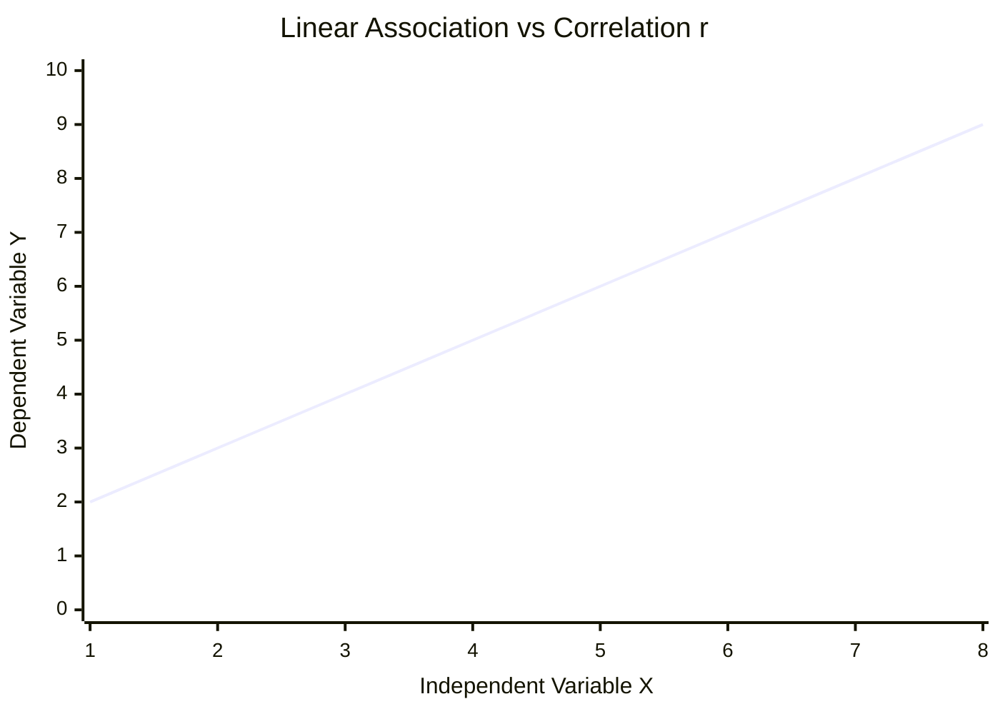

## MODULE 1: Analysis of Variance (ANOVA), Goodness of Fit, and Covariance/Correlation

---

### One-Way Analysis of Variance (ANOVA) Overview

**One-Way ANOVA** is a hypothesis testing procedure used to compare the means of $K \ge 2$ independent populations (or treatments) based on sample data using a single quantitative response variable $X$.

| Term / Notation | Definition / Description |
|---|---|
| **Factor Level / Treatment** | The specific population, group, or condition being compared ($K$ total levels) |
| **Response Variable ($X$)** | The quantitative measurement collected from each sample |
| **Sample Sizes** | $n_1, n_2, \dots, n_K$ (group sample sizes); $N_T = \sum_{i=1}^K n_i$ (total sample size) |
| **Null Hypothesis ($H_0$)** | $H_0: \mu_1 = \mu_2 = \dots = \mu_K$ (All population means are equal) |
| **Alternate Hypothesis ($H_A$)** | $H_A:$ Not all population means are equal (At least two means are different) |

> **Q:** In One-Way ANOVA with $K$ populations, the alternate hypothesis $H_A$ states that all population means are different from each other = **FALSE** ✓ *(It states that **NOT** all means are equal; at least one pair is different)*
> **Q:** Lower-tail and upper-tail test versions exist under ANOVA = **FALSE** ✓ *(ANOVA always uses an upper-tail $F$-test)*
> **Q:** Why is a test comparing population means called "Analysis of Variance"? = **It determines differences between means by analyzing sample variances and their composition** ✓
> **Q:** Each population being compared in an experiment is formally referred to as a **Treatment** ✓

---

### ANOVA Assumptions & Mathematical Formulas

#### Assumptions of One-Way ANOVA
1. **Normality:** For each population, the response variable $X$ is **normally distributed**.
2. **Equal Variances (Homogeneity of Variance):** The variance of $X$, denoted by $\sigma^2$, is the **same for all populations**.
3. **Independence:** Observations within and across sample groups are **independent**.

#### Sum of Squares & Mean Squares Partitioning
$$\text{SST} = \text{SSTr} + \text{SSE}$$

| Source of Variation | Sum of Squares (SS) Formula | Degrees of Freedom (DF) | Mean Square (MS) Formula | Test Statistic ($F$) |
|---|---|---|---|---|
| **Between Treatments (SSTr)** | $\sum_{i=1}^K n_i (\bar{X}_i - \bar{X})^2$ | $K - 1$ | $\text{MSTr} = \frac{\text{SSTr}}{K - 1}$ | $F = \frac{\text{MSTr}}{\text{MSE}}$ |
| **Within Groups / Error (SSE)** | $\sum_{i=1}^K \sum_{j=1}^{n_i} (X_{ij} - \bar{X}_i)^2$ | $N_T - K$ | $\text{MSE} = \frac{\text{SSE}}{N_T - K}$ | — |
| **Total Variation (SST)** | $\sum_{i=1}^K \sum_{j=1}^{n_i} (X_{ij} - \bar{X})^2$ | $N_T - 1$ | — | — |

where $\bar{X}_i$ is the sample mean of group $i$, and $\bar{X}$ is the overall (grand) mean across all $N_T$ data points.

#### Properties of Estimates & Test Statistic
- **MSE** is **always** an unbiased estimate of population variance $\sigma^2$, regardless of whether $H_0$ is true.
- **MSTr** is an unbiased estimate of $\sigma^2$ **only when $H_0$ is true**. If $H_0$ is false, MSTr **overestimates** $\sigma^2$.
- When $H_0$ is true, the ratio $F = \frac{\text{MSTr}}{\text{MSE}}$ follows an $F$-distribution with $K - 1$ numerator degrees of freedom and $N_T - K$ denominator degrees of freedom.
- **Decision Rule:** Reject $H_0$ if $F > F_{\alpha, K-1, N_T-K}$ or $p\text{-value} \le \alpha$.

> **Q:** Under ANOVA, which quantity is **ALWAYS** an unbiased estimator of population variance $\sigma^2$? = **MSE** ✓
> **Q:** When the null hypothesis $H_0$ is false, MSTr will **overestimate** the population variance $\sigma^2$ ✓
> **Q:** The numerator degrees of freedom for the ANOVA $F$-test is **$K - 1$** ✓
> **Q:** The denominator degrees of freedom for the ANOVA $F$-test is **$N_T - K$** ✓

---

### ANOVA Numerical Problem Solving & Case Studies

**Q1 (Palnadu District Investment Study):** Srinivas Rao compares average investment amounts across 3 age groups ($K=3$): Young ($n_1=4, \bar{X}_1=60$), Middle ($n_2=5, \bar{X}_2=57.2$), Senior ($n_3=6, \bar{X}_3=54.8$). Total sample size $N_T = 15$. Grand mean $\bar{X} = 57$. Given $\text{SST} = 132$ and $\text{SSTr} = 64.37$, test $H_0: \mu_1 = \mu_2 = \mu_3$ at $\alpha = 0.05$.

> *Why: One-way ANOVA applies because we are comparing means of $K=3$ independent populations.*
> $\text{SSE} = \text{SST} - \text{SSTr} = 132 - 64.37 = 67.63$
> $\text{DF}_{\text{treatment}} = K - 1 = 3 - 1 = 2$
> $\text{DF}_{\text{error}} = N_T - K = 15 - 3 = 12$
> $\text{MSTr} = \frac{64.37}{2} = 32.18$
> $\text{MSE} = \frac{67.63}{12} = 5.64$
> $F = \frac{32.18}{5.64} = 5.71$
> 📋 **F-Distribution Table:** Lookup $F_{0.05, 2, 12} \rightarrow 3.88$ (or $p\text{-value} = 0.018$)
> Since $F = 5.71 > 3.88$ ($p = 0.018 \le 0.05$), reject $H_0$.
> **Answer = Reject $H_0$; average investments across the 3 age groups are NOT all equal** ✓
> *(Sample means alone are not conclusive; within-group variance puts differences in X-bar in context)*

---

**Q2 (Bapatla District Investment Study):** In Bapatla district, $K=3, N_T=15$ ($n_1=4, n_2=5, n_3=6$). Sample means are $\bar{X}_1=41, \bar{X}_2=42, \bar{X}_3=41.67$. Sample standard deviations are high ($S_1=24.08, S_2=21.12, S_3=18.61$). Given $\text{SST} = 5257.6$, $\text{SSTr} = 2.27$, and $\text{SSE} = 5255$, conduct the test at $\alpha = 0.05$.

> *Why: High within-group variability reduces the ability to distinguish differences between population means.*
> $\text{DF}_{\text{treatment}} = 2, \quad \text{DF}_{\text{error}} = 12$
> $\text{MSTr} = \frac{2.27}{2} = 1.13$
> $\text{MSE} = \frac{5255}{12} = 438$
> $F = \frac{1.13}{438} = 0.0026 \approx 0$
> 📋 **F-Distribution Table:** Lookup $F_{0.05, 2, 12} \rightarrow 3.88$ ($p\text{-value} = 0.997$)
> Since $F = 0.0026 < 3.88$ ($p = 0.997 > 0.05$), do not reject $H_0$.
> **Answer = Do NOT reject $H_0$; insufficient evidence to claim mean investment levels differ** ✓
> *(High internal variance causes MSE to dwarf MSTr, driving F statistic close to zero)*

---

**Q3 (NTR District Investment Study):** In NTR district, $K=3, N_T=15$ ($n_1=4, n_2=5, n_3=6$). Sample means are $\bar{X}_1=60, \bar{X}_2=37.2, \bar{X}_3=20$. Sample standard deviations are small ($S_1=2.31, S_2=2.28, S_3=2.31$). Given $\text{SST} = 3345.6$, $\text{SSTr} = 3287$, and $\text{SSE} = 58.8$, test at $\alpha = 0.05$.

> *Why: Large separation between group means combined with low within-group variability produces a massive F-statistic.*
> $\text{MSTr} = \frac{3287}{2} = 1643.5$
> $\text{MSE} = \frac{58.8}{12} = 4.9$
> $F = \frac{1643.5}{4.9} = 335.4$
> 📋 **F-Distribution Table:** Lookup $F_{0.05, 2, 12} \rightarrow 3.88$ ($p\text{-value} \approx 0.000$)
> Since $F = 335.4 > 3.88$, reject $H_0$.
> **Answer = Reject $H_0$; strong evidence that population means are significantly different** ✓

---

**Q4 (Kia Transmission Assembly Methods):** Lakshmamma tests $K=4$ assembly methods with $N_T=34$ ($n_1=8, n_2=11, n_3=9, n_4=6$). Overall mean $\bar{X}=107.2$. Sample means: $\bar{X}_1=117, \bar{X}_2=100, \bar{X}_3=102.6, \bar{X}_4=114.2$. Given $\text{SST} = 11588$, $\text{SSTr} = 1800.3$, and $\text{SSE} = 9787.7$, test at $\alpha = 0.05$.

> *Why: Evaluating performance across 4 assembly method treatments using One-Way ANOVA.*
> $\text{DF}_{\text{treatment}} = 4 - 1 = 3$
> $\text{DF}_{\text{error}} = 34 - 4 = 30$
> $\text{MSTr} = \frac{1800.3}{3} = 600.1$
> $\text{MSE} = \frac{9787.7}{30} = 326.3$
> $F = \frac{600.1}{326.3} = 1.84$
> 📋 **F-Distribution Table:** Lookup $F_{0.05, 3, 30} \rightarrow 2.92$
> Since $F = 1.84 < 2.92$, do not reject $H_0$.
> **Answer = Do NOT reject $H_0$; assembly method differences are NOT statistically significant** ✓
> *(Never rush to claim a superior process based solely on sample means without hypothesis testing)*

---

**Q5 (Vijayawada Biryani Meal Prices):** Sujata tests meal prices across $K=3$ restaurant locations: Shopping ($n_1=13, \bar{X}_1=390.7$), Office ($n_2=9, \bar{X}_2=393.3$), Station ($n_3=8, \bar{X}_3=460$). $N_T = 30$, $\bar{X} = 410$. Given $\text{SST} = 172600$, $\text{SSTr} = 27307$, and $\text{SSE} = 145293$, conduct ANOVA at $\alpha = 0.05$.

> *Why: Testing location effect on average price across 3 areas.*
> $\text{DF}_{\text{treatment}} = 3 - 1 = 2, \quad \text{DF}_{\text{error}} = 30 - 3 = 27$
> $\text{MSTr} = \frac{27307}{2} = 13653.5$
> $\text{MSE} = \frac{145293}{27} = 5381.2$
> $F = \frac{13653.5}{5381.2} = 2.54$
> 📋 **F-Distribution Table:** Lookup $F_{0.05, 2, 27} \rightarrow 3.35$
> Since $F = 2.54 < 3.35$, do not reject $H_0$.
> **Answer = Do NOT reject $H_0$; price differences are not statistically significant** ✓
> *(Although Station mean was high, small $n_3=8$ and high internal variance prevented rejection)*

---

**Q6 (Audit Team Composition Study):** Ram tests audit completion days across $K=3$ team types: Local ($n_1=7, \bar{X}_1=25.3$), Corporate ($n_2=6, \bar{X}_2=20.8$), Both ($n_3=7, \bar{X}_3=17$). $N_T = 20$, $\bar{X} = 21.05$. Given $\text{SST} = 324.95$, $\text{SSTr} = 240.6$, and $\text{SSE} = 84.3$, test at $\alpha = 0.05$.

> *Why: Testing team structure effect on audit completion time.*
> $\text{DF}_{\text{treatment}} = 2, \quad \text{DF}_{\text{error}} = 20 - 3 = 17$
> $\text{MSTr} = \frac{240.6}{2} = 120.3$
> $\text{MSE} = \frac{84.3}{17} = 4.96 \approx 4.9$
> $F = \frac{120.3}{4.9} = 24.55 \quad (\text{or } 24.3)$
> 📋 **F-Distribution Table:** Lookup $F_{0.05, 2, 17} \rightarrow 3.59$
> Since $F = 24.3 > 3.59$, reject $H_0$.
> **Answer = Reject $H_0$; audit completion times differ significantly by team composition** ✓

---

### Post-Hoc Analysis in ANOVA

When $H_0$ is rejected in ANOVA, **Post-Hoc Analysis** is performed to determine *which* specific population means differ from each other.

- **Method:** Pairwise comparisons (e.g., conducting One-Way ANOVA on two groups at a time).
- **Palnadu Post-Hoc Results Summary ($\alpha = 0.05$):**
  - **Young ($\mu_1$) vs. Middle ($\mu_2$):** $F = 3.96, p = 0.09 \implies$ Do **NOT** reject ($\mu_1$ and $\mu_2$ could be equal).
  - **Middle ($\mu_2$) vs. Senior ($\mu_3$):** $p = 0.16 \implies$ Do **NOT** reject ($\mu_2$ and $\mu_3$ could be equal).
  - **Young ($\mu_1$) vs. Senior ($\mu_3$):** $\text{MSTr} = 64.1, \text{MSE} = 5.86, p = 0.01 \implies$ **Reject $H_0$** ($\mu_1 \neq \mu_3$ significantly).

> **Q:** What is the primary purpose of post-hoc analysis following an ANOVA test? = **To identify which specific treatment means are significantly different after rejecting $H_0$** ✓

---

### Goodness-of-Fit (GOF) Tests

**Goodness-of-Fit (GOF) Test** uses a Chi-Square ($\chi^2$) test statistic to determine whether observed sample data conforms to a hypothesized historical or theoretical probability distribution.

#### Key Rules & Test Statistic
$$\chi^2 = \sum_{i=1}^K \frac{(O_i - E_i)^2}{E_i}$$

- **Always an Upper-Tail Test:** Any discrepancy between observed ($O_i$) and expected ($E_i$) frequencies inflates $\chi^2$.
- **Degrees of Freedom:** $\text{DF} = K - 1$ ($K = \text{number of categories/bins}$).
- **Rule of Thumb:** Expected frequency in each bin/category **MUST** be at least 5 ($E_i \ge 5$). Sample observed values $O_i$ have **NO** such restriction.

> **Q:** Chi-square goodness-of-fit tests are always upper-tail tests = **TRUE** ✓
> **Q:** The restriction $E_i \ge 5$ in a Chi-square test applies to observed frequencies $O_i$ = **FALSE** ✓ *(It applies strictly to expected frequencies $E_i$)*
> **Q:** What happens to the $\chi^2$ statistic if observed frequencies perfectly match expected frequencies? = **$\chi^2 = 0$** ✓

---

### GOF Applications: Multinomial, Binomial, Normal, and Exponential Distributions

| Distribution Type | Categorization Method | Expected Frequency Formula ($E_i$) | Degrees of Freedom ($\text{DF}$) |
|---|---|---|---|
| **Multinomial (Discrete)** | Historical categories ($K$) | $E_i = n \cdot p_i$ | $K - 1$ |
| **Binomial (Discrete)** | Bins for success counts $X = 0, 1, \dots, n_{trials}$ | $E_i = N_{samples} \cdot \binom{n}{x} p^x (1-p)^{n-x}$ | $K - 1$ |
| **Normal (Continuous)** | $k$ equal-probability demand intervals | $E_i = N_{samples} \cdot P(\text{Interval}) = \frac{N}{k}$ | $k - 1$ |
| **Exponential (Continuous)** | $k$ equal-probability time intervals using CDF $F(x) = 1 - e^{-\lambda x}$ | $E_i = N_{samples} \cdot P(\text{Interval}) = \frac{N}{k}$ | $k - 1$ |

#### GOF Numerical Case Studies

**Q7 (TV Viewership - Subba Rao):** Survey of $N=600$ households across $K=4$ channels. Historical probabilities: ETV ($0.29$), Zee ($0.28$), Star Maa ($0.25$), Gemini ($0.18$). Observed counts: $O = [195, 170, 189, 46]$. Test if historical distribution still holds at $\alpha = 0.05$.

> *Why: Goodness-of-fit for a multinomial discrete distribution with known historical probabilities.*
> $E_1 = 600(0.29) = 174, \quad E_2 = 600(0.28) = 168, \quad E_3 = 600(0.25) = 150, \quad E_4 = 600(0.18) = 108$
> $\chi^2 = \frac{(195-174)^2}{174} + \frac{(170-168)^2}{168} + \frac{(189-150)^2}{150} + \frac{(46-108)^2}{108}$
> $\chi^2 = 2.53 + 0.02 + 10.14 + 35.59 = 48.29$
> $\text{DF} = 4 - 1 = 3$
> 📋 **Chi-Square Table:** Lookup $\chi^2_{0.05, 3} \rightarrow 7.81$
> Since $\chi^2 = 48.29 > 7.81$, reject $H_0$.
> **Answer = Reject $H_0$; viewership percentages have changed significantly** ✓

---

**Q8 (TV Viewership - Revised Hypothesis):** Same $N=600$ and $O = [195, 170, 189, 46]$, test $H_0: p_A=0.3, p_B=0.3, p_C=0.3, p_D=0.1$ at $\alpha = 0.05$.

> *Why: Testing a new candidate multinomial distribution.*
> $E_1 = 180, \quad E_2 = 180, \quad E_3 = 180, \quad E_4 = 60$
> $\chi^2 = \frac{(195-180)^2}{180} + \frac{(170-180)^2}{180} + \frac{(189-180)^2}{180} + \frac{(46-60)^2}{60} = 1.25 + 0.56 + 0.45 + 3.27 = 5.52$
> 📋 **Chi-Square Table:** Lookup $\chi^2_{0.05, 3} \rightarrow 7.81$ ($p\text{-value} = 0.14$)
> Since $\chi^2 = 5.52 < 7.81$, do not reject $H_0$.
> **Answer = Do NOT reject $H_0$; population could follow the revised distribution** ✓

---

**Q9 (Eye Surgeries - Dr. Srinivasan):** Sample of $N=365$ days, each day $n=6$ surgeries. Test if daily child surgeries follow $\text{Binomial}(n=6, p=0.5)$ at $\alpha = 0.05$. Bins $X=0,1,2,3,4,5,6$ ($K=7$).
Observed counts $O = [3, 25, 92, 105, 93, 39, 8]$.

> *Why: Binomial goodness-of-fit test across $K=7$ outcome bins.*
> $E_0 = 365 \cdot \binom{6}{0}(0.5)^6 = 5.7, \quad E_1 = 365 \cdot \binom{6}{1}(0.5)^6 = 34.2, \quad E_2 = 85.5, \quad E_3 = 114.4, \quad E_4 = 85.5, \quad E_5 = 34.2, \quad E_6 = 5.7$
> $\chi^2 = \frac{(3-5.7)^2}{5.7} + \frac{(25-34.2)^2}{34.2} + \frac{(92-85.5)^2}{85.5} + \frac{(105-114.4)^2}{114.4} + \frac{(93-85.5)^2}{85.5} + \frac{(39-34.2)^2}{34.2} + \frac{(8-5.7)^2}{5.7}$
> $\chi^2 = 1.28 + 2.48 + 0.49 + 0.72 + 0.65 + 0.67 + 0.93 = 7.21$
> $\text{DF} = 7 - 1 = 6$
> 📋 **Chi-Square Table:** Lookup $\chi^2_{0.05, 6} \rightarrow 12.59$
> Since $\chi^2 = 7.21 < 12.59$, do not reject $H_0$.
> **Answer = Do NOT reject $H_0$; child surgeries follow a Binomial distribution with $p=0.5$** ✓

---

**Q10 (Khaja Demand - Venkatesh Babu):** Sample of $N=25$ days. Test $H_0: X \sim \text{Normal}(\mu=70, \sigma=20)$ at $\alpha = 0.05$. Divide normal distribution into $k=5$ equal probability intervals ($P=0.20$ each $\implies E_i = 25 \times 0.20 = 5$).
Z-cutoffs for probabilities $0.2, 0.4, 0.6, 0.8$: $Z = -0.842, -0.253, +0.253, +0.842$.
Demand cutoffs ($X = 70 + 20Z$): $53.17, 64.93, 75.07, 86.83$.
Observed counts in 5 intervals: $O = [4, 8, 8, 2, 3]$.

> *Why: Normal distribution GOF using equal probability intervals.*
> $\chi^2 = \frac{(4-5)^2}{5} + \frac{(8-5)^2}{5} + \frac{(8-5)^2}{5} + \frac{(2-5)^2}{5} + \frac{(3-5)^2}{5} = 0.2 + 1.8 + 1.8 + 1.8 + 0.8 = 6.4$
> $\text{DF} = 5 - 1 = 4$
> 📋 **Chi-Square Table:** Lookup $\chi^2_{0.05, 4} \rightarrow 9.48$
> Since $\chi^2 = 6.4 < 9.48$, do not reject $H_0$.
> **Answer = Do NOT reject $H_0$; demand data is consistent with Normal(70, 20)** ✓

---

**Q11 (Call Center Duration - Madhavi):** Sample of $N=50$ calls. Test $H_0: X \sim \text{Exponential}(\text{mean}=6 \text{ min} \implies \lambda = 1/6)$ at $\alpha = 0.05$.
Construct $k=10$ equal probability intervals ($P=0.10$ each $\implies E_i = 50 \times 0.10 = 5$).
Formula for cutoff $x$: $1 - e^{-x/6} = P \implies x = -6 \ln(1 - P)$.
Cutoffs: $0.632, 1.34, 2.14, 3.06, 4.16, 5.50, 7.22, 9.66, 13.82$.
Observed counts in 10 intervals: $O = [4, 1, 3, 4, 5, 5, 8, 5, 7, 8]$.

> *Why: Exponential GOF using inverse CDF cutoffs.*
> $\chi^2 = \frac{(4-5)^2}{5} + \frac{(1-5)^2}{5} + \frac{(3-5)^2}{5} + \frac{(4-5)^2}{5} + \frac{(5-5)^2}{5} + \frac{(5-5)^2}{5} + \frac{(8-5)^2}{5} + \frac{(5-5)^2}{5} + \frac{(7-5)^2}{5} + \frac{(8-5)^2}{5}$
> $\chi^2 = 0.2 + 3.2 + 0.8 + 0.2 + 0 + 0 + 1.8 + 0 + 0.8 + 1.8 = 8.8$
> $\text{DF} = 10 - 1 = 9$
> 📋 **Chi-Square Table:** Lookup $\chi^2_{0.05, 9} \rightarrow 16.92$
> Since $\chi^2 = 8.8 < 16.92$, do not reject $H_0$.
> **Answer = Do NOT reject $H_0$; call durations are consistent with Exponential(mean=6)** ✓

---

### Covariance and Correlation

#### Sample Covariance ($s_{xy}$)
$$\text{Sample Covariance } s_{xy} = \frac{\sum_{i=1}^n (x_i - \bar{x})(y_i - \bar{y})}{n - 1}$$

- **Excel Function:** `=COVARIANCE.S(Array1, Array2)`
- Measures direction of linear association between two variables.
- **Quadrant Interpretation:**
  - $s_{xy} > 0$: Points in Quadrants 1 & 3 dominate $\implies$ positive association ($x \uparrow, y \uparrow$).
  - $s_{xy} < 0$: Points in Quadrants 2 & 4 dominate $\implies$ negative association ($x \uparrow, y \downarrow$).
  - $s_{xy} \approx 0$: Points evenly scattered across all 4 quadrants.
- **Special Case:** Covariance of $x$ with itself is the sample variance: $s_{xx} = s_x^2$.
- **Major Limitation:** Value depends on units of measurement (scale-dependent).

#### Sample Correlation Coefficient ($r_{xy}$)
$$\text{Pearson Correlation Coefficient } r_{xy} = \frac{s_{xy}}{s_x s_y}$$

- **Excel Function:** `=CORREL(Array1, Array2)`
- **Scale-Free:** Unitless measure bounded by $-1 \le r_{xy} \le +1$.
- **Interpretation:**
  - $r_{xy} = +1$: Perfect positive linear relationship.
  - $r_{xy} = -1$: Perfect negative linear relationship.
  - $r_{xy} = 0$: **NO linear association** present.

#### Critical Concepts & Pitfalls
1. **Linearity Only:** $r_{xy} = 0$ does **NOT** mean no relationship exists; a strong **non-linear** relationship may exist!
   *(Example: $y = 1/x^2$ with symmetric $x = [-3, -2, -1, 1, 2, 3] \implies s_{xy} = 0, r_{xy} = 0$ despite perfect functional association).*
2. **Correlation $\neq$ Causation:** High correlation does not imply a cause-and-effect relationship.
3. **Explainable vs. Spurious Correlation:**
   - **Explainable Correlation:** Logical causal/indirect link exists.
   - **Spurious Correlation:** Artificial correlation driven by an unobserved **hidden/latent variable** or sheer coincidence.
     - *Ice cream sales vs. Crime rate:* Driven by latent variable **Temperature**.
     - *Doctors in villages vs. Village deaths:* Driven by overall **Poor Public Health**.
     - *Maine Divorce rate vs. Margarine consumption ($r = 0.99$):* Purely coincidence.
     - *Skirt length vs. Economic performance:* Hemline theory.

> **Q:** The covariance between variable $x$ and itself equals the **Sample Variance $s_x^2$** ✓
> **Q:** A sample correlation coefficient $r_{xy} = 0$ proves that there is no relationship between $x$ and $y$ = **FALSE** ✓ *(It only proves no **linear** relationship; a non-linear relationship may exist)*
> **Q:** Which Excel function calculates the sample covariance? = **`=COVARIANCE.S`** ✓
> **Q:** Correlation coefficient depends on the units of measurement of $x$ and $y$ = **FALSE** ✓ *(It is unitless/scale-free)*
> **Q:** What causes the spurious correlation between ice cream sales and crime rate? = **A hidden/latent variable (Temperature)** ✓

---

## Quick Reference: Summary Table

| Technique | Primary Purpose | Test Statistic | Key Parameters / DF | Rejection Condition |
|---|---|---|---|---|
| **One-Way ANOVA** | Compare means of $K \ge 2$ populations | $F = \frac{\text{MSTr}}{\text{MSE}}$ | $\text{DF}_1 = K - 1, \quad \text{DF}_2 = N_T - K$ | $F > F_{\alpha}$ or $p \le \alpha$ |
| **Multinomial GOF** | Test fit to historical categorical probabilities | $\chi^2 = \sum \frac{(O - E)^2}{E}$ | $\text{DF} = K - 1$ | $\chi^2 > \chi^2_{\alpha}$ or $p \le \alpha$ |
| **Binomial GOF** | Test fit to Binomial counts | $\chi^2 = \sum \frac{(O - E)^2}{E}$ | $\text{DF} = K - 1$ | $\chi^2 > \chi^2_{\alpha}$ or $p \le \alpha$ |
| **Normal GOF** | Test fit to Normal distribution | $\chi^2 = \sum \frac{(O - E)^2}{E}$ | $\text{DF} = k - 1$ ($k$ equal probability intervals) | $\chi^2 > \chi^2_{\alpha}$ or $p \le \alpha$ |
| **Exponential GOF** | Test fit to Exponential distribution | $\chi^2 = \sum \frac{(O - E)^2}{E}$ | $\text{DF} = k - 1$ ($k$ equal probability intervals) | $\chi^2 > \chi^2_{\alpha}$ or $p \le \alpha$ |
| **Covariance** | Direction of linear association | $s_{xy} = \frac{\sum (x-\bar{x})(y-\bar{y})}{n-1}$ | Scale-dependent | N/A |
| **Correlation** | Strength & direction of linear relationship | $r_{xy} = \frac{s_{xy}}{s_x s_y}$ | Bounded $[-1, +1]$ | Tested using $t$-distribution |

---

## Key Decision Rules Summary

| Rule Name | Operational Rule / Formula |
|---|---|
| **ANOVA $H_0$ Statement** | Always set as $H_0: \mu_1 = \mu_2 = \dots = \mu_K$ |
| **ANOVA $H_A$ Statement** | Always set as $H_A:$ Not all means are equal (at least one pair differs) |
| **Sum of Squares Total Identity** | $\text{SST} = \text{SSTr} + \text{SSE}$ holds universally |
| **Unbiased Variance Estimates** | MSE is **ALWAYS** unbiased; MSTr is unbiased **ONLY IF $H_0$ IS TRUE** |
| **ANOVA Test Direction** | ANOVA $F$-test is strictly an **upper-tail** test |
| **GOF Bin Size Rule** | Expected frequency $E_i \ge 5$ for all categories; sample $O_i$ has no minimum limit |
| **GOF Test Direction** | Chi-Square Goodness-of-Fit is strictly an **upper-tail** test |
| **Correlation Range** | Pearson correlation $r_{xy}$ satisfies $-1 \le r_{xy} \le +1$ |
| **Correlation vs. Causation** | High correlation $r \approx 1$ does **NOT** imply $x$ causes $y$ |