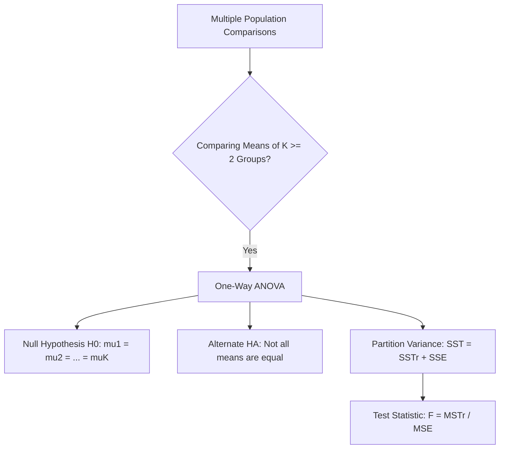
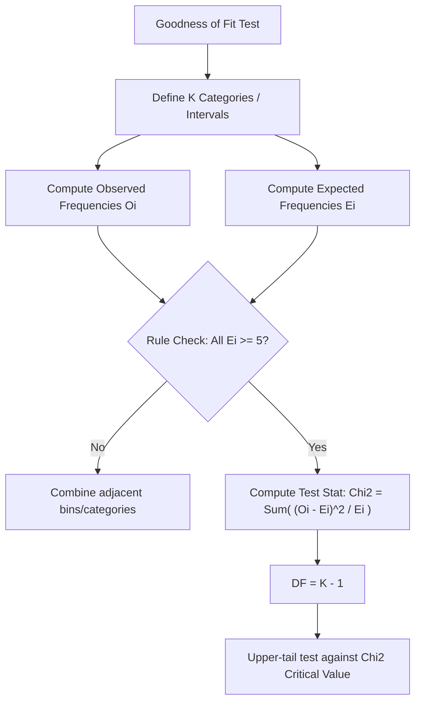
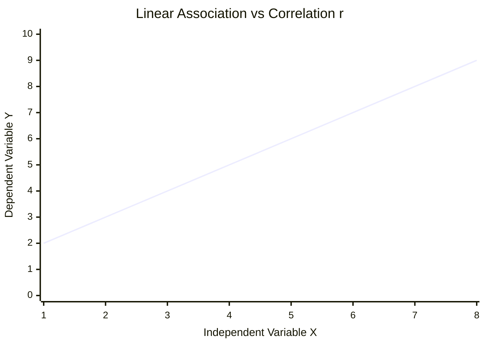

# Module 1: ANOVA and Chi-squared Tests

## 1.1 Introduction to Analysis of Variance (ANOVA)

### 1.1.1 Overview and Purpose of ANOVA

#### Fundamental Concept of Comparing Multiple Population Means
* **Analysis of Variance (ANOVA)** is a statistical hypothesis testing technique used to compare the means of **$k$ independent populations** ($k \ge 2$) using sample data drawn from each population.
* While simple two-sample $t$-tests compare at most two population means, ANOVA extends statistical inference to handle multiple populations simultaneously without inflating the Type I error rate ($\alpha$).
* **Terminology**:
  * **Factor / Treatment**: The categorical variable or group criterion defining the different populations (e.g., age groups, locations, assembly methods).
  * **Factor Levels**: The specific categories or groups under investigation ($k$ levels).
  * **Response Variable ($X$)**: The quantitative outcome variable being measured across populations (e.g., investment amount, assembly time, meal price).

#### Null and Alternative Hypotheses in ANOVA
* For $k$ populations with unknown population means $\mu_1, \mu_2, \dots, \mu_k$, ANOVA tests whether all population means are equal against the alternative that at least one mean differs.

$$\text{Null Hypothesis } (H_0): \mu_1 = \mu_2 = \mu_3 = \dots = \mu_k$$
$$\text{Alternative Hypothesis } (H_A): \text{Not all population means are equal (i.e., at least two means differ)}$$

* **Key Distinctions**:
  * $H_A$ does **not** require every population mean to be distinct from every other mean; the existence of a single unequal pair is sufficient to reject $H_0$.
  * ANOVA is structured as a two-sided overall comparison. Direct upper-tail or lower-tail directional hypotheses across multiple populations do not fall under standard ANOVA.

#### Why it is Called Analysis of Variance
* Although the primary objective is to test for equality of population **means**, the technique evaluates population means by analyzing the **composition of sample variances**.
* ANOVA decomposes the total variability observed in the combined dataset into two distinct components:
  1. Variability **between** the treatment/group means.
  2. Variability **within** each treatment/group sample.
* By taking the ratio of these variance estimates, ANOVA determines whether the differences among sample means are larger than what would be expected purely by random sampling variation.

---

## 1.2 One-way ANOVA

### 1.2.1 Core Assumptions of ANOVA

#### Required Assumptions for Validity
To ensure that the test statistic follows an $F$-distribution under $H_0$, One-way ANOVA requires three fundamental assumptions:

| Assumption | Description | Practical Implications |
| :--- | :--- | :--- |
| **1. Normality** | For each population, the response variable $X$ is normally distributed. | $X_{ij} \sim N(\mu_j, \sigma^2)$ for each group $j$. |
| **2. Equal Variances (Homoscedasticity)** | The variance of the response variable $\sigma^2$ is identical across all $k$ populations. | $\sigma_1^2 = \sigma_2^2 = \dots = \sigma_k^2 = \sigma^2$, regardless of group mean differences. |
| **3. Independence** | All sample observations are independently drawn both within groups and across groups. | The value of one observation does not influence or depend on another. |

---

### 1.2.2 Partitioning Variance and Sum of Squares

#### Formulas and Definitions of Sum of Squares
Let $k$ be the number of treatments, $n_j$ be the sample size for treatment $j$, and $N_T = \sum_{j=1}^k n_j$ be the total sample size across all treatments.

Let $X_{ij}$ represent observation $i$ in treatment group $j$, $\bar{X}_j$ represent the sample mean of group $j$, and $\bar{\bar{X}}$ represent the overall grand mean.

$$\bar{X}_j = \frac{\sum_{i=1}^{n_j} X_{ij}}{n_j}$$

$$\bar{\bar{X}} = \frac{\sum_{j=1}^k \sum_{i=1}^{n_j} X_{ij}}{N_T}$$

#### Total Sum of Squares ($SST$)
* Measures total variation in all $N_T$ observations relative to the overall grand mean $\bar{\bar{X}}$, ignoring group classifications.

$$SST = \sum_{j=1}^k \sum_{i=1}^{n_j} (X_{ij} - \bar{\bar{X}})^2 \quad \text{with Degrees of Freedom } DF_{\text{total}} = N_T - 1$$

#### Sum of Squares Treatment / Between ($SSTr$)
* Measures variation attributable to differences **between treatment means** and the overall grand mean.

$$SSTr = \sum_{j=1}^k n_j (\bar{X}_j - \bar{\bar{X}})^2 \quad \text{with Degrees of Freedom } DF_{\text{treatment}} = k - 1$$

#### Sum of Squares Error / Within ($SSE$)
* Measures residual variation **within individual treatment groups** relative to their respective group sample means.

$$SSE = \sum_{j=1}^k \sum_{i=1}^{n_j} (X_{ij} - \bar{X}_j)^2 \quad \text{with Degrees of Freedom } DF_{\text{error}} = N_T - k$$

#### Additivity Identity
The total variation partitions cleanly into treatment and error components:

$$SST = SSTr + SSE$$
$$DF_{\text{total}} = DF_{\text{treatment}} + DF_{\text{error}} \implies (N_T - 1) = (k - 1) + (N_T - k)$$

---

### 1.2.3 Mean Squares and the F-Test

#### Derivation of Mean Squares ($MSTr$, $MSE$) and $F$-Statistic
Mean Square quantities are obtained by dividing each Sum of Squares by its associated degrees of freedom:

$$\text{Mean Square Treatment }(MSTr) = \frac{SSTr}{k - 1}$$

$$\text{Mean Square Error }(MSE) = \frac{SSE}{N_T - k}$$

* **Variance Estimation Properties**:
  * **$MSE$**: Provides an **unbiased estimate** of the population variance $\sigma^2$ regardless of whether $H_0$ is true or false, as it depends solely on within-group spread.
  * **$MSTr$**: Provides an **unbiased estimate** of $\sigma^2$ **only if $H_0$ is true**. If $H_0$ is false (population means differ), $MSTr$ overestimates $\sigma^2$ due to added variability between treatment means.

#### Test Statistic Formula
The test statistic $F$ is defined as the ratio of two independent variance estimates:

$$F = \frac{MSTr}{MSE}$$

Under $H_0$, $F$ follows an **$F$-distribution** with numerator degrees of freedom $df_1 = k - 1$ and denominator degrees of freedom $df_2 = N_T - k$.

$$F \sim F_{k-1, \, N_T-k}$$

#### Decision Rules
Because inequality among sample means inflates $MSTr$ and makes $F$ large, ANOVA is always an **upper-tail test**.

* **$P$-Value Approach**:
  * $P\text{-value} = P(F_{k-1, N_T-k} \ge F_{\text{calculated}})$
  * Reject $H_0$ if $P\text{-value} \le \alpha$.
* **Critical Value Approach**:
  * Find critical value $F_{\alpha, \, k-1, \, N_T-k}$ from the $F$-table.
  * Reject $H_0$ if $F_{\text{calculated}} \ge F_{\alpha, \, k-1, \, N_T-k}$.

---

### 1.2.4 ANOVA Table Structure

#### Standard One-Way ANOVA Table Format

| Source of Variation | Sum of Squares ($SS$) | Degrees of Freedom ($DF$) | Mean Square ($MS$) | $F$-Statistic | $P$-Value |
| :--- | :--- | :--- | :--- | :--- | :--- |
| **Between Groups (Treatment)** | $SSTr$ | $k - 1$ | $MSTr = \frac{SSTr}{k - 1}$ | $F = \frac{MSTr}{MSE}$ | Area to right of $F$ |
| **Within Groups (Error)** | $SSE$ | $N_T - k$ | $MSE = \frac{SSE}{N_T - k}$ | | |
| **Total** | $SST$ | $N_T - 1$ | | | |

---

### 1.2.5 Post-Hoc Analysis

#### Pairwise Comparisons and Rationale
* Rejecting $H_0$ in ANOVA confirms that not all population means are equal, but it does **not** identify *which* specific population means differ.
* **Post-Hoc Analysis** involves pairwise two-sample hypothesis tests to evaluate specific pairs $(\mu_i, \mu_j)$.
* **Methodology**:
  * One simplified approach is conducting individual One-way ANOVA tests on selected pairs of treatments at a time.
  * Advanced post-hoc tests (e.g., Tukey's HSD, Fisher's LSD) adjust significance levels to control for cumulative family-wise Type I error rates across multiple pairwise tests.

---

## 1.3 Introduction to Chi-squared Tests

### 1.3.1 Concept and Scope of Chi-squared Tests

#### Testing Population Distributions
* Chi-squared ($\chi^2$) tests extend statistical inference beyond single parameters (mean $\mu$, variance $\sigma^2$, proportion $p$) to make inferences about an **entire population probability distribution**.
* **Goodness of Fit (GOF) Test**: Evaluates whether sample data collected from a population is consistent with a hypothesized theoretical or historical distribution (discrete or continuous).

---

## 1.4 Chi-squared Goodness of Fit Tests

### 1.4.1 Discrete Distributions (Multinomial & Binomial)

#### Hypothesis Setup and Expected Frequency Calculation
* **Multinomial Distribution**: Extension of the binomial distribution where each independent trial yields one of $k \ge 3$ mutually exclusive categories, with hypothesized population proportions $p_1, p_2, \dots, p_k$ such that $\sum_{i=1}^k p_i = 1$.

$$H_0: p_1 = p_{10}, \, p_2 = p_{20}, \, \dots, \, p_k = p_{k0}$$
$$H_A: \text{The population proportions differ from the hypothesized values } p_{10}, p_{20}, \dots, p_{k0}$$

* **Expected Frequencies ($E_i$)**: Calculated under the assumption that $H_0$ is true, given a sample size $n$:

$$E_i = n \cdot p_i \quad \text{for category } i = 1, 2, \dots, k$$

#### Chi-Square Test Statistic Formula and Degrees of Freedom
Let $O_i$ be the observed frequency and $E_i$ be the expected frequency for category $i$:

$$\chi^2 = \sum_{i=1}^k \frac{(O_i - E_i)^2}{E_i}$$

* **Condition for Validity**: The sample size must be sufficiently large such that $E_i \ge 5$ for all categories $i = 1, 2, \dots, k$.
* **Sampling Distribution**: Under $H_0$, $\chi^2$ follows a Chi-square distribution with $df = k - 1$ degrees of freedom.

$$\chi^2 \sim \chi^2_{k-1}$$

* **Decision Rule**: Chi-square GOF tests are always **upper-tail tests**.
  * Reject $H_0$ if $\chi^2_{\text{calculated}} \ge \chi^2_{\alpha, \, k-1}$ or $P\text{-value} \le \alpha$.

---

### 1.4.2 Continuous Distributions (Normal & Exponential)

#### Interval Construction, Cutoffs, and Expected Frequencies
When evaluating continuous distributions (e.g., Normal, Exponential), continuous data must be grouped into $k$ discrete intervals/bins.

1. **Rule for Category Definition**: Construct $k$ non-overlapping adjacent intervals covering the entire real line ($-\infty$ to $+\infty$ or $0$ to $+\infty$) such that $E_i = n \cdot P(\text{Interval } i) \ge 5$ for all $i$.
2. **Equal Probability Approach**: Divide the theoretical CDF into $k$ equal-probability slices such that $P(\text{Interval } i) = \frac{1}{k}$, yielding identical expected counts $E_i = \frac{n}{k} \ge 5$.
3. **Binomial Probability**: $P(X = x) = \binom{n}{x} p^x (1-p)^{n-x}$
4. **Normal Distribution Cutoffs**: Calculate $Z$-scores corresponding to cumulative probability thresholds, then unstandardize using $X = \mu + Z\sigma$.
5. **Exponential Distribution Cutoffs**: Uses CDF $F(x) = 1 - e^{-\lambda x}$, where mean $\mu = \frac{1}{\lambda}$. Cutoffs for cumulative probability $P$ are found via inverse CDF:

$$1 - e^{-\lambda x} = P \implies x = -\mu \cdot \ln(1 - P)$$

#### Chi-Square Decision Rules for Continuous Distributions
* Compute observed count $O_i$ within each constructed interval.
* Calculate test statistic $\chi^2 = \sum_{i=1}^k \frac{(O_i - E_i)^2}{E_i}$.
* Degrees of freedom $df = k - 1$ (when distribution parameters $\mu, \sigma, \lambda$ are specified *a priori* by $H_0$).
* Reject $H_0$ if $\chi^2_{\text{calculated}} \ge \chi^2_{\alpha, \, k-1}$.

---

## 1.5 Applications of One-way ANOVA

### 1.5.1 Real-World Case Studies and Calculations

#### Case Study 1: Investor Portfolios by Age Groups (Srinivas Rao / Motilal Oswal)
* **Problem**: Determine whether average investment amount ($\text{in } \text{\textrupee} \text{ thousands}$) varies across 3 age groups: Young ($n_1=4$), Middle-Aged ($n_2=5$), Senior ($n_3=6$). Total $N_T = 15, k = 3$.
* **Hypotheses**: $H_0: \mu_1 = \mu_2 = \mu_3$ vs. $H_A: \text{Not all means are equal}$.

##### Dataset 1: Palnadu District
* Sample Means: $\bar{X}_1 = 60.0$, $\bar{X}_2 = 57.2$, $\bar{X}_3 = 54.8$, Grand Mean $\bar{\bar{X}} = 57.0$.
* Standard Deviations: $S_1 = 1.83$, $S_2 = 2.28$, $S_3 = 2.71$.

$$\text{Calculations:}$$
$$SST = 132.0, \quad SSTr = 4(60-57)^2 + 5(57.2-57)^2 + 6(54.8-57)^2 = 64.37$$
$$SSE = SST - SSTr = 132.0 - 64.37 = 67.63$$
$$DF_{\text{treatment}} = 3 - 1 = 2, \quad DF_{\text{error}} = 15 - 3 = 12$$
$$MSTr = \frac{64.37}{2} = 32.18, \quad MSE = \frac{67.63}{12} = 5.64$$
$$F = \frac{32.18}{5.64} = 5.71, \quad P\text{-value} = 0.018, \quad F_{0.05, 2, 12} = 3.88$$

* **Decision**: $F_{\text{calc}} (5.71) > F_{\text{crit}} (3.88)$ and $P\text{-value} (0.018) < 0.05$. **Reject $H_0$**. Average investment levels differ significantly across age groups.

##### Palnadu Post-Hoc Pairwise Analysis

| Comparison | $SSTr$ | $SSE$ | $MSTr$ | $MSE$ | $F$-Stat | $P$-Value | Decision ($\alpha=0.05$) |
| :--- | :--- | :--- | :--- | :--- | :--- | :--- | :--- |
| **Young vs. Middle-Aged** | $17.42$ | $30.80$ | $17.42$ | $4.40$ | $3.96$ | $0.090$ | Do Not Reject $H_0$ ($\mu_1 \approx \mu_2$) |
| **Middle-Aged vs. Senior** | $15.30$ | $57.60$ | $15.30$ | $5.24$ | $2.92$ | $0.160$ | Do Not Reject $H_0$ ($\mu_2 \approx \mu_3$) |
| **Young vs. Senior** | $64.10$ | $29.30$ | $64.10$ | $5.86$ | $10.94$ | $0.010$ | **Reject $H_0$** ($\mu_1 \neq \mu_3$) |

* **Conclusion**: The primary driver of the overall rejection is the significant difference between Young and Senior investors.

##### Dataset 2: Bapatla District (High Within-Group Variability)
* $\bar{X}_1 = 41.0$, $\bar{X}_2 = 42.0$, $\bar{X}_3 = 41.67$. $S_1 = 24.08$, $S_2 = 21.12$, $S_3 = 18.61$.
* $SST = 5257.6$, $SSTr = 2.27$, $SSE = 5255.33$.
* $MSTr = 1.13$, $MSE = 438.0$, $F = \frac{1.13}{438} = 0.0026$, $P\text{-value} = 0.997$.
* **Decision**: **Do Not Reject $H_0$**. High sample variance obscures any potential mean differences.

##### Dataset 3: NTR District (High Between-Group Variability)
* $\bar{X}_1 = 60.0$, $\bar{X}_2 = 37.2$, $\bar{X}_3 = 20.0$. $S_1 = 2.31$, $S_2 = 2.28$, $S_3 = 2.31$.
* $SST = 3345.6$, $SSTr = 3287.0$, $SSE = 58.6$.
* $MSTr = 1643.5$, $MSE = 4.88$, $F = \frac{1643.5}{4.88} = 336.8$, $P\text{-value} \approx 0.000$.
* **Decision**: **Reject $H_0$**. Strong separation between sample means relative to small within-group variance.

---

#### Case Study 2: Transmission Assembly Methods (Kia Motors / Lakshmamma)
* **Problem**: Compare 4 transmission assembly methods ($k=4$): Method A ($n_1=8$), Method B ($n_2=11$), Method C ($n_3=9$), Method D ($n_4=6$). Total $N_T = 34$. $\alpha = 0.05$.
* **Hypotheses**: $H_0: \mu_A = \mu_B = \mu_C = \mu_D$ vs. $H_A: \text{Not all means are equal}$.
* **Data**: $\bar{X}_1 = 117.0$, $\bar{X}_2 = 100.0$, $\bar{X}_3 = 102.6$, $\bar{X}_4 = 114.2$, Grand Mean $\bar{\bar{X}} = 107.2$.

$$\text{Calculations:}$$
$$SST = 11588.0, \quad SSTr = 1800.3, \quad SSE = 9787.7$$
$$DF_{\text{treatment}} = 4 - 1 = 3, \quad DF_{\text{error}} = 34 - 4 = 30$$
$$MSTr = \frac{1800.3}{3} = 600.1, \quad MSE = \frac{9787.7}{30} = 326.3$$
$$F = \frac{600.1}{326.3} = 1.84, \quad F_{0.05, 3, 30} = 2.92$$

* **ANOVA Table**:

| Source | $SS$ | $DF$ | $MS$ | $F$ | $P$-Value |
| :--- | :--- | :--- | :--- | :--- | :--- |
| **Treatment** | $1800.3$ | $3$ | $600.1$ | $1.84$ | $>0.05$ |
| **Error** | $9787.7$ | $30$ | $326.3$ | | |
| **Total** | $11588.0$ | $33$ | | | |

* **Decision**: $F_{\text{calc}} (1.84) < F_{\text{crit}} (2.92)$. **Do Not Reject $H_0$**. Assembly method differences are not statistically significant.

---

#### Case Study 3: Biryani Meal Prices by Location (Wanderlog / Sujata)
* **Problem**: Test whether average biryani price depends on restaurant location: Shopping ($n_1=13$), Office ($n_2=9$), Station ($n_3=8$). Total $N_T = 30, k = 3, \alpha = 0.05$.
* **Hypotheses**: $H_0: \mu_1 = \mu_2 = \mu_3$ vs. $H_A: \text{Not all means are equal}$.
* **Data**: $\bar{X}_1 = 390.7$, $\bar{X}_2 = 393.3$, $\bar{X}_3 = 460.0$, Grand Mean $\bar{\bar{X}} = 410.0$.

$$\text{Calculations:}$$
$$SST = 172600.0, \quad SSTr = 27307.0, \quad SSE = 145293.0$$
$$DF_{\text{treatment}} = 3 - 1 = 2, \quad DF_{\text{error}} = 30 - 3 = 27$$
$$MSTr = \frac{27307}{2} = 13653.5, \quad MSE = \frac{145293}{27} = 5381.2$$
$$F = \frac{13653.5}{5381.2} = 2.54, \quad F_{0.05, 2, 27} = 3.35$$

* **Decision**: $F_{\text{calc}} (2.54) < F_{\text{crit}} (3.35)$. **Do Not Reject $H_0$**. Despite $\bar{X}_3$ being higher, small sample size ($n_3=8$) and high within-group variance result in insufficient statistical evidence.

---

#### Case Study 4: Audit Completion Times by Team Composition (Davuluri & Associates / Ram)
* **Problem**: Determine if audit team composition affects completion days: Local ($n_1=7$), Corporate ($n_2=6$), Both ($n_3=7$). Total $N_T = 20, k = 3, \alpha = 0.05$.
* **Hypotheses**: $H_0: \mu_1 = \mu_2 = \mu_3$ vs. $H_A: \text{Not all means are equal}$.
* **Data**: $\bar{X}_1 = 25.3$, $\bar{X}_2 = 20.8$, $\bar{X}_3 = 17.0$, Grand Mean $\bar{\bar{X}} = 21.05$.

$$\text{Calculations:}$$
$$SST = 324.95, \quad SSTr = 240.65, \quad SSE = 84.30$$
$$DF_{\text{treatment}} = 3 - 1 = 2, \quad DF_{\text{error}} = 20 - 3 = 17$$
$$MSTr = \frac{240.65}{2} = 120.33, \quad MSE = \frac{84.30}{17} = 4.96$$
$$F = \frac{120.33}{4.96} = 24.26, \quad F_{0.05, 2, 17} = 3.59$$

* **Decision**: $F_{\text{calc}} (24.26) \gg F_{\text{crit}} (3.59)$. **Reject $H_0$**. Audit completion time is significantly impacted by team composition.

---

## 1.6 Applications of Chi-squared Tests

### 1.6.1 Real-World Case Studies and Calculations

#### Case Study 1: TV Viewership Trends (Andhra Jyothi / Subba Rao - Multinomial)
* **Problem**: Survey of $n=600$ households to evaluate if prime-time Saturday viewership changed after launching a new show. $\alpha = 0.05, k = 4$.

##### Initial Historical Model
* $H_0: p_A = 0.29 \, (\text{ETV}), \, p_B = 0.28 \, (\text{Zee}), \, p_C = 0.25 \, (\text{Star Maa}), \, p_D = 0.18 \, (\text{Gemini})$.
* $H_A: \text{Proportions differ from historical values}$.
* Expected counts: $E_A = 600(0.29)=174, \, E_B = 600(0.28)=168, \, E_C = 600(0.25)=150, \, E_D = 600(0.18)=108$.
* Observed counts: $O_A = 195, \, O_B = 170, \, O_C = 189, \, O_D = 46$.

$$\chi^2 = \frac{(195-174)^2}{174} + \frac{(170-168)^2}{168} + \frac{(189-150)^2}{150} + \frac{(46-108)^2}{108}$$
$$\chi^2 = 2.53 + 0.02 + 10.14 + 35.59 = 48.28$$
$$df = 4 - 1 = 3, \quad \chi^2_{0.05, 3} = 7.81$$

* **Decision**: $\chi^2_{\text{calc}} (48.28) > \chi^2_{\text{crit}} (7.81)$. **Reject $H_0$**. Viewership proportions have changed significantly.

##### Revised Model Test
* $H_0: p_A = 0.30, \, p_B = 0.30, \, p_C = 0.30, \, p_D = 0.10$.
* Expected counts: $E_A = 180, \, E_B = 180, \, E_C = 180, \, E_D = 60$.

$$\chi^2 = \frac{(195-180)^2}{180} + \frac{(170-180)^2}{180} + \frac{(189-180)^2}{180} + \frac{(46-60)^2}{60}$$
$$\chi^2 = 1.25 + 0.56 + 0.45 + 3.27 = 5.53$$
$$df = 3, \quad \chi^2_{0.05, 3} = 7.81, \quad P\text{-value} = 0.14$$

* **Decision**: $\chi^2_{\text{calc}} (5.53) < \chi^2_{\text{crit}} (7.81)$ and $P\text{-value} (0.14) > 0.05$. **Do Not Reject $H_0$**. The revised distribution is a plausible fit.

---

#### Case Study 2: Pediatric Eye Surgeries (Aravind Eye Hospital / Dr. Srinivasan - Binomial)
* **Problem**: Test whether daily pediatric surgeries follow $Binomial(n=6, p=0.5)$ across $N=365$ operating days. $\alpha = 0.05, k = 7$.
* $H_0: \text{Daily pediatric surgeries } X \sim Binomial(6, 0.5)$.
* Binomial Probabilities $P(X=x) = \binom{6}{x} (0.5)^6$:

$$\text{Expected Counts } E_x = 365 \cdot P(X=x)$$

| Surgeries ($x$) | $P(X=x)$ | $E_x$ | $O_x$ | $\frac{(O_x - E_x)^2}{E_x}$ |
| :---: | :---: | :---: | :---: | :---: |
| **0** | $0.0156$ | $5.7$ | $3$ | $\frac{(3-5.7)^2}{5.7} = 1.28$ |
| **1** | $0.0938$ | $34.2$ | $25$ | $\frac{(25-34.2)^2}{34.2} = 2.48$ |
| **2** | $0.2344$ | $85.5$ | $92$ | $\frac{(92-85.5)^2}{85.5} = 0.49$ |
| **3** | $0.3125$ | $114.4$ | $105$ | $\frac{(105-114.4)^2}{114.4} = 0.77$ |
| **4** | $0.2344$ | $85.5$ | $93$ | $\frac{(93-85.5)^2}{85.5} = 0.66$ |
| **5** | $0.0938$ | $34.2$ | $39$ | $\frac{(39-34.2)^2}{34.2} = 0.67$ |
| **6** | $0.0156$ | $5.7$ | $8$ | $\frac{(8-5.7)^2}{5.7} = 0.93$ |
| **Total** | $1.0000$ | $365.0$ | $365$ | **$\chi^2 = 7.28$** |

* Degrees of Freedom $df = 7 - 1 = 6$. Critical Value $\chi^2_{0.05, 6} = 12.59$.
* **Decision**: $\chi^2_{\text{calc}} (7.28) < \chi^2_{\text{crit}} (12.59)$. **Do Not Reject $H_0$**. Pediatric surgeries follow a Binomial distribution with $p=0.5$.

---

#### Case Study 3: Daily Khaja Demand Distribution (Suruchi Foods / Venkatesh Babu - Normal)
* **Problem**: Sample of $n=25$ days to test if daily demand follows $Normal(\mu=70, \sigma=20)$. $\alpha = 0.05$.
* Construct $k=5$ equal-probability intervals ($P_i = 0.20 \implies E_i = 25 \times 0.20 = 5$ for all $i$).
* Cutoffs derived from standard normal $Z$-scores ($Z_{0.20} = -0.842, Z_{0.40} = -0.253, Z_{0.60} = 0.253, Z_{0.80} = 0.842$):
  * $X_1 = 70 + (-0.842)(20) = 53.17$
  * $X_2 = 70 + (-0.253)(20) = 64.93$
  * $X_3 = 70 + (0.253)(20) = 75.07$
  * $X_4 = 70 + (0.842)(20) = 86.83$

| Demand Interval | Expected ($E_i$) | Observed ($O_i$) | $\frac{(O_i - E_i)^2}{E_i}$ |
| :--- | :---: | :---: | :---: |
| **$(-\infty, 53.17]$** | $5$ | $4$ | $\frac{(4-5)^2}{5} = 0.20$ |
| **$(53.17, 64.93]$** | $5$ | $8$ | $\frac{(8-5)^2}{5} = 1.80$ |
| **$(64.93, 75.07]$** | $5$ | $8$ | $\frac{(8-5)^2}{5} = 1.80$ |
| **$(75.07, 86.83]$** | $5$ | $2$ | $\frac{(2-5)^2}{5} = 1.80$ |
| **$(86.83, \infty)$** | $5$ | $3$ | $\frac{(3-5)^2}{5} = 0.80$ |
| **Total** | $25$ | $25$ | **$\chi^2 = 6.40$** |

* Degrees of Freedom $df = 5 - 1 = 4$. Critical Value $\chi^2_{0.05, 4} = 9.48$.
* **Decision**: $\chi^2_{\text{calc}} (6.40) < \chi^2_{\text{crit}} (9.48)$. **Do Not Reject $H_0$**. The $Normal(70, 20)$ demand assumption remains valid.

---

#### Case Study 4: Call Center Duration (Chandarana Bhima / Madhavi - Exponential)
* **Problem**: Sample of $n=50$ call durations to test if data follows $Exponential(\text{mean } \mu = 6 \text{ min}) \implies \lambda = \frac{1}{6}$. $\alpha = 0.05$.
* Construct $k=10$ equal-probability intervals ($P_i = 0.10 \implies E_i = 50 \times 0.10 = 5$ for all $i$).
* Cutoffs via Inverse CDF $x = -6 \cdot \ln(1 - P)$:
  * $P=0.10 \implies x_1 = 0.632$
  * $P=0.20 \implies x_2 = 1.339$
  * $P=0.30 \implies x_3 = 2.140$
  * $P=0.40 \implies x_4 = 3.065$
  * $P=0.50 \implies x_5 = 4.159$
  * $P=0.60 \implies x_6 = 5.500$
  * $P=0.70 \implies x_7 = 7.223$
  * $P=0.80 \implies x_8 = 9.657$
  * $P=0.90 \implies x_9 = 13.816$

| Interval ($i$) | Range (min) | Expected ($E_i$) | Observed ($O_i$) | $\frac{(O_i - E_i)^2}{E_i}$ |
| :---: | :--- | :---: | :---: | :---: |
| **1** | $[0, 0.63)$ | $5$ | $4$ | $0.20$ |
| **2** | $[0.63, 1.34)$ | $5$ | $1$ | $3.20$ |
| **3** | $[1.34, 2.14)$ | $5$ | $3$ | $0.80$ |
| **4** | $[2.14, 3.06)$ | $5$ | $4$ | $0.20$ |
| **5** | $[3.06, 4.16)$ | $5$ | $5$ | $0.00$ |
| **6** | $[4.16, 5.50)$ | $5$ | $5$ | $0.00$ |
| **7** | $[5.50, 7.22)$ | $5$ | $8$ | $1.80$ |
| **8** | $[7.22, 9.66)$ | $5$ | $5$ | $0.00$ |
| **9** | $[9.66, 13.82)$ | $5$ | $7$ | $0.80$ |
| **10** | $[13.82, \infty)$ | $5$ | $8$ | $1.80$ |
| **Total** | | $50$ | $50$ | **$\chi^2 = 8.80$** |

* Degrees of Freedom $df = 10 - 1 = 9$. Critical Value $\chi^2_{0.05, 9} = 16.92$.
* **Decision**: $\chi^2_{\text{calc}} (8.80) < \chi^2_{\text{crit}} (16.92)$. **Do Not Reject $H_0$**. Call durations follow an Exponential distribution with mean $6$ minutes.

---

## 1.7 Covariance and Correlation

### 1.7.1 Measures of Linear Association

#### Formulas and Properties of Covariance and Correlation
Covariance and correlation measure the strength and direction of the **linear relationship** between two quantitative variables $X$ and $Y$ across $n$ paired observations $(x_1, y_1), (x_2, y_2), \dots, (x_n, y_n)$.

#### Sample Covariance ($s_{xy}$)

$$s_{xy} = \frac{\sum_{i=1}^n (x_i - \bar{x})(y_i - \bar{y})}{n - 1}$$

* **Interpretation**:
  * $s_{xy} > 0$: Positive linear relationship (points cluster in Quadrants I and III relative to $(\bar{x}, \bar{y})$).
  * $s_{xy} < 0$: Negative linear relationship (points cluster in Quadrants II and IV).
  * $s_{xy} \approx 0$: No linear association.
  * **Generalization**: Covariance of a variable with itself equals its sample variance ($s_{xx} = s_x^2$).
* **Limitation**: Depends on measurement units, making scale comparisons across datasets impossible.

#### Sample Correlation Coefficient ($r_{xy}$)
The Pearson product-moment correlation coefficient normalizes covariance by the product of individual sample standard deviations ($s_x, s_y$):

$$r_{xy} = \frac{s_{xy}}{s_x \cdot s_y} = \frac{\sum_{i=1}^n (x_i - \bar{x})(y_i - \bar{y})}{\sqrt{\sum_{i=1}^n (x_i - \bar{x})^2} \sqrt{\sum_{i=1}^n (y_i - \bar{y})^2}}$$

* **Key Properties**:
  1. **Scale-Invariant**: Unitless measure bounded in $[-1, +1]$.
  2. $r_{xy} = +1$: Perfect positive linear relationship.
  3. $r_{xy} = -1$: Perfect negative linear relationship.
  4. $r_{xy} = 0$: Absence of **linear** relationship.

#### Case Study Example: Credit Card Expenditures (Canara Bank / Hanumantha)
* Sample size $n = 55$.
* Variable $Y$: Monthly Credit Card Spend ($\text{Mean } \bar{y} = \text{\textrupee} 3852, s_y = \text{\textrupee} 1454$).
* Variable $X_1$: Annual Income ($\text{in } \text{\textrupee} \text{ lakhs}, s_{x1} = 13.74$).
  * $s_{y, x1} = 16109 \implies r_{y, x1} = \frac{16109}{(13.74)(1454)} = 0.81$ (**Strong positive linear association**).
* Variable $X_2$: Household Size ($s_{x2} = 1.76$).
  * $s_{y, x2} = 1610 \implies r_{y, x2} = \frac{1610}{(1.76)(1454)} = 0.63$ (**Moderate positive linear association**).

---

#### Limitations, Nonlinearity, and Spurious Correlation

| Concept | Explanation | Example |
| :--- | :--- | :--- |
| **Nonlinear Relationships** | Pearson $r$ evaluates **linear** association only. If $Y = f(X)$ is quadratic or parabolic, $r$ can be zero despite a perfect deterministic relationship. | Data points $x \in \{-3, -2, -1, 1, 2, 3\}$ and $y = \frac{1}{x^2}$ yield $s_{xy} = 0$ and $r_{xy} = 0$. Utility spend vs. outside temperature forms a U-shape where $r \approx 0$. |
| **Correlation vs. Causation** | High correlation does **not** imply cause-and-effect. | Higher income correlates with higher credit card spend, but high income does not force higher spending. |
| **Spurious Correlation** | A strong statistical correlation driven by an omitted **latent / confounding variable** rather than a true relationship. | 1. Ice cream sales vs. crime rates ($r > 0$) driven by latent variable **Temperature**. 2. Number of doctors vs. village deaths ($r > 0$) driven by latent variable **Population Size / Poor Initial Health**. 3. Maine divorce rates vs. margarine consumption ($r = 0.99$). 4. Hemline Index (George Taylor, 1926): Skirt lengths vs. economic growth. |
| **Non-Quantitative Data** | Pearson correlation applies strictly to quantitative variables. Ordinal/Nominal data require alternative measures (e.g., Spearman rank correlation). | Ranking data, customer satisfaction ratings. |

---

## Quick Revision Summary

### Key Definitions
* **ANOVA**: Hypothesis test assessing equality of $k \ge 2$ population means by analyzing sample variances.
* **Sum of Squares Treatment ($SSTr$)**: Measures between-group variation; sensitive to population mean differences.
* **Sum of Squares Error ($SSE$)**: Measures within-group variation; provides an unbiased estimate of $\sigma^2$ regardless of $H_0$.
* **Chi-Squared Goodness-of-Fit Test**: Evaluates whether sample frequencies conform to a specified discrete or continuous probability distribution.
* **Sample Covariance ($s_{xy}$)**: Measures absolute direction and strength of joint linear variability between two variables.
* **Pearson Correlation ($r_{xy}$)**: Scale-free measure bounded in $[-1, +1]$ quantifying linear association.
* **Spurious Correlation**: High correlation between two variables caused by a hidden confounding variable rather than direct cause-and-effect.

---

### Important Formulas

$$\text{ANOVA Partitioning: } SST = SSTr + SSE$$

$$SSTr = \sum_{j=1}^k n_j (\bar{X}_j - \bar{\bar{X}})^2, \quad SSE = \sum_{j=1}^k \sum_{i=1}^{n_j} (X_{ij} - \bar{X}_j)^2$$

$$\text{ANOVA } F\text{-Statistic: } F = \frac{MSTr}{MSE} = \frac{SSTr / (k - 1)}{SSE / (N_T - k)} \sim F_{k-1, \, N_T-k}$$

$$\text{Chi-Square Test Statistic: } \chi^2 = \sum_{i=1}^k \frac{(O_i - E_i)^2}{E_i} \sim \chi^2_{k-1}$$

$$\text{Multinomial Expected Count: } E_i = n \cdot p_i$$

$$\text{Exponential Cutoff Formula: } x = -\mu \cdot \ln(1 - P)$$

$$\text{Sample Covariance: } s_{xy} = \frac{\sum (x_i - \bar{x})(y_i - \bar{y})}{n - 1}$$

$$\text{Pearson Correlation: } r_{xy} = \frac{s_{xy}}{s_x \cdot s_y}$$

---

### Must-Remember Points
* ANOVA and Chi-squared Goodness-of-Fit tests are **always upper-tail tests**.
* Rejecting $H_0$ in ANOVA means **at least one** population mean is different, not that all means are distinct. Post-hoc analysis is required to identify specific differing pairs.
* Chi-squared GOF test requires expected frequencies $E_i \ge 5$ in every bin.
* $r_{xy} = 0$ indicates the absence of a **linear** relationship, **not** the absence of any relationship (non-linear associations can yield $r_{xy} = 0$).
* **Correlation does not imply causation.** Always verify potential lurking/confounding variables before drawing business conclusions.

## MODULE 1: Analysis of Variance (ANOVA), Goodness of Fit, and Covariance/Correlation

---

### One-Way Analysis of Variance (ANOVA) Overview

**One-Way ANOVA** is a hypothesis testing procedure used to compare the means of $K \ge 2$ independent populations (or treatments) based on sample data using a single quantitative response variable $X$.

| Term / Notation | Definition / Description |
|---|---|
| **Factor Level / Treatment** | The specific population, group, or condition being compared ($K$ total levels) |
| **Response Variable ($X$)** | The quantitative measurement collected from each sample |
| **Sample Sizes** | $n_1, n_2, \dots, n_K$ (group sample sizes); $N_T = \sum_{i=1}^K n_i$ (total sample size) |
| **Null Hypothesis ($H_0$)** | $H_0: \mu_1 = \mu_2 = \dots = \mu_K$ (All population means are equal) |
| **Alternate Hypothesis ($H_A$)** | $H_A:$ Not all population means are equal (At least two means are different) |

> **Q:** In One-Way ANOVA with $K$ populations, the alternate hypothesis $H_A$ states that all population means are different from each other = **FALSE** ✓ *(It states that **NOT** all means are equal; at least one pair is different)*
> **Q:** Lower-tail and upper-tail test versions exist under ANOVA = **FALSE** ✓ *(ANOVA always uses an upper-tail $F$-test)*
> **Q:** Why is a test comparing population means called "Analysis of Variance"? = **It determines differences between means by analyzing sample variances and their composition** ✓
> **Q:** Each population being compared in an experiment is formally referred to as a **Treatment** ✓

---

### ANOVA Assumptions & Mathematical Formulas

#### Assumptions of One-Way ANOVA
1. **Normality:** For each population, the response variable $X$ is **normally distributed**.
2. **Equal Variances (Homogeneity of Variance):** The variance of $X$, denoted by $\sigma^2$, is the **same for all populations**.
3. **Independence:** Observations within and across sample groups are **independent**.

#### Sum of Squares & Mean Squares Partitioning
$$\text{SST} = \text{SSTr} + \text{SSE}$$

| Source of Variation | Sum of Squares (SS) Formula | Degrees of Freedom (DF) | Mean Square (MS) Formula | Test Statistic ($F$) |
|---|---|---|---|---|
| **Between Treatments (SSTr)** | $\sum_{i=1}^K n_i (\bar{X}_i - \bar{X})^2$ | $K - 1$ | $\text{MSTr} = \frac{\text{SSTr}}{K - 1}$ | $F = \frac{\text{MSTr}}{\text{MSE}}$ |
| **Within Groups / Error (SSE)** | $\sum_{i=1}^K \sum_{j=1}^{n_i} (X_{ij} - \bar{X}_i)^2$ | $N_T - K$ | $\text{MSE} = \frac{\text{SSE}}{N_T - K}$ | — |
| **Total Variation (SST)** | $\sum_{i=1}^K \sum_{j=1}^{n_i} (X_{ij} - \bar{X})^2$ | $N_T - 1$ | — | — |

where $\bar{X}_i$ is the sample mean of group $i$, and $\bar{X}$ is the overall (grand) mean across all $N_T$ data points.

#### Properties of Estimates & Test Statistic
- **MSE** is **always** an unbiased estimate of population variance $\sigma^2$, regardless of whether $H_0$ is true.
- **MSTr** is an unbiased estimate of $\sigma^2$ **only when $H_0$ is true**. If $H_0$ is false, MSTr **overestimates** $\sigma^2$.
- When $H_0$ is true, the ratio $F = \frac{\text{MSTr}}{\text{MSE}}$ follows an $F$-distribution with $K - 1$ numerator degrees of freedom and $N_T - K$ denominator degrees of freedom.
- **Decision Rule:** Reject $H_0$ if $F > F_{\alpha, K-1, N_T-K}$ or $p\text{-value} \le \alpha$.

> **Q:** Under ANOVA, which quantity is **ALWAYS** an unbiased estimator of population variance $\sigma^2$? = **MSE** ✓
> **Q:** When the null hypothesis $H_0$ is false, MSTr will **overestimate** the population variance $\sigma^2$ ✓
> **Q:** The numerator degrees of freedom for the ANOVA $F$-test is **$K - 1$** ✓
> **Q:** The denominator degrees of freedom for the ANOVA $F$-test is **$N_T - K$** ✓

---

### ANOVA Numerical Problem Solving & Case Studies

**Q1 (Palnadu District Investment Study):** Srinivas Rao compares average investment amounts across 3 age groups ($K=3$): Young ($n_1=4, \bar{X}_1=60$), Middle ($n_2=5, \bar{X}_2=57.2$), Senior ($n_3=6, \bar{X}_3=54.8$). Total sample size $N_T = 15$. Grand mean $\bar{X} = 57$. Given $\text{SST} = 132$ and $\text{SSTr} = 64.37$, test $H_0: \mu_1 = \mu_2 = \mu_3$ at $\alpha = 0.05$.

> *Why: One-way ANOVA applies because we are comparing means of $K=3$ independent populations.*
> $\text{SSE} = \text{SST} - \text{SSTr} = 132 - 64.37 = 67.63$
> $\text{DF}_{\text{treatment}} = K - 1 = 3 - 1 = 2$
> $\text{DF}_{\text{error}} = N_T - K = 15 - 3 = 12$
> $\text{MSTr} = \frac{64.37}{2} = 32.18$
> $\text{MSE} = \frac{67.63}{12} = 5.64$
> $F = \frac{32.18}{5.64} = 5.71$
> 📋 **F-Distribution Table:** Lookup $F_{0.05, 2, 12} \rightarrow 3.88$ (or $p\text{-value} = 0.018$)
> Since $F = 5.71 > 3.88$ ($p = 0.018 \le 0.05$), reject $H_0$.
> **Answer = Reject $H_0$; average investments across the 3 age groups are NOT all equal** ✓
> *(Sample means alone are not conclusive; within-group variance puts differences in X-bar in context)*

---

**Q2 (Bapatla District Investment Study):** In Bapatla district, $K=3, N_T=15$ ($n_1=4, n_2=5, n_3=6$). Sample means are $\bar{X}_1=41, \bar{X}_2=42, \bar{X}_3=41.67$. Sample standard deviations are high ($S_1=24.08, S_2=21.12, S_3=18.61$). Given $\text{SST} = 5257.6$, $\text{SSTr} = 2.27$, and $\text{SSE} = 5255$, conduct the test at $\alpha = 0.05$.

> *Why: High within-group variability reduces the ability to distinguish differences between population means.*
> $\text{DF}_{\text{treatment}} = 2, \quad \text{DF}_{\text{error}} = 12$
> $\text{MSTr} = \frac{2.27}{2} = 1.13$
> $\text{MSE} = \frac{5255}{12} = 438$
> $F = \frac{1.13}{438} = 0.0026 \approx 0$
> 📋 **F-Distribution Table:** Lookup $F_{0.05, 2, 12} \rightarrow 3.88$ ($p\text{-value} = 0.997$)
> Since $F = 0.0026 < 3.88$ ($p = 0.997 > 0.05$), do not reject $H_0$.
> **Answer = Do NOT reject $H_0$; insufficient evidence to claim mean investment levels differ** ✓
> *(High internal variance causes MSE to dwarf MSTr, driving F statistic close to zero)*

---

**Q3 (NTR District Investment Study):** In NTR district, $K=3, N_T=15$ ($n_1=4, n_2=5, n_3=6$). Sample means are $\bar{X}_1=60, \bar{X}_2=37.2, \bar{X}_3=20$. Sample standard deviations are small ($S_1=2.31, S_2=2.28, S_3=2.31$). Given $\text{SST} = 3345.6$, $\text{SSTr} = 3287$, and $\text{SSE} = 58.8$, test at $\alpha = 0.05$.

> *Why: Large separation between group means combined with low within-group variability produces a massive F-statistic.*
> $\text{MSTr} = \frac{3287}{2} = 1643.5$
> $\text{MSE} = \frac{58.8}{12} = 4.9$
> $F = \frac{1643.5}{4.9} = 335.4$
> 📋 **F-Distribution Table:** Lookup $F_{0.05, 2, 12} \rightarrow 3.88$ ($p\text{-value} \approx 0.000$)
> Since $F = 335.4 > 3.88$, reject $H_0$.
> **Answer = Reject $H_0$; strong evidence that population means are significantly different** ✓

---

**Q4 (Kia Transmission Assembly Methods):** Lakshmamma tests $K=4$ assembly methods with $N_T=34$ ($n_1=8, n_2=11, n_3=9, n_4=6$). Overall mean $\bar{X}=107.2$. Sample means: $\bar{X}_1=117, \bar{X}_2=100, \bar{X}_3=102.6, \bar{X}_4=114.2$. Given $\text{SST} = 11588$, $\text{SSTr} = 1800.3$, and $\text{SSE} = 9787.7$, test at $\alpha = 0.05$.

> *Why: Evaluating performance across 4 assembly method treatments using One-Way ANOVA.*
> $\text{DF}_{\text{treatment}} = 4 - 1 = 3$
> $\text{DF}_{\text{error}} = 34 - 4 = 30$
> $\text{MSTr} = \frac{1800.3}{3} = 600.1$
> $\text{MSE} = \frac{9787.7}{30} = 326.3$
> $F = \frac{600.1}{326.3} = 1.84$
> 📋 **F-Distribution Table:** Lookup $F_{0.05, 3, 30} \rightarrow 2.92$
> Since $F = 1.84 < 2.92$, do not reject $H_0$.
> **Answer = Do NOT reject $H_0$; assembly method differences are NOT statistically significant** ✓
> *(Never rush to claim a superior process based solely on sample means without hypothesis testing)*

---

**Q5 (Vijayawada Biryani Meal Prices):** Sujata tests meal prices across $K=3$ restaurant locations: Shopping ($n_1=13, \bar{X}_1=390.7$), Office ($n_2=9, \bar{X}_2=393.3$), Station ($n_3=8, \bar{X}_3=460$). $N_T = 30$, $\bar{X} = 410$. Given $\text{SST} = 172600$, $\text{SSTr} = 27307$, and $\text{SSE} = 145293$, conduct ANOVA at $\alpha = 0.05$.

> *Why: Testing location effect on average price across 3 areas.*
> $\text{DF}_{\text{treatment}} = 3 - 1 = 2, \quad \text{DF}_{\text{error}} = 30 - 3 = 27$
> $\text{MSTr} = \frac{27307}{2} = 13653.5$
> $\text{MSE} = \frac{145293}{27} = 5381.2$
> $F = \frac{13653.5}{5381.2} = 2.54$
> 📋 **F-Distribution Table:** Lookup $F_{0.05, 2, 27} \rightarrow 3.35$
> Since $F = 2.54 < 3.35$, do not reject $H_0$.
> **Answer = Do NOT reject $H_0$; price differences are not statistically significant** ✓
> *(Although Station mean was high, small $n_3=8$ and high internal variance prevented rejection)*

---

**Q6 (Audit Team Composition Study):** Ram tests audit completion days across $K=3$ team types: Local ($n_1=7, \bar{X}_1=25.3$), Corporate ($n_2=6, \bar{X}_2=20.8$), Both ($n_3=7, \bar{X}_3=17$). $N_T = 20$, $\bar{X} = 21.05$. Given $\text{SST} = 324.95$, $\text{SSTr} = 240.6$, and $\text{SSE} = 84.3$, test at $\alpha = 0.05$.

> *Why: Testing team structure effect on audit completion time.*
> $\text{DF}_{\text{treatment}} = 2, \quad \text{DF}_{\text{error}} = 20 - 3 = 17$
> $\text{MSTr} = \frac{240.6}{2} = 120.3$
> $\text{MSE} = \frac{84.3}{17} = 4.96 \approx 4.9$
> $F = \frac{120.3}{4.9} = 24.55 \quad (\text{or } 24.3)$
> 📋 **F-Distribution Table:** Lookup $F_{0.05, 2, 17} \rightarrow 3.59$
> Since $F = 24.3 > 3.59$, reject $H_0$.
> **Answer = Reject $H_0$; audit completion times differ significantly by team composition** ✓

---

### Post-Hoc Analysis in ANOVA

When $H_0$ is rejected in ANOVA, **Post-Hoc Analysis** is performed to determine *which* specific population means differ from each other.

- **Method:** Pairwise comparisons (e.g., conducting One-Way ANOVA on two groups at a time).
- **Palnadu Post-Hoc Results Summary ($\alpha = 0.05$):**
  - **Young ($\mu_1$) vs. Middle ($\mu_2$):** $F = 3.96, p = 0.09 \implies$ Do **NOT** reject ($\mu_1$ and $\mu_2$ could be equal).
  - **Middle ($\mu_2$) vs. Senior ($\mu_3$):** $p = 0.16 \implies$ Do **NOT** reject ($\mu_2$ and $\mu_3$ could be equal).
  - **Young ($\mu_1$) vs. Senior ($\mu_3$):** $\text{MSTr} = 64.1, \text{MSE} = 5.86, p = 0.01 \implies$ **Reject $H_0$** ($\mu_1 \neq \mu_3$ significantly).

> **Q:** What is the primary purpose of post-hoc analysis following an ANOVA test? = **To identify which specific treatment means are significantly different after rejecting $H_0$** ✓

---

### Goodness-of-Fit (GOF) Tests

**Goodness-of-Fit (GOF) Test** uses a Chi-Square ($\chi^2$) test statistic to determine whether observed sample data conforms to a hypothesized historical or theoretical probability distribution.

#### Key Rules & Test Statistic
$$\chi^2 = \sum_{i=1}^K \frac{(O_i - E_i)^2}{E_i}$$

- **Always an Upper-Tail Test:** Any discrepancy between observed ($O_i$) and expected ($E_i$) frequencies inflates $\chi^2$.
- **Degrees of Freedom:** $\text{DF} = K - 1$ ($K = \text{number of categories/bins}$).
- **Rule of Thumb:** Expected frequency in each bin/category **MUST** be at least 5 ($E_i \ge 5$). Sample observed values $O_i$ have **NO** such restriction.

> **Q:** Chi-square goodness-of-fit tests are always upper-tail tests = **TRUE** ✓
> **Q:** The restriction $E_i \ge 5$ in a Chi-square test applies to observed frequencies $O_i$ = **FALSE** ✓ *(It applies strictly to expected frequencies $E_i$)*
> **Q:** What happens to the $\chi^2$ statistic if observed frequencies perfectly match expected frequencies? = **$\chi^2 = 0$** ✓

---

### GOF Applications: Multinomial, Binomial, Normal, and Exponential Distributions

| Distribution Type | Categorization Method | Expected Frequency Formula ($E_i$) | Degrees of Freedom ($\text{DF}$) |
|---|---|---|---|
| **Multinomial (Discrete)** | Historical categories ($K$) | $E_i = n \cdot p_i$ | $K - 1$ |
| **Binomial (Discrete)** | Bins for success counts $X = 0, 1, \dots, n_{trials}$ | $E_i = N_{samples} \cdot \binom{n}{x} p^x (1-p)^{n-x}$ | $K - 1$ |
| **Normal (Continuous)** | $k$ equal-probability demand intervals | $E_i = N_{samples} \cdot P(\text{Interval}) = \frac{N}{k}$ | $k - 1$ |
| **Exponential (Continuous)** | $k$ equal-probability time intervals using CDF $F(x) = 1 - e^{-\lambda x}$ | $E_i = N_{samples} \cdot P(\text{Interval}) = \frac{N}{k}$ | $k - 1$ |

#### GOF Numerical Case Studies

**Q7 (TV Viewership - Subba Rao):** Survey of $N=600$ households across $K=4$ channels. Historical probabilities: ETV ($0.29$), Zee ($0.28$), Star Maa ($0.25$), Gemini ($0.18$). Observed counts: $O = [195, 170, 189, 46]$. Test if historical distribution still holds at $\alpha = 0.05$.

> *Why: Goodness-of-fit for a multinomial discrete distribution with known historical probabilities.*
> $E_1 = 600(0.29) = 174, \quad E_2 = 600(0.28) = 168, \quad E_3 = 600(0.25) = 150, \quad E_4 = 600(0.18) = 108$
> $\chi^2 = \frac{(195-174)^2}{174} + \frac{(170-168)^2}{168} + \frac{(189-150)^2}{150} + \frac{(46-108)^2}{108}$
> $\chi^2 = 2.53 + 0.02 + 10.14 + 35.59 = 48.29$
> $\text{DF} = 4 - 1 = 3$
> 📋 **Chi-Square Table:** Lookup $\chi^2_{0.05, 3} \rightarrow 7.81$
> Since $\chi^2 = 48.29 > 7.81$, reject $H_0$.
> **Answer = Reject $H_0$; viewership percentages have changed significantly** ✓

---

**Q8 (TV Viewership - Revised Hypothesis):** Same $N=600$ and $O = [195, 170, 189, 46]$, test $H_0: p_A=0.3, p_B=0.3, p_C=0.3, p_D=0.1$ at $\alpha = 0.05$.

> *Why: Testing a new candidate multinomial distribution.*
> $E_1 = 180, \quad E_2 = 180, \quad E_3 = 180, \quad E_4 = 60$
> $\chi^2 = \frac{(195-180)^2}{180} + \frac{(170-180)^2}{180} + \frac{(189-180)^2}{180} + \frac{(46-60)^2}{60} = 1.25 + 0.56 + 0.45 + 3.27 = 5.52$
> 📋 **Chi-Square Table:** Lookup $\chi^2_{0.05, 3} \rightarrow 7.81$ ($p\text{-value} = 0.14$)
> Since $\chi^2 = 5.52 < 7.81$, do not reject $H_0$.
> **Answer = Do NOT reject $H_0$; population could follow the revised distribution** ✓

---

**Q9 (Eye Surgeries - Dr. Srinivasan):** Sample of $N=365$ days, each day $n=6$ surgeries. Test if daily child surgeries follow $\text{Binomial}(n=6, p=0.5)$ at $\alpha = 0.05$. Bins $X=0,1,2,3,4,5,6$ ($K=7$).
Observed counts $O = [3, 25, 92, 105, 93, 39, 8]$.

> *Why: Binomial goodness-of-fit test across $K=7$ outcome bins.*
> $E_0 = 365 \cdot \binom{6}{0}(0.5)^6 = 5.7, \quad E_1 = 365 \cdot \binom{6}{1}(0.5)^6 = 34.2, \quad E_2 = 85.5, \quad E_3 = 114.4, \quad E_4 = 85.5, \quad E_5 = 34.2, \quad E_6 = 5.7$
> $\chi^2 = \frac{(3-5.7)^2}{5.7} + \frac{(25-34.2)^2}{34.2} + \frac{(92-85.5)^2}{85.5} + \frac{(105-114.4)^2}{114.4} + \frac{(93-85.5)^2}{85.5} + \frac{(39-34.2)^2}{34.2} + \frac{(8-5.7)^2}{5.7}$
> $\chi^2 = 1.28 + 2.48 + 0.49 + 0.72 + 0.65 + 0.67 + 0.93 = 7.21$
> $\text{DF} = 7 - 1 = 6$
> 📋 **Chi-Square Table:** Lookup $\chi^2_{0.05, 6} \rightarrow 12.59$
> Since $\chi^2 = 7.21 < 12.59$, do not reject $H_0$.
> **Answer = Do NOT reject $H_0$; child surgeries follow a Binomial distribution with $p=0.5$** ✓

---

**Q10 (Khaja Demand - Venkatesh Babu):** Sample of $N=25$ days. Test $H_0: X \sim \text{Normal}(\mu=70, \sigma=20)$ at $\alpha = 0.05$. Divide normal distribution into $k=5$ equal probability intervals ($P=0.20$ each $\implies E_i = 25 \times 0.20 = 5$).
Z-cutoffs for probabilities $0.2, 0.4, 0.6, 0.8$: $Z = -0.842, -0.253, +0.253, +0.842$.
Demand cutoffs ($X = 70 + 20Z$): $53.17, 64.93, 75.07, 86.83$.
Observed counts in 5 intervals: $O = [4, 8, 8, 2, 3]$.

> *Why: Normal distribution GOF using equal probability intervals.*
> $\chi^2 = \frac{(4-5)^2}{5} + \frac{(8-5)^2}{5} + \frac{(8-5)^2}{5} + \frac{(2-5)^2}{5} + \frac{(3-5)^2}{5} = 0.2 + 1.8 + 1.8 + 1.8 + 0.8 = 6.4$
> $\text{DF} = 5 - 1 = 4$
> 📋 **Chi-Square Table:** Lookup $\chi^2_{0.05, 4} \rightarrow 9.48$
> Since $\chi^2 = 6.4 < 9.48$, do not reject $H_0$.
> **Answer = Do NOT reject $H_0$; demand data is consistent with Normal(70, 20)** ✓

---

**Q11 (Call Center Duration - Madhavi):** Sample of $N=50$ calls. Test $H_0: X \sim \text{Exponential}(\text{mean}=6 \text{ min} \implies \lambda = 1/6)$ at $\alpha = 0.05$.
Construct $k=10$ equal probability intervals ($P=0.10$ each $\implies E_i = 50 \times 0.10 = 5$).
Formula for cutoff $x$: $1 - e^{-x/6} = P \implies x = -6 \ln(1 - P)$.
Cutoffs: $0.632, 1.34, 2.14, 3.06, 4.16, 5.50, 7.22, 9.66, 13.82$.
Observed counts in 10 intervals: $O = [4, 1, 3, 4, 5, 5, 8, 5, 7, 8]$.

> *Why: Exponential GOF using inverse CDF cutoffs.*
> $\chi^2 = \frac{(4-5)^2}{5} + \frac{(1-5)^2}{5} + \frac{(3-5)^2}{5} + \frac{(4-5)^2}{5} + \frac{(5-5)^2}{5} + \frac{(5-5)^2}{5} + \frac{(8-5)^2}{5} + \frac{(5-5)^2}{5} + \frac{(7-5)^2}{5} + \frac{(8-5)^2}{5}$
> $\chi^2 = 0.2 + 3.2 + 0.8 + 0.2 + 0 + 0 + 1.8 + 0 + 0.8 + 1.8 = 8.8$
> $\text{DF} = 10 - 1 = 9$
> 📋 **Chi-Square Table:** Lookup $\chi^2_{0.05, 9} \rightarrow 16.92$
> Since $\chi^2 = 8.8 < 16.92$, do not reject $H_0$.
> **Answer = Do NOT reject $H_0$; call durations are consistent with Exponential(mean=6)** ✓

---

### Covariance and Correlation

#### Sample Covariance ($s_{xy}$)
$$\text{Sample Covariance } s_{xy} = \frac{\sum_{i=1}^n (x_i - \bar{x})(y_i - \bar{y})}{n - 1}$$

- **Excel Function:** `=COVARIANCE.S(Array1, Array2)`
- Measures direction of linear association between two variables.
- **Quadrant Interpretation:**
  - $s_{xy} > 0$: Points in Quadrants 1 & 3 dominate $\implies$ positive association ($x \uparrow, y \uparrow$).
  - $s_{xy} < 0$: Points in Quadrants 2 & 4 dominate $\implies$ negative association ($x \uparrow, y \downarrow$).
  - $s_{xy} \approx 0$: Points evenly scattered across all 4 quadrants.
- **Special Case:** Covariance of $x$ with itself is the sample variance: $s_{xx} = s_x^2$.
- **Major Limitation:** Value depends on units of measurement (scale-dependent).

#### Sample Correlation Coefficient ($r_{xy}$)
$$\text{Pearson Correlation Coefficient } r_{xy} = \frac{s_{xy}}{s_x s_y}$$

- **Excel Function:** `=CORREL(Array1, Array2)`
- **Scale-Free:** Unitless measure bounded by $-1 \le r_{xy} \le +1$.
- **Interpretation:**
  - $r_{xy} = +1$: Perfect positive linear relationship.
  - $r_{xy} = -1$: Perfect negative linear relationship.
  - $r_{xy} = 0$: **NO linear association** present.

#### Critical Concepts & Pitfalls
1. **Linearity Only:** $r_{xy} = 0$ does **NOT** mean no relationship exists; a strong **non-linear** relationship may exist!
   *(Example: $y = 1/x^2$ with symmetric $x = [-3, -2, -1, 1, 2, 3] \implies s_{xy} = 0, r_{xy} = 0$ despite perfect functional association).*
2. **Correlation $\neq$ Causation:** High correlation does not imply a cause-and-effect relationship.
3. **Explainable vs. Spurious Correlation:**
   - **Explainable Correlation:** Logical causal/indirect link exists.
   - **Spurious Correlation:** Artificial correlation driven by an unobserved **hidden/latent variable** or sheer coincidence.
     - *Ice cream sales vs. Crime rate:* Driven by latent variable **Temperature**.
     - *Doctors in villages vs. Village deaths:* Driven by overall **Poor Public Health**.
     - *Maine Divorce rate vs. Margarine consumption ($r = 0.99$):* Purely coincidence.
     - *Skirt length vs. Economic performance:* Hemline theory.

> **Q:** The covariance between variable $x$ and itself equals the **Sample Variance $s_x^2$** ✓
> **Q:** A sample correlation coefficient $r_{xy} = 0$ proves that there is no relationship between $x$ and $y$ = **FALSE** ✓ *(It only proves no **linear** relationship; a non-linear relationship may exist)*
> **Q:** Which Excel function calculates the sample covariance? = **`=COVARIANCE.S`** ✓
> **Q:** Correlation coefficient depends on the units of measurement of $x$ and $y$ = **FALSE** ✓ *(It is unitless/scale-free)*
> **Q:** What causes the spurious correlation between ice cream sales and crime rate? = **A hidden/latent variable (Temperature)** ✓

---

## Quick Reference: Summary Table

| Technique | Primary Purpose | Test Statistic | Key Parameters / DF | Rejection Condition |
|---|---|---|---|---|
| **One-Way ANOVA** | Compare means of $K \ge 2$ populations | $F = \frac{\text{MSTr}}{\text{MSE}}$ | $\text{DF}_1 = K - 1, \quad \text{DF}_2 = N_T - K$ | $F > F_{\alpha}$ or $p \le \alpha$ |
| **Multinomial GOF** | Test fit to historical categorical probabilities | $\chi^2 = \sum \frac{(O - E)^2}{E}$ | $\text{DF} = K - 1$ | $\chi^2 > \chi^2_{\alpha}$ or $p \le \alpha$ |
| **Binomial GOF** | Test fit to Binomial counts | $\chi^2 = \sum \frac{(O - E)^2}{E}$ | $\text{DF} = K - 1$ | $\chi^2 > \chi^2_{\alpha}$ or $p \le \alpha$ |
| **Normal GOF** | Test fit to Normal distribution | $\chi^2 = \sum \frac{(O - E)^2}{E}$ | $\text{DF} = k - 1$ ($k$ equal probability intervals) | $\chi^2 > \chi^2_{\alpha}$ or $p \le \alpha$ |
| **Exponential GOF** | Test fit to Exponential distribution | $\chi^2 = \sum \frac{(O - E)^2}{E}$ | $\text{DF} = k - 1$ ($k$ equal probability intervals) | $\chi^2 > \chi^2_{\alpha}$ or $p \le \alpha$ |
| **Covariance** | Direction of linear association | $s_{xy} = \frac{\sum (x-\bar{x})(y-\bar{y})}{n-1}$ | Scale-dependent | N/A |
| **Correlation** | Strength & direction of linear relationship | $r_{xy} = \frac{s_{xy}}{s_x s_y}$ | Bounded $[-1, +1]$ | Tested using $t$-distribution |

---

## Key Decision Rules Summary

| Rule Name | Operational Rule / Formula |
|---|---|
| **ANOVA $H_0$ Statement** | Always set as $H_0: \mu_1 = \mu_2 = \dots = \mu_K$ |
| **ANOVA $H_A$ Statement** | Always set as $H_A:$ Not all means are equal (at least one pair differs) |
| **Sum of Squares Total Identity** | $\text{SST} = \text{SSTr} + \text{SSE}$ holds universally |
| **Unbiased Variance Estimates** | MSE is **ALWAYS** unbiased; MSTr is unbiased **ONLY IF $H_0$ IS TRUE** |
| **ANOVA Test Direction** | ANOVA $F$-test is strictly an **upper-tail** test |
| **GOF Bin Size Rule** | Expected frequency $E_i \ge 5$ for all categories; sample $O_i$ has no minimum limit |
| **GOF Test Direction** | Chi-Square Goodness-of-Fit is strictly an **upper-tail** test |
| **Correlation Range** | Pearson correlation $r_{xy}$ satisfies $-1 \le r_{xy} \le +1$ |
| **Correlation vs. Causation** | High correlation $r \approx 1$ does **NOT** imply $x$ causes $y$ |

# Module 2: Simple Linear Regression

## 2.1 Model Building

### 2.1.1 Introduction to Simple Linear Regression

#### Definition, Purpose, and Historical Context
* **Simple Linear Regression (SLR)**: A supervised learning statistical technique used to model and quantify the linear relationship between a single quantitative dependent variable ($Y$) and a single quantitative independent variable ($X$).
* **Primary Purposes**:
  1. **Description / Inference**: Explaining how changes in the independent variable are associated with changes in the dependent variable.
  2. **Prediction / Estimation**: Predicting individual values of $Y$ or estimating the conditional expected value $E(Y|X)$ for a given value of $X$.
* **Historical Origins**:
  * First conceptualized by **Sir Francis Galton** while studying height transmission from parents to adult offspring (analyzing $905$ adult children across $205$ families).
  * Galton adjusted female heights by multiplying by $1.08$ to obtain male equivalents.
  * Observed that taller parents had children who were shorter than them on average, and shorter parents had children who were taller than them on average—coining the term **regression** as heights "regressed towards the mean" of the population.

#### Dependent vs. Independent Variables

| Term | Alternative Names | Role in Model | Example |
| :--- | :--- | :--- | :--- |
| **Dependent Variable ($Y$)** | Response, Outcome, Target Variable | Continuous numeric variable being predicted or explained | Credit Card Spend ($\text{\textrupee}$), Maintenance Cost ($\text{\textrupee}$ lakhs), Debt ($\text{\textrupee}$) |
| **Independent Variable ($X$)** | Predictor, Explanatory Variable, Feature | Variable used to explain or predict the variation in $Y$ | Annual Income ($\text{\textrupee}$ lakhs), Bus Age (years), Monthly Payment ($\text{\textrupee}$) |

#### Functional Form and Parameters
* **Population Regression Model**:

$$Y_i = \beta_0 + \beta_1 X_i + \epsilon_i \quad (i = 1, 2, \dots, n)$$

  * $\beta_0$: Population $Y$-intercept parameter.
  * $\beta_1$: Population slope parameter (marginal change in $Y$ per unit change in $X$).
  * $\epsilon_i$: Random error term (residual or unexplained variation).
* **Population Regression Equation (Conditional Expectation)**:
  * Taking the expected value removes the error term ($E(\epsilon_i) = 0$):

$$E(Y_i | X_i) = \beta_0 + \beta_1 X_i$$

* **Estimated (Sample) Regression Equation**:
  * Using sample estimators $b_0$ (or $B_0$) for $\beta_0$ and $b_1$ (or $B_1$) for $\beta_1$:

$$\hat{Y}_i = b_0 + b_1 X_i$$

  * $\hat{Y}_i$: Predicted value of $Y_i$ or point estimator of $E(Y_i | X_i)$.

#### Linearity Condition with Respect to Parameters
* The linearity condition in linear regression requires the model to be **linear in the regression parameters ($\beta_0, \beta_1$)**, **not** necessarily linear in the independent variable ($X$).

| Model Equation | Linear in Parameters ($\beta$)? | Linear Regression Model? |
| :--- | :---: | :---: |
| $Y_i = \beta_0 + \beta_1 X_i + \epsilon_i$ | Yes | **Yes** |
| $Y_i = \beta_0 + \beta_1 X_i^2 + \epsilon_i$ | Yes | **Yes** (Polynomial / Quadratic feature) |
| $Y_i = \beta_0 + \beta_1 \ln(X_i) + \epsilon_i$ | Yes | **Yes** (Logarithmic feature transformation) |
| $Y_i = \beta_0 + e^{\beta_1 X_i} + \epsilon_i$ | No | **No** (Non-linear regression model) |

---

### 2.1.2 Stages of Building a Regression Model

#### Nine-Step Framework for Model Development
1. **Data Collection & Extraction**: Gathering primary data (surveys, interviews) or extracting secondary data (existing databases/logs).
2. **Data Preprocessing**: Feature engineering (e.g., Galton's $1.08$ height adjustment factor), missing data handling, and outlier filtering.
3. **Data Partitioning**: Splitting data into **Training Set** ($\approx 75\%$) for model estimation and **Validation Set** ($\approx 25\%$) for testing generalizability.
4. **Descriptive Statistics & Visualization**: Generating summary statistics, box plots, and scatter plots on training data to discover preliminary trends.
5. **Functional Form Specification**: Selecting the appropriate mathematical relationship (e.g., linear vs. polynomial vs. logarithmic).
6. **Parameter Estimation**: Computing sample estimators $b_0$ and $b_1$ using Ordinary Least Squares (OLS).
7. **Model Diagnostics**: Validating error term assumptions ($\epsilon_i$) and checking structural adequacy.
8. **Model Validation**: Evaluating performance consistency on validation data to guard against **overfitting** (high performance on training data, poor performance on validation data).
9. **Model Deployment**: Translating validated equations into actionable business decision rules.

#### Supervised Learning and Data Partitioning
* Linear regression is a **supervised learning algorithm** because model estimation requires known values of both predictor $X$ and target outcome $Y$ in the training set.
* An ideal deployed model achieves **low bias** (accurate representation) and **low variance** (stable performance across different data samples).

---

### 2.1.3 Parameter Estimation using Ordinary Least Squares (OLS)

#### Objective Criterion of OLS
* **Ordinary Least Squares (OLS)** identifies estimators $b_0$ and $b_1$ by minimizing the Sum of Squared Residuals ($SSE$):

$$\text{Minimize } SSE = \sum_{i=1}^n e_i^2 = \sum_{i=1}^n (Y_i - \hat{Y}_i)^2 = \sum_{i=1}^n \left(Y_i - (b_0 + b_1 X_i)\right)^2$$

* Under standard regression assumptions (Gauss-Markov Theorem), OLS estimators provide the **Best Linear Unbiased Estimator (BLUE)**.

#### Derivation and Formulas for Intercept ($b_0$) and Slope ($b_1$)
Using partial differential calculus to set $\frac{\partial SSE}{\partial b_0} = 0$ and $\frac{\partial SSE}{\partial b_1} = 0$ yields the OLS normal equations:

$$\text{Slope Estimator } (b_1) = \frac{\sum_{i=1}^n (X_i - \bar{X})(Y_i - \bar{Y})}{\sum_{i=1}^n (X_i - \bar{X})^2} = \frac{s_{xy}}{s_x^2}$$

$$\text{Intercept Estimator } (b_0) = \bar{Y} - b_1 \bar{X}$$

* Where $\bar{X} = \frac{\sum X_i}{n}$ and $\bar{Y} = \frac{\sum Y_i}{n}$ are sample means of $X$ and $Y$.

#### Interpretation of Regression Coefficients and Extrapolation Warning
* **Slope ($b_1$)**: Represents the estimated change in the mean of $Y$ associated with a 1-unit increase in $X$.
* **Intercept ($b_0$)**: Represents the estimated mean value of $Y$ when $X = 0$.
  * **Warning on Extrapolation**: $b_0$ and the fitted line are valid **only within the range of $X$ values in the training dataset**. Making predictions or interpreting $b_0$ outside this domain (e.g., predicting maintenance cost for a brand-new bus when training data contains ages $1$–$5$ years) can yield misleading results.

---

### 2.1.4 Goodness of Fit and Coefficient of Determination ($R^2$)

#### Partitioning Total Variability ($SST = SSR + SSE$)
Total variation in $Y$ relative to its mean $\bar{Y}$ partitions into two orthogonal components:

$$SST = SSR + SSE$$

$$\sum_{i=1}^n (Y_i - \bar{Y})^2 = \sum_{i=1}^n (\hat{Y}_i - \bar{Y})^2 + \sum_{i=1}^n (Y_i - \hat{Y}_i)^2$$

| Sum of Squares Term | Formula | Meaning |
| :--- | :--- | :--- |
| **Total Sum of Squares ($SST$)** | $\sum_{i=1}^n (Y_i - \bar{Y})^2$ | Total variation of $Y_i$ around sample mean $\bar{Y}$ (baseline error without $X$). |
| **Regression Sum of Squares ($SSR$)** | $\sum_{i=1}^n (\hat{Y}_i - \bar{Y})^2$ | Variation of $Y_i$ **explained** by the regression line. |
| **Error Sum of Squares ($SSE$)** | $\sum_{i=1}^n (Y_i - \hat{Y}_i)^2$ | Residual variation **unexplained** by the model. |

#### Definition and Mathematical Calculation of $R^2$
* **Coefficient of Determination ($R^2$)**: The proportion of total variation in $Y$ explained by the linear model.

$$R^2 = \frac{SSR}{SST} = 1 - \frac{SSE}{SST}$$

* **Properties**:
  * Range: $0 \le R^2 \le 1$ (or $0\%$ to $100\%$).
  * $R^2 = 1 \implies SSE = 0$ (all data points fall perfectly on the regression line).
  * $R^2 = 0 \implies SSR = 0$ (the regression line provides no explanatory power over $\bar{Y}$).

#### Relationship Between $R^2$ and Correlation Coefficient ($r$)
In Simple Linear Regression with one independent variable, $R^2$ is the square of the sample Pearson correlation coefficient $r_{xy}$:

$$r_{xy} = \text{sign}(b_1) \cdot \sqrt{R^2}$$

* While $r_{xy}$ is strictly limited to two quantitative variables in a linear relationship, $R^2$ generalizes to non-linear and multiple regression contexts.

---

## 2.2 Model Diagnostics

### 2.2.1 Underlying Assumptions of Error Term ($\epsilon$)

#### Four Core Model Assumptions
Valid statistical inference ($t$-tests, $F$-tests, confidence intervals) requires four assumptions regarding the error terms $\epsilon_i$:

| Assumption | Mathematical Statement | Meaning |
| :--- | :--- | :--- |
| **1. Zero Mean** | $E(\epsilon_i) = 0$ for all $X_i$ | On average, error offsets to zero; regression line represents conditional mean. |
| **2. Homoscedasticity** | $Var(\epsilon_i) = \sigma^2$ for all $X_i$ | Constant variance of error terms across all levels of $X$. |
| **3. Independence** | $Cov(\epsilon_i, \epsilon_j) = 0 \quad (i \neq j)$ | Error terms for distinct observations are un-correlated. |
| **4. Normality** | $\epsilon_i \sim N(0, \sigma^2)$ | Error terms are normally distributed for all values of $X$. |

#### Mathematical Model for Conditional Expectation and Normality
* Combining these assumptions implies that the response variable $Y_i$ is an independent, normally distributed random variable with conditional mean $\beta_0 + \beta_1 X_i$ and constant variance $\sigma^2$:

$$Y_i \sim N\left(\beta_0 + \beta_1 X_i, \, \sigma^2\right)$$

---

### 2.2.2 Hypothesis Testing for Model Significance

To verify if a statistically significant linear relationship exists between $X$ and $Y$, we test whether the slope coefficient $\beta_1$ differs from zero.

$$\text{Null Hypothesis } (H_0): \beta_1 = 0 \quad (\text{No linear relationship exists; } E(Y) = \beta_0)$$
$$\text{Alternative Hypothesis } (H_A): \beta_1 \neq 0 \quad (\text{A statistically significant linear relationship exists})$$

#### $t$-Test for Regression Slope ($\beta_1$)
1. **Estimate of Error Variance ($\sigma^2$)**:
   * Uses Mean Square Error ($MSE$), where $SSE$ has $df = n - 2$ (since two parameters $b_0, b_1$ are estimated):

$$MSE = s^2 = \frac{SSE}{n - 2}$$

   * Standard error of the regression model: $s = \sqrt{MSE}$.

2. **Standard Error of Slope Estimator $b_1$**:

$$SE(b_1) = \frac{s}{\sqrt{\sum_{i=1}^n (X_i - \bar{X})^2}}$$

3. **$t$-Test Statistic**:

$$t_{\text{calc}} = \frac{b_1 - 0}{SE(b_1)} \sim t_{n-2}$$

4. **Decision Rule**:
   * Reject $H_0$ if $|t_{\text{calc}}| \ge t_{\alpha/2, \, n-2}$ or $P\text{-value} \le \alpha$.

#### $F$-Test for Overall Significance (ANOVA in SLR)
1. **Mean Square Regression ($MSR$)**:

$$MSR = \frac{SSR}{1} = SSR \quad (df = 1)$$

2. **$F$-Test Statistic**:

$$F_{\text{calc}} = \frac{MSR}{MSE} = \frac{SSR / 1}{SSE / (n - 2)} \sim F_{1, \, n-2}$$

3. **Decision Rule**:
   * Reject $H_0$ if $F_{\text{calc}} \ge F_{\alpha, \, 1, \, n-2}$ or $P\text{-value} \le \alpha$.

#### Equivalence of $t$-Test and $F$-Test in Simple Linear Regression
* In simple linear regression with a single predictor, the $t$-test and $F$-test are mathematically identical:

$$F_{\text{calc}} = \left(t_{\text{calc}}\right)^2$$

* Both yield identical $P$-values and reach identical conclusions. (In Multiple Regression, the $F$-test evaluates overall model significance, while individual $t$-tests evaluate partial slopes).

---

### 2.2.3 Residual Analysis and Validation

#### Residual Definition and Properties
* **Residual ($e_i$)**: Difference between observed outcome $Y_i$ and predicted value $\hat{Y}_i$:

$$e_i = Y_i - \hat{Y}_i = Y_i - (b_0 + b_1 X_i)$$

* **Properties**:
  * Sum of OLS residuals equals zero: $\sum_{i=1}^n e_i = 0$.
  * Mean of OLS residuals equals zero: $\bar{e} = 0$.

#### Graphical Residual Plots ($e_i$ vs. $x$, $e_i$ vs. $\hat{y}$)
Graphical inspection of residual plots validates whether regression assumptions hold:

| Plot Pattern | Graphic Impression | Diagnostic Implication | Corrective Action |
| :--- | :--- | :--- | :--- |
| **Horizontal Band** | Points spread evenly around zero residual line | **Assumptions Valid**: Constant variance (homoscedasticity) and linear functional form. | None; model is valid. |
| **Funnel / Wedge** | Spread of residuals increases or decreases as $X$ (or $\hat{Y}$) increases | **Heteroscedasticity**: Constant variance assumption violated ($Var(\epsilon_i) \neq \sigma^2$). | Apply log or square root transformations to $Y$. |
| **U-Shape / Parabolic** | Residuals systematically cluster above zero, then below, then above | **Non-linear Functional Form**: Linear specification is inadequate. | Add quadratic term ($X^2$) or use non-linear/multiple regression. |
| **Systematic Trend** | Residuals vs $\hat{Y}$ exhibit an inclined pattern | **Omitted Variable Bias**: Key explanatory variables are missing. | Include omitted predictors via Multiple Linear Regression. |

#### Standardized Residuals and Outlier Detection
* Standardizing residuals divides each residual by its estimated standard deviation ($s_e \approx s$):

$$\text{Standardized Residual } (z_e)_i = \frac{e_i}{s_e}$$

* **Normal Probability Property**: If $\epsilon_i \sim N(0, \sigma^2)$, approximately **$95\%$ of standardized residuals should lie within $[-2, +2]$**.

---

### 2.2.4 Outliers and Influential Observations

#### Identification and Handling of Outliers
* **Outliers**: Data observations with residual values that deviate substantially from the prevailing trend of the rest of the data.
* **Detection Criterion**: Observations with standardized residuals outside $[-2, +2]$ (or strictly $|z_e| > 3$).
* **Handling Protocol**:
  1. Check for data entry or recording errors $\implies$ Correct data and rerun regression.
  2. If data is valid but reflects model assumption violations $\implies$ Modify functional form.
  3. If data is an extreme valid chance occurrence $\implies$ Evaluate whether to retain or omit.

#### Detection and Impact of Influential Observations
* **Influential Observations**: Observations that exert a strong pull on the estimated regression line. Removing an influential observation significantly alters $b_0$, $b_1$, and $R^2$.
* **Causes**:
  * Extreme $Y$-value (outlier in response space).
  * Extreme $X$-value (high leverage in predictor space).
  * Combination of moderately unusual $X$ and $Y$ values.
* **Handling Protocol**:
  * Verify data recording accuracy.
  * Collect intermediate sample data in the missing range of $X$ to better establish the relationship.

---

## 2.3 Applications

### 2.3.1 Credit Card Spend vs. Annual Income (Canara Bank Case)

#### Problem Setup
* **Context**: Hanumantha Pai (Canara Bank) analyzing $n=55$ customers.
* **Dependent Variable ($Y$)**: Monthly Credit Card Spend ($\text{\textrupee}$).
* **Independent Variable ($X$)**: Annual Household Income ($\text{\textrupee}$ lakhs).
* **Summary Stats**: $\bar{X} = 32.89$ lakhs, $\bar{Y} = \text{\textrupee} 3852$.

#### Parameter Calculations & OLS Equation

$$b_1 = \frac{\sum (X_i - \bar{X})(Y_i - \bar{Y})}{\sum (X_i - \bar{X})^2} = 85.27, \quad b_0 = \bar{Y} - b_1 \bar{X} = 3852 - (85.27)(32.89) = 1047.37$$

$$\hat{Y} = 1047.37 + 85.27 X$$

* **Slope Interpretation**: For every $1$ lakh increase in annual income, monthly credit card spend increases by $\text{\textrupee} 85.27$.
* **Prediction Example**: For a customer with income $X = 35$ lakhs:

$$\hat{Y} = 1047.37 + 85.27(35) = \text{\textrupee} 4031.82 \approx \text{\textrupee} 4032$$

#### Partitioned Sum of Squares & Goodness of Fit

$$SST = 114,197,923, \quad SSR = 74,180,516, \quad SSE = 40,017,408$$
$$R^2 = \frac{74,180,516}{114,197,923} = 0.650 \quad (65.0\% \text{ of spend variation explained by income})$$
$$r_{xy} = \sqrt{0.650} = +0.806 \quad (\text{Strong positive linear correlation})$$

#### ANOVA Table & Significance Testing

$$df_{\text{reg}} = 1, \quad df_{\text{err}} = 55 - 2 = 53$$
$$MSR = \frac{74,180,516}{1} = 74,180,516, \quad MSE = \frac{40,017,408}{53} = 755,045$$
$$s = \sqrt{MSE} = \sqrt{755,045} = 868.9, \quad SE(b_1) = \frac{868.9}{\sqrt{10201}} = 8.603$$
$$F_{\text{calc}} = \frac{74,180,516}{755,045} = 98.25 \quad (P\text{-value} \approx 0.000)$$
$$t_{\text{calc}} = \frac{85.27}{8.603} = 9.91 \quad (P\text{-value} = 1.1 \times 10^{-13})$$

* **Decision**: Reject $H_0: \beta_1 = 0$. Annual income is a statistically significant predictor of credit card spend.

---

### 2.3.2 Credit Card Spend vs. Household Size (Canara Bank Case)

#### Model Formulation & Comparison with Income Model
* **Dataset**: Same $n=55$ customers. Predictor $X$: Household Size (number of members).
* **Fitted Equation**: $\hat{Y} = 2083.7 + 520.13 X$
* **Model Statistics**:
  * $SSR = 45,233,346, \quad SSE = 68,964,576, \quad SST = 114,197,922$
  * $MSE = 1,301,218 \implies s = \sqrt{1,301,218} = 1140.71$
  * $R^2 = 0.396 \quad (39.6\% \text{ explained}), \quad r_{xy} = \sqrt{0.396} = 0.63$
  * $F_{\text{calc}} = \frac{45,233,346}{1,301,218} = 34.7 \quad (P\text{-value} \approx 0.000)$
  * $SE(b_1) = 88.2 \implies t_{\text{calc}} = \frac{520.13}{88.2} = 5.89 \quad (P\text{-value} \approx 0.000)$

#### Diagnostic Insights
* Both models are statistically significant ($P < 0.05$), but **Income** ($R^2 = 65\%$) is a much stronger predictor than **Household Size** ($R^2 = 39.6\%$).
* Residual plot $e_i$ vs. $\hat{Y}$ for household size displays a distinct trend line, indicating that additional omitted variables (like income) must be added via multiple linear regression.

---

### 2.3.3 Bus Maintenance Cost vs. Bus Age (BMTC Case)

#### Problem Setup
* **Context**: Shiva (BMTC Bengaluru) evaluating $n=30$ buses.
* **Dependent Variable ($Y$)**: Annual Maintenance Cost ($\text{\textrupee}$ lakhs). Mean = $6.1$ lakhs, $s_y = 2.0$ lakhs.
* **Independent Variable ($X$)**: Bus Age (years). Mean = $3.0$ years, Range = $1$ to $5$ years.

#### Fitted Model & Calculations
* **Equation**: $\hat{Y} = 2.2 + 1.32 X$
* **Slope Interpretation**: Each additional year of bus age increases annual maintenance cost by $\text{\textrupee} 1.32$ lakhs.
* **Extrapolation Warning**: Intercept $b_0 = 2.2$ lakhs suggests a brand-new bus (age 0) costs $2.2$ lakhs to maintain. However, since the training data only covers ages $1$–$5$ years, predicting costs for age $0$ is an invalid extrapolation.

$$\text{ANOVA & Model Metrics:}$$
$$SST = 107.10, \quad SSR = 93.51, \quad SSE = 13.65$$
$$df_{\text{reg}} = 1, \quad df_{\text{err}} = 28$$
$$MSR = 93.51, \quad MSE = \frac{13.65}{28} = 0.4875 \implies s = \sqrt{0.4875} = 0.698$$
$$R^2 = \frac{93.51}{107.10} = 0.873 \quad (87.3\% \text{ of cost variation explained by age})$$
$$r_{xy} = \sqrt{0.873} = 0.934 \quad (\text{Very strong positive correlation})$$
$$F_{\text{calc}} = \frac{93.51}{0.4875} = 191.7 \quad (P\text{-value} \approx 0.000)$$
$$SE(b_1) = 0.095 \implies t_{\text{calc}} = \frac{1.32}{0.095} = 13.85 \quad (P\text{-value} \approx 0.000)$$

* **Diagnostics**: All standardized residuals fall within $[-2, +2]$ (no outliers). Residual plot exhibits a horizontal random band, confirming model assumptions.

---

### 2.3.4 Customer Satisfaction Score vs. Computer Price (Buzzer Rogers Case)

#### Survey Setup & Empirical Equation
* **Context**: Basaraju evaluating $n=36$ computer survey responses.
* **Dependent Variable ($Y$)**: Customer Satisfaction Score ($0$ to $100$).
* **Independent Variable ($X$)**: Price Paid ($\text{\textrupee}$ thousands).
* **Fitted Equation**: $\hat{Y} = 48.44 + 0.132 X$
* **Slope Interpretation**: Each $\text{\textrupee} 1000$ increase in price increases satisfaction score by $0.132$ points. (Though intuition suggests lower prices raise satisfaction, regression reflects the training data, where premium prices correlate with higher quality/satisfaction).

#### Model Statistics & Diagnostics

$$SST = 1451.6, \quad SSR = 510.8, \quad SSE = 940.8$$
$$df_{\text{err}} = 34 \implies MSE = \frac{940.8}{34} = 26.90 \implies s = \sqrt{26.90} = 5.19$$
$$R^2 = \frac{510.8}{1451.6} = 0.362 \quad (36.2\% \text{ explained}), \quad r_{xy} = 0.592$$
$$F_{\text{calc}} = \frac{510.8}{26.90} = 18.99 \quad (P\text{-value} \approx 0.000)$$
$$SE(b_1) = 0.030 \implies t_{\text{calc}} = \frac{0.132}{0.030} = 4.36 \quad (P\text{-value} \approx 0.000)$$

* **Outliers**: Two observations had standardized residuals below $-2$ ($-2.48$ and $-2.12$), indicating significant over-prediction of satisfaction for those computers.

---

### 2.3.5 Household Debt Analysis (99 Acres Case)

* **Context**: Manjula Nayak (99 Acres) analyzing $n=500$ households in Bengaluru.
* **Dependent Variable ($Y$)**: Household Debt ($\text{\textrupee}$).

#### Model A: Debt ($Y$) vs. First Income ($X_1$)

$$\hat{Y} = 32976 + 0.04 X_1$$

* $R^2 = 0.31 \quad (31\% \text{ explained}), \quad r_{xy} = 0.56$
* $SST = 5.94 \times 10^{11}, \quad SSR = 1.86 \times 10^{11}, \quad SSE = 4.08 \times 10^{11}$
* $df_{\text{err}} = 498 \implies MSE = 819,076,096 \implies s = 28,619$
* $F_{\text{calc}} = 228 \quad (P\text{-value} \approx 0.000)$
* $SE(b_1) = 0.002 \implies t_{\text{calc}} = \frac{0.04}{0.002} = 15.1 \quad (P\text{-value} \approx 0.000)$

#### Model B: Debt ($Y$) vs. Monthly Payment ($X_2$)

$$\hat{Y} = 28791 + 2.94 X_2$$

* $R^2 = 0.37 \quad (37\% \text{ explained}), \quad r_{xy} = 0.60$
* $SST = 5.98 \times 10^{11}, \quad SSR = 2.18 \times 10^{11}, \quad SSE = 3.80 \times 10^{11}$
* $df_{\text{err}} = 498 \implies MSE = 757,268,785 \implies s = 27,518$
* $F_{\text{calc}} = 288 \quad (P\text{-value} \approx 0.000)$
* $SE(b_1) = 0.174 \implies t_{\text{calc}} = \frac{2.94}{0.174} = 16.95 \quad (P\text{-value} \approx 0.000)$

#### Case Comparative Summary

| Metric | Credit Card (Income) | Credit Card (Size) | BMTC Bus | Computer Survey | Debt (Income) | Debt (Payment) |
| :--- | :---: | :---: | :---: | :---: | :---: | :---: |
| **Sample Size ($n$)** | $55$ | $55$ | $30$ | $36$ | $500$ | $500$ |
| **Slope ($b_1$)** | $85.27$ | $520.13$ | $1.32$ | $0.132$ | $0.04$ | $2.94$ |
| **Intercept ($b_0$)** | $1047.37$ | $2083.70$ | $2.20$ | $48.44$ | $32976$ | $28791$ |
| **Std Error ($s$)** | $868.9$ | $1140.71$ | $0.698$ | $5.19$ | $28619$ | $27518$ |
| **$R^2$** | **$0.650$** | $0.396$ | **$0.873$** | $0.362$ | $0.310$ | $0.370$ |
| **Correlation ($r$)** | $+0.806$ | $+0.630$ | $+0.934$ | $+0.592$ | $+0.560$ | $+0.600$ |
| **$F$-Statistic** | $98.25$ | $34.70$ | $191.70$ | $18.99$ | $228.00$ | $288.00$ |
| **$t$-Statistic** | $9.91$ | $5.89$ | $13.85$ | $4.36$ | $15.10$ | $16.95$ |

---

## Quick Revision Summary

### Key Definitions
* **Simple Linear Regression**: Modeling the conditional mean of a quantitative response $Y$ given a single predictor $X$ via a straight line.
* **Ordinary Least Squares (OLS)**: Parameter estimation method minimizing the sum of squared vertical residuals ($\sum e_i^2$).
* **Coefficient of Determination ($R^2$)**: Ratio $\frac{SSR}{SST}$ representing the fraction of total variability in $Y$ explained by the model.
* **Homoscedasticity**: The model assumption that error terms $\epsilon_i$ have constant variance $\sigma^2$ across all levels of $X$.
* **Standardized Residual**: Residual divided by its standard error ($z_e = \frac{e_i}{s_e}$); values outside $[-2, +2]$ flag potential outliers.
* **Overfitting**: Phenomenon where a complex model performs exceptionally on training data but poorly on unseen validation data.

---

### Important Formulas

$$\text{Sample Model Equation: } \hat{Y}_i = b_0 + b_1 X_i$$

$$\text{OLS Slope Estimator: } b_1 = \frac{\sum (X_i - \bar{X})(Y_i - \bar{Y})}{\sum (X_i - \bar{X})^2}$$

$$\text{OLS Intercept Estimator: } b_0 = \bar{Y} - b_1 \bar{X}$$

$$\text{ANOVA Sum of Squares: } SST = SSR + SSE$$

$$SST = \sum (Y_i - \bar{Y})^2, \quad SSR = \sum (\hat{Y}_i - \bar{Y})^2, \quad SSE = \sum (Y_i - \hat{Y}_i)^2$$

$$\text{Coefficient of Determination: } R^2 = \frac{SSR}{SST} = 1 - \frac{SSE}{SST}$$

$$\text{Mean Square Error (Residual Variance): } MSE = s^2 = \frac{SSE}{n - 2}$$

$$\text{Slope Standard Error: } SE(b_1) = \frac{s}{\sqrt{\sum (X_i - \bar{X})^2}}$$

$$\text{Hypothesis Test Statistics: } t_{\text{calc}} = \frac{b_1}{SE(b_1)}, \quad F_{\text{calc}} = \frac{MSR}{MSE} = \frac{SSR / 1}{SSE / (n - 2)}$$

---

### Must-Remember Points
* Linearity in linear regression refers to **linearity in parameters ($\beta$)**, not variables ($X$). Models with $X^2$ or $\ln(X)$ are still linear regression models.
* In Simple Linear Regression, $F_{\text{calc}} = \left(t_{\text{calc}}\right)^2$, and both tests evaluate $H_0: \beta_1 = 0$.
* Regression models must **never be used for extrapolation** outside the domain of $X$ present in the training set.
* High $R^2$ alone does not validate a model; residual plots ($e_i$ vs. $X$ or $\hat{Y}$) must be inspected to ensure homoscedasticity, linearity, and independence.
* Funnel residual patterns signal **heteroscedasticity**, U-shaped patterns signal **non-linear functional form**, and linear trends in residuals vs. $\hat{Y}$ signal **omitted variable bias**.

# Module 3: Multiple Linear Regression-1

## 3.1 Model Building

### 3.1.1 Foundations of Multiple Linear Regression

#### Population Model and Conditional Mean Equation
* **Multiple Linear Regression (MLR)**: An extension of simple linear regression that models the linear relationship between a single continuous dependent variable ($Y$) and two or more independent predictor variables ($X_1, X_2, \dots, X_p$).
* **Population Regression Model**:

$$Y_i = \beta_0 + \beta_1 X_{1i} + \beta_2 X_{2i} + \dots + \beta_p X_{pi} + \epsilon_i \quad (i = 1, 2, \dots, n)$$

  * $p$: Number of independent variables.
  * $\beta_0$: Population intercept parameter.
  * $\beta_1, \beta_2, \dots, \beta_p$: Population partial regression coefficients (slope parameters).
  * $\epsilon_i$: Random error term capturing unexplained variation in $Y_i$.
* **Population Multiple Regression Equation (Conditional Expectation)**:
  * Taking the expected value under the assumption that $E(\epsilon_i) = 0$:

$$E(Y_i | X_{1i}, X_{2i}, \dots, X_{pi}) = \beta_0 + \beta_1 X_{1i} + \beta_2 X_{2i} + \dots + \beta_p X_{pi}$$

* **Geometric Interpretation**:
  * For $p = 1$: Represents a line in 2D space.
  * For $p = 2$: Represents a flat **plane** (response surface) in 3D space.
  * For $p > 2$: Represents a **hyperplane** in $(p+1)$-dimensional space.

#### Estimated Regression Equation and OLS Principles
* **Estimated Multiple Regression Equation**:

$$\hat{Y}_i = b_0 + b_1 X_{1i} + b_2 X_{2i} + \dots + b_p X_{pi}$$

  * $b_0, b_1, \dots, b_p$: Sample statistics computed as point estimators of $\beta_0, \beta_1, \dots, \beta_p$.
  * $\hat{Y}_i$: Predicted value of $Y_i$ (or point estimate of $E(Y_i)$).
* **Ordinary Least Squares (OLS) Criterion**:
  * OLS selects coefficients $b_0, b_1, \dots, b_p$ that minimize the sum of squared residuals ($SSE$):

$$\text{Minimize } SSE = \sum_{i=1}^n e_i^2 = \sum_{i=1}^n (Y_i - \hat{Y}_i)^2 = \sum_{i=1}^n \left(Y_i - (b_0 + b_1 X_{1i} + \dots + b_p X_{pi})\right)^2$$

  * OLS estimators provide the **Best Linear Unbiased Estimators (BLUE)** under standard regression assumptions. Matrix algebra is used computationally to solve the resulting normal equations.

#### Interpretation of Partial Regression Coefficients (Ceteris Paribus)
* **Partial Slope ($b_j$)**: Represents the estimated change in the mean of $Y$ associated with a **one-unit increase in $X_j$**, holding all other independent variables in the model **constant** (*ceteris paribus*).
* **Difference from Simple Linear Regression**:
  * In SLR, the slope $b_1$ reflects both the direct effect of $X_1$ and the indirect effects of omitted variables correlated with $X_1$.
  * In MLR, adding other predictors isolates the unique partial marginal contribution of each variable.

---

### 3.1.2 Stages of Multiple Linear Regression Development

#### Ten-Step Framework for Model Lifecycle

| Step | Phase | Key Activities |
| :---: | :--- | :--- |
| **1** | **Data Collection & Extraction** | Extract primary data (surveys) or secondary data (ERP, databases, census). |
| **2** | **Data Preprocessing** | Evaluate completeness, handle missing values, and transform categorical features. |
| **3** | **Descriptive Analytics** | Use correlation matrices, scatter plots, and box plots to identify preliminary associations and proxy variables. |
| **4** | **Modeling Strategy** | Choose relevant predictors; prioritize controllable variables over non-controllable factors. |
| **5** | **Data Partitioning** | Split dataset into Training Set ($\approx 75\%$) for estimation and Validation Set ($\approx 25\%$) for testing. |
| **6** | **Functional Form Definition** | Define baseline linear structure or test non-linear variable transformations (e.g., $X^2, \ln(X)$). |
| **7** | **Parameter Estimation** | Estimate coefficients $b_0, b_1, \dots, b_p$ using Ordinary Least Squares (OLS). |
| **8** | **Model Diagnostics** | Perform overall $F$-test, individual $t$-tests, multicollinearity checks, and residual analysis. |
| **9** | **Model Validation** | Evaluate out-of-sample fit using $R^2_{\text{adj}}$, RMSE, and MAPE to prevent **overfitting**. |
| **10** | **Model Deployment** | Implement regression equations into decision-support systems and monitor performance over time. |

#### Controllable vs. Non-Controllable Explanatory Variables
* **Controllable Variables**: Factors manageable by decision-makers (e.g., product price, advertising expenditure, store inventory).
* **Non-Controllable Variables**: External factors beyond operational control (e.g., weather patterns, macroeconomic cycles). While they may explain variance, their inclusion offers limited operational leverage compared to controllable variables.

---

### 3.1.3 Goodness of Fit and Model Explanatory Power

#### Multiple Coefficient of Determination ($R^2$)
* Partitioning of total sum of squares:

$$SST = SSR + SSE$$

$$\sum_{i=1}^n (Y_i - \bar{Y})^2 = \sum_{i=1}^n (\hat{Y}_i - \bar{Y})^2 + \sum_{i=1}^n (Y_i - \hat{Y}_i)^2$$

* **Multiple $R^2$**:

$$R^2 = \frac{SSR}{SST} = 1 - \frac{SSE}{SST}$$

* **Mathematical Property**: Adding any new independent variable to an MLR model will **always cause $SSE$ to decrease (or stay constant) and $SSR$ to increase (or stay constant)**. Consequently, **sample $R^2$ never decreases** when new predictors are added, even if the added variables are irrelevant.

#### Adjusted Coefficient of Determination ($R^2_{\text{adj}}$)
* **Adjusted $R^2$ ($R^2_{\text{adj}}$)** modifies $R^2$ by accounting for degrees of freedom, penalizing the addition of non-informative independent variables:

$$R^2_{\text{adj}} = 1 - \left[ (1 - R^2) \left( \frac{n - 1}{n - p - 1} \right) \right] = 1 - \left[ \frac{SSE / (n - p - 1)}{SST / (n - 1)} \right] = 1 - \frac{MSE}{SST / (n - 1)}$$

  * $n$: Total number of observations.
  * $p$: Number of independent variables.

#### Comparison of $R^2$ vs. $R^2_{\text{adj}}$

| Dimension | Multiple $R^2$ | Adjusted $R^2$ ($R^2_{\text{adj}}$) |
| :--- | :--- | :--- |
| **Formula** | $\frac{SSR}{SST} = 1 - \frac{SSE}{SST}$ | $1 - (1 - R^2)\left(\frac{n-1}{n-p-1}\right)$ |
| **Response to Added Predictors** | Monotonically increases or stays constant. | Increases **only** if the new predictor improves the model more than expected by chance. |
| **Typical Value** | Always $\ge R^2_{\text{adj}}$. | Slightly lower than $R^2$; can be negative if $p$ is large and fit is poor (set to $0$ if negative). |
| **Primary Use** | Reporting proportion of explained variance in the training sample. | Comparing models with different numbers of independent variables. |

---

## 3.2 Model Diagnostics

### 3.2.1 Underlying Assumptions of Multiple Regression

#### Assumptions on Error Term ($\epsilon$)
Valid statistical inference in MLR relies on four classical Gauss-Markov assumptions:

| Assumption | Mathematical Statement | Operational Meaning |
| :--- | :--- | :--- |
| **1. Zero Expected Error** | $E(\epsilon_i) = 0$ for all combinations of $(X_1, \dots, X_p)$ | The conditional expectation of $Y$ lies directly on the regression hyperplane. |
| **2. Homoscedasticity** | $Var(\epsilon_i) = \sigma^2$ (Constant Variance) | The dispersion of errors around the regression plane is uniform across all values of predictors. |
| **3. Error Independence** | $Cov(\epsilon_i, \epsilon_j) = 0 \quad (i \neq j)$ | Error terms are independent of predictor values and uncorrelated across different observations. |
| **4. Error Normality** | $\epsilon_i \sim N(0, \sigma^2)$ | Error terms follow a normal distribution for any given combination of predictors. |

#### Geometric Response Surface in 3D Space
* When $p = 2$, the expected value of $Y$ forms a flat plane: $E(Y) = \beta_0 + \beta_1 X_1 + \beta_2 X_2$.
* The actual observed value $Y_i$ is distributed above or below this plane:

$$Y_i = E(Y_i | X_{1i}, X_{2i}) + \epsilon_i \implies Y_i \sim N\left(\beta_0 + \beta_1 X_{1i} + \beta_2 X_{2i}, \, \sigma^2\right)$$

---

### 3.2.2 Hypothesis Testing for Model Significance

#### $F$-Test for Overall Model Significance
* Tests whether the entire set of $p$ independent variables collectively explains a significant portion of variation in $Y$.

$$\text{Null Hypothesis } (H_0): \beta_1 = \beta_2 = \dots = \beta_p = 0 \quad (\text{No linear relationship exists})$$
$$\text{Alternative Hypothesis } (H_A): \text{At least one } \beta_j \neq 0 \quad (j = 1, 2, \dots, p)$$

* **Degrees of Freedom**:
  * Regression DF: $df_1 = p$
  * Error (Residual) DF: $df_2 = n - p - 1$
  * Total DF: $df_{\text{total}} = n - 1$
* **Mean Squares & Test Statistic**:

$$MSR = \frac{SSR}{p}, \quad MSE = s^2 = \frac{SSE}{n - p - 1}$$

$$F_{\text{calc}} = \frac{MSR}{MSE} \sim F_{p, \, n - p - 1}$$

* **Decision Rule**: Reject $H_0$ if $F_{\text{calc}} \ge F_{\alpha, \, p, \, n - p - 1}$ or if $\text{Significance } F \le \alpha$.

#### $t$-Test for Individual Parameter Significance
* Tests the marginal significance of each predictor $X_j$ after controlling for all other predictors in the model.

$$\text{Null Hypothesis } (H_0): \beta_j = 0$$
$$\text{Alternative Hypothesis } (H_A): \beta_j \neq 0$$

* **Test Statistic**:

$$t_{\text{calc}} = \frac{b_j - 0}{SE(b_j)} \sim t_{n - p - 1}$$

  * $SE(b_j)$: Standard error of estimator $b_j$ (derived from $s = \sqrt{MSE}$ and data dispersion matrix).
* **Decision Rule**: Reject $H_0$ if $|t_{\text{calc}}| \ge t_{\alpha/2, \, n - p - 1}$ or if $P\text{-value} \le \alpha$.

#### Contrasting Overall vs. Individual Significance

| Feature | Overall $F$-Test | Individual $t$-Test |
| :--- | :--- | :--- |
| **Scope** | Evaluates all $p$ predictors simultaneously. | Evaluates a single predictor $X_j$ conditionally. |
| **Hypothesis** | $H_0: \beta_1 = \dots = \beta_p = 0$ | $H_0: \beta_j = 0$ |
| **Degrees of Freedom** | Numerator = $p$, Denominator = $n - p - 1$ | $df = n - p - 1$ |
| **Equivalence with $t$-test** | Equivalent **only** in SLR ($p=1$, where $F = t^2$). | Distinct in MLR ($p \ge 2$). |

---

### 3.2.3 Multicollinearity

#### Definition, Detection, and Rule of Thumb ($|r| > 0.7$)
* **Multicollinearity**: High degree of linear correlation between two or more independent variables within an MLR model.
* **Detection via Correlation Matrix**:
  * **Rule of Thumb**: A sample correlation coefficient $|r| > 0.70$ (or $r < -0.70$) between any pair of independent variables signals potential multicollinearity problems.

#### Consequences: Inflated Standard Errors, Wrong Coefficient Signs, High $P$-Values
1. **Severe Inflation of Standard Errors**: $SE(b_j)$ becomes very large, reducing $t$-statistics ($t = \frac{b_j}{SE(b_j)}$) and causing $P$-values to rise above $\alpha = 0.05$.
2. **Contradictory Hypothesis Tests**: Overall $F$-test is highly significant ($P < 0.05$), while none (or few) of the individual $t$-tests are statistically significant.
3. **Wrong / Counter-Intuitive Coefficient Signs**: Estimated coefficients ($b_j$) may take opposite signs from reality (e.g., negative coefficient for an income variable that should positively increase spending).
4. **Instability**: Small changes in sample data cause large fluctuations in estimated coefficients.

#### Remedial Strategies
* Remove one of the redundant, highly correlated independent variables from the model.
* Keep the variable that is more theoretically relevant or more easily controllable by management.

---

### 3.2.4 Omitted Variable Bias (OVB) and Intercept Analysis

#### Definition, Conditions, and Detection of Omitted Variable Bias
* **Omitted Variable Bias (OVB)**: Occurs when a relevant explanatory variable is excluded from the regression equation. The included variables absorb the effect of the omitted variable, leading to biased and inconsistent coefficient estimates.
* **Two Mandatory Conditions for OVB**:
  1. The omitted variable is correlated with the dependent variable $Y$.
  2. The omitted variable is correlated with at least one included independent variable $X$.
* **Detection of OVB**:
  * Adding the omitted variable results in a significant jump in $R^2$ and $R^2_{\text{adj}}$.
  * Standard error of the regression ($s = \sqrt{MSE}$) drops substantially.
  * Coefficients ($b_j$) of previously included variables change significantly toward their true partial values.

#### Analysis of Intercept Term ($\beta_0$) and Extrapolation Dangers
* The intercept test ($H_0: \beta_0 = 0$) evaluates whether the expected value of $Y$ equals zero when all $X_1 = X_2 = \dots = X_p = 0$.
* **Practical Relevance**:
  * In most business contexts, $H_0: \beta_0 = 0$ is of little practical importance.
  * If the training dataset does not include observations near $X_1 = \dots = X_p = 0$, interpreting $b_0$ represents an **invalid extrapolation**.
  * The regression equation must strictly be used for predictions within the range of predictor values present in the training set.

---

### 3.2.5 Residual Diagnostics and Outliers

#### Graphical Residual Plots ($e_i$ vs. $\hat{y}$, $e_i$ vs. $x_j$)
* **Residual Definition**: $e_i = Y_i - \hat{Y}_i$.
* In MLR, the **plot of residuals ($e_i$) against predicted values ($\hat{Y}_i$)** is the primary diagnostic tool (because viewing multidimensional $X$-space simultaneously is impractical).

| Pattern in $e_i$ vs. $\hat{Y}$ | Diagnostic Finding | Solution |
| :--- | :--- | :--- |
| **Uniform Horizontal Band** | Model assumptions (homoscedasticity, linearity) hold. | Retain model. |
| **Funnel Shape** | **Heteroscedasticity** (variance increases/decreases with $\hat{Y}$). | Transform dependent variable. |
| **U-Shape / Curvilinear** | **Non-linear Relationship** omitted. | Introduce non-linear/polynomial terms. |
| **Systematic Linear Trend** | **Omitted Variable Bias** present. | Include missing independent variables. |

#### Standardized Residuals and Outlier Identification Criteria
* **Standardized Residual**:

$$z_{e_i} = \frac{e_i}{s_{e_i}} \approx \frac{e_i}{s}$$

* **Detection Rule**:
  * Under normality, approximately $95\%$ of standardized residuals fall within $[-2, +2]$.
  * Standardized residuals outside $[-2, +2]$ (and especially $|z_e| > 3$) are flagged as potential **outliers**.

#### Influential Observations vs. Outliers
* **Outlier**: A data point with an extreme residual $|e_i|$ (deviates vertically from the fitted hyperplane).
* **Influential Observation**: A data point whose presence or deletion noticeably shifts the regression coefficients ($b_0, b_1, \dots, b_p$) and alters the fitted surface.
  * Often characterized by extreme predictor values (high leverage in $X$-space) combined with unusual $Y$-values.
* **Handling Protocol**: Verify data collection accuracy. Erroneous data must be corrected; valid extreme observations should generally be retained unless evidence confirms they belong to a different population.

---

## 3.3 Applications

### 3.3.1 Credit Card Spend Modeling (Canara Bank Case)

#### Problem Setup
* **Context**: Hanumantha Pai (Canara Bank) analyzing credit card spending across $n = 55$ customers.
* **Dependent Variable ($Y$)**: Monthly Credit Card Spend ($\text{\textrupee}$).
* **Predictors**: $X_1$ = Annual Income ($\text{\textrupee}$ lakhs), $X_2$ = Household Size.

#### Model Comparison: SLR vs. MLR

| Model Specification | Estimated Regression Equation | $R^2$ | $R^2_{\text{adj}}$ | Std Error ($s$) | Overall Model Test |
| :--- | :--- | :---: | :---: | :---: | :---: |
| **SLR: Spend vs. Income ($X_1$)** | $\hat{Y} = 1047.37 + 85.27 X_1$ | $0.650$ | $0.640$ | $868.9$ | $F = 98.24, \, P \approx 0$ |
| **SLR: Spend vs. Size ($X_2$)** | $\hat{Y} = 2083.67 + 520.13 X_2$ | $0.396$ | $0.385$ | $1140.7$ | $F = 34.76, \, P \approx 0$ |
| **MLR: Spend vs. $X_1$ and $X_2$** | $\hat{Y} = 355.68 + 71.16 X_1 + 339.90 X_2$ | **$0.801$** | **$0.793$** | **$661.1$** | **$F = 104.63, \, P \approx 0$** |

#### ANOVA & Detailed Metrics for MLR Model

$$SST = 114,197,923 \quad (df = 54)$$
$$SSR = 91,468,852 \quad (df = 2) \implies MSR = \frac{91,468,852}{2} = 45,734,426$$
$$SSE = 22,729,070 \quad (df = 52) \implies MSE = \frac{22,729,070}{52} = 437,098 \implies s = \sqrt{437,098} = 661.13$$
$$F_{\text{calc}} = \frac{45,734,426}{437,098} = 104.63 \quad (P\text{-value} \approx 0.000)$$

#### Individual Parameter Tests & Interpretation
* **Income ($X_1$)**: $b_1 = 71.16, \, SE(b_1) = 6.92 \implies t_{\text{calc}} = \frac{71.16}{6.92} = 10.28 \quad (P < 0.001)$.
  * *Interpretation*: Holding household size constant, each additional $\text{\textrupee} 1$ lakh of annual income increases monthly credit card spend by $\text{\textrupee} 71.16$.
* **Household Size ($X_2$)**: $b_2 = 339.90, \, SE(b_2) = 54.05 \implies t_{\text{calc}} = \frac{339.90}{54.05} = 6.29 \quad (P < 0.001)$.
  * *Interpretation*: Holding annual income constant, each additional household member increases monthly spend by $\text{\textrupee} 339.90$.

#### Multicollinearity Demonstration (Monthly vs. Annual Income)
* When replacing household size with **Monthly Income ($X_1$)** alongside **Annual Income ($X_2$)**:
  * Pairwise correlation: $r(X_1, X_2) = 0.83$ ($> 0.70 \implies$ Severe Multicollinearity).
  * Regression equation: $\hat{Y} = b_0 - 202.85 X_1 + 102.74 X_2$.
  * $R^2 = 0.66$ (no improvement over single-variable income model).
  * Overall $F$-test is significant ($P < 0.05$).
  * Individual $t$-test for Monthly Income: $t = 0.18, \, P\text{-value} > 0.05$ (fails to reject $\beta_1 = 0$).
  * **Wrong Sign**: $b_1 = -202.85$ (illogically implies higher monthly income reduces credit spend).
  * *Conclusion*: High collinearity distorts parameter estimation; monthly income should be excluded.

---

### 3.3.2 Household Debt Determination (99 Acres Case)

#### Context and Progressive Model Evolution
* **Context**: Manjula Nayak (99 Acres) analyzing $n = 500$ Bengaluru households.
* **Dependent Variable ($Y$)**: Total Household Debt ($\text{\textrupee}$). Total variation $SST = 5.94 \times 10^{11} \quad (df = 499)$.

#### Progressive Model Summary

| Model | Independent Variables | Estimated Equation | $R^2$ | $R^2_{\text{adj}}$ | Std Error ($s$) | $F$-Stat |
| :---: | :--- | :--- | :---: | :---: | :---: | :---: |
| **1** | First Income ($X_1$) | $\hat{Y} = 32976 + 0.040 X_1$ | $0.310$ | $0.309$ | $28,619$ | $228.0$ |
| **2** | Monthly Payment ($X_2$) | $\hat{Y} = 28791 + 2.940 X_2$ | $0.370$ | $0.369$ | $27,518$ | $288.0$ |
| **3** | $X_1$ (Income) + $X_2$ (Payment) | $\hat{Y} = 13081.6 + 0.025 X_1 + 2.09 X_2$ | $0.450$ | $0.448$ | $25,644$ | $203.0$ |
| **4** | $X_2$ (Payment) + $X_3$ (Utilities) | $\hat{Y} = -140771 + 1.44 X_2 + 168.91 X_3$ | $0.670$ | $0.670$ | $19,839$ | $506.9$ |
| **5** | $X_1$ (Income) + $X_2$ (Payment) + $X_3$ (Utilities) | $\hat{Y} = -140378 + 0.017 X_1 + 0.96 X_2 + 157.95 X_3$ | **$0.708$** | **$0.700$** | **$18,699$** | **$401.6$** |

#### Three-Variable Model Diagnostics ($X_1, X_2, X_3$)

$$SST = 5.94 \times 10^{11}, \quad SSR = 4.21 \times 10^{11} \, (df = 3), \quad SSE = 1.73 \times 10^{11} \, (df = 496)$$
$$MSR = \frac{4.21 \times 10^{11}}{3} = 1.40 \times 10^{11}, \quad MSE = \frac{1.73 \times 10^{11}}{496} = 349,653,451 \implies s = 18,699$$
$$F_{\text{calc}} = \frac{1.40 \times 10^{11}}{349,653,451} = 401.6 \quad (P\text{-value} \approx 0.000)$$

* **Individual Significance ($df = 496$)**:
  * First Income ($X_1$): $b_1 = 0.017, \, SE = 0.002 \implies t_{\text{calc}} = \frac{0.017}{0.002} = 7.96 \quad (P < 0.001)$
  * Monthly Payment ($X_2$): $b_2 = 0.960, \, SE = 0.148 \implies t_{\text{calc}} = \frac{0.96}{0.148} = 6.50 \quad (P < 0.001)$
  * Utilities ($X_3$): $b_3 = 157.95, \, SE = 7.540 \implies t_{\text{calc}} = \frac{157.95}{7.54} = 20.95 \quad (P < 0.001)$

#### Omitted Variable Bias Demonstration
* In Model 1 (First Income only), $b_1 = 0.040, R^2 = 0.31, s = 28,619$.
* In Model 5 (Full Model), $b_1$ drops to $0.017$, $R^2$ jumps to $0.708$, and $s$ drops to $18,699$.
* The initial single-variable model suffered from severe Omitted Variable Bias because First Income was correlated with the omitted variables ($r_{\text{Income, Payment}} = 0.55, r_{\text{Income, Utilities}} = 0.39$), artificially inflating its apparent marginal effect.

---

### 3.3.3 Residential Property Valuation (Magic Bricks Case)

#### Problem Setup
* **Context**: Vijay Gowda (Magic Bricks) analyzing selling prices of $n = 30$ flats in Jayalakshmi Puram, Mysuru.
* **Dependent Variable ($Y$)**: Selling Price ($\text{\textrupee}$ lakhs). $SST = 251,001 \quad (df = 29)$.
* **Candidate Quantitative Predictors**: Area ($X_1$, sq ft), Bedrooms ($X_2$), Bathrooms ($X_3$).

#### Model Building and Multicollinearity Analysis

| Model Specification | Estimated Regression Equation | $R^2$ | $R^2_{\text{adj}}$ | Std Error ($s$) | $F$-Stat ($P$-value) | Individual $t$-Test Results |
| :--- | :--- | :---: | :---: | :---: | :---: | :--- |
| **SLR: Area ($X_1$)** | $\hat{Y} = 28.37 + 0.0968 X_1$ | $0.440$ | $0.430$ | $70.57$ | $22.39 \, (< 0.001)$ | Area: $t = 4.73, \, P \approx 0$ |
| **MLR: Area ($X_1$) + Bedrooms ($X_2$)** | $\hat{Y} = -29.19 + 0.085 X_1 + 23.46 X_2$ | $0.461$ | $0.420$ | $70.74$ | $11.58 \, (0.0002)$ | Area: $t = 3.46, \, P = 0.002$ Bedrooms: $t = 0.932, \, \mathbf{P = 0.36}$ |
| **MLR: Area ($X_1$) + Bathrooms ($X_3$)** | $\hat{Y} = 10.61 + 0.084 X_1 + 17.80 X_3$ | $0.455$ | $0.410$ | $71.18$ | $11.26 \, (0.0003)$ | Area: $t = 3.05, \, P = 0.005$ Bathrooms: $t = 0.723, \, \mathbf{P = 0.48}$ |

#### Correlation Matrix

$$r(\text{Area}, \text{Bedrooms}) = 0.542, \quad r(\text{Area}, \text{Bathrooms}) = 0.659$$

#### Diagnostic Takeaways
* In both two-variable models, the overall $F$-test is significant ($P < 0.001$), and Area remains highly significant ($P < 0.01$).
* However, neither Bedrooms ($P = 0.36$) nor Bathrooms ($P = 0.48$) achieves statistical significance.
* **Explanation**: Because square footage is already correlated with the number of rooms, adding bedrooms or bathrooms provides negligible incremental explanatory power. Quantitative room counts should be dropped in favor of exploring qualitative features (e.g., location, amenities).

---

## Quick Revision Summary

### Key Definitions
* **Multiple Linear Regression (MLR)**: Modeling the conditional mean of a quantitative response $Y$ given $p \ge 2$ predictors using a hyperplane.
* **Partial Regression Coefficient ($b_j$)**: Marginal change in $E(Y)$ per unit change in $X_j$, holding all other predictors fixed (*ceteris paribus*).
* **Multiple $R^2$**: Proportion $\frac{SSR}{SST}$ of total variation explained by the $p$ predictors; never decreases when predictors are added.
* **Adjusted $R^2$ ($R^2_{\text{adj}}$)**: Penalized goodness-of-fit measure accounting for model complexity ($p$) and sample size ($n$).
* **Multicollinearity**: High inter-correlation among independent variables causing inflated standard errors and unreliable $t$-tests.
* **Omitted Variable Bias**: Systematic distortion in parameter estimates caused by excluding relevant correlated predictors.

---

### Important Formulas

$$\text{Estimated MLR Model: } \hat{Y}_i = b_0 + b_1 X_{1i} + b_2 X_{2i} + \dots + b_p X_{pi}$$

$$\text{Partition of Sum of Squares: } SST = SSR + SSE$$

$$\text{Degrees of Freedom: } df_{\text{total}} = n - 1, \quad df_{\text{reg}} = p, \quad df_{\text{err}} = n - p - 1$$

$$\text{Multiple } R^2 = \frac{SSR}{SST} = 1 - \frac{SSE}{SST}$$

$$\text{Adjusted } R^2 = 1 - \left[ (1 - R^2) \left( \frac{n - 1}{n - p - 1} \right) \right]$$

$$\text{Overall } F\text{-Statistic: } F_{\text{calc}} = \frac{MSR}{MSE} = \frac{SSR / p}{SSE / (n - p - 1)} \sim F_{p, \, n - p - 1}$$

$$\text{Individual } t\text{-Statistic: } t_{\text{calc}} = \frac{b_j}{SE(b_j)} \sim t_{n - p - 1}$$

---

### Must-Remember Points
* In MLR, the **$F$-test** tests overall joint significance ($H_0: \beta_1 = \dots = \beta_p = 0$), whereas individual **$t$-tests** evaluate the partial significance of each predictor ($H_0: \beta_j = 0$).
* $R^2$ artificially rises with every added predictor; use **$R^2_{\text{adj}}$** to compare model specifications.
* Multicollinearity signs: Pairwise $|r| > 0.70$, high overall $F$ alongside insignificant individual $t$-tests, and unexpected coefficient signs.
* Omitted Variable Bias is corrected by adding relevant missing variables, which decreases the standard error of regression ($s$) and restores unbiased coefficient estimates.
* In multiple regression, inspect the **residuals vs. predicted values ($\hat{Y}$)** plot as the primary check for homoscedasticity and linearity.