## MODULE 1: Forces of Demand and Supply

---

### What is Economics

- Economics = study of how society manages its **scarce resources**
- Resources allocated through combined actions of millions of **households and firms**
- Level of economic activity = amount of buying and selling (interaction between households and firms)
- **Economy** = households and firms in a particular geographical region

---

### Microeconomics vs. Macroeconomics

| Feature | Microeconomics | Macroeconomics |
|---------|---------------|----------------|
| **Focus** | Individual units (households, firms, consumers) | Economy as a whole (nations, governments) |
| **Key Decisions** | How much to save/consume; firm pricing | National output, inflation, unemployment |
| **Trade-offs** | Allocation of limited inputs to product lines | Welfare schemes vs. industrial subsidies |

- Closely intertwined — macro arises from millions of micro decisions
- Each has its own set of **models**, often taught separately

#### Circular Flow of Economy

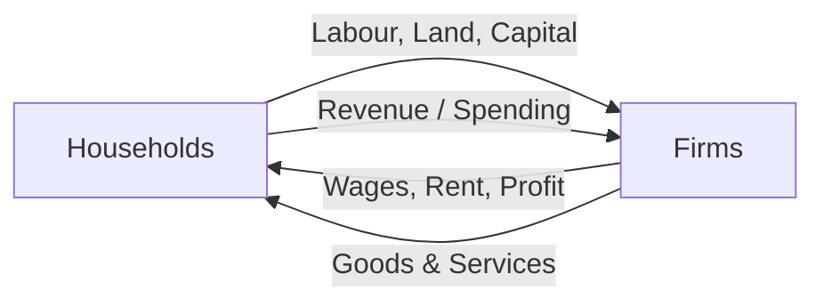

> **Q:** Economics is the study of how society manages its **scarce resources** ✓

---

### Equity vs. Efficiency

| Concept | Meaning |
|---------|---------|
| **Efficiency** | Size of the "economic pie" — maximum output from scarce resources |
| **Equity** | How the "pie" is divided — fairness of distribution |
| **Conflict** | Policies increasing equity (taxing rich for welfare) can reduce efficiency (lower incentive to work) |

---

### Economic Models

- Mathematical representations / "maps" of the real world
- Simplify reality by omitting unimportant variables to focus on major forces
- George Box: **"All models are wrong, but some are useful"**

---

### Opportunity Cost

**Definition:** The value of the **next best alternative** that must be given up to pursue a decision.

- **Implicit costs** — often not visible, frequently ignored
- **Subjective** — varies per individual
- **Decision Rule:** Never ignore opportunity cost; if missed, benefits are overstated

$$\text{Opportunity Cost} = \text{Explicit Cost} + \text{Implicit Cost (Foregone Earnings)}$$

**Reference — Rishav Problem:**

| Option | Ticket Cost | Total Commute | Task Time | Total Time | Hourly Wage |
|--------|-----------|---------------|-----------|------------|-------------|
| **Metro** | Rs 50 | 1 hr | 1 hr | **2 hrs** | Rs 100/hr |
| **Bus** | Rs 30 | 3 hrs | 1 hr | **4 hrs** | Rs 100/hr |

Utility from task = Rs 500

**Q:** What is the opportunity cost of traveling by bus?

> Explicit cost = Rs 30; Implicit cost = 4 hrs × Rs 100 = Rs 400
> **Total OC = Rs 430** ✓
> *(Include ALL time spent — commute + task — as foregone wages)*

**Q:** What is the opportunity cost of traveling by metro?

> Explicit = Rs 50; Implicit = 2 hrs × Rs 100 = Rs 200
> **Total OC = Rs 250** ✓

**Q:** What is the net economic benefit of traveling by metro?

> Net Benefit = Total Utility − Opportunity Cost = 500 − 250
> **Net Benefit = Rs 250** ✓

**Q:** Debayan is identical to Rishav but earns Rs 50/hr. What is his OC of traveling by bus?

> Explicit = Rs 30; Implicit = 4 × 50 = Rs 200
> **OC = Rs 230** ✓

**Q:** What is Debayan's OC of traveling by metro?

> Explicit = Rs 50; Implicit = 2 × 50 = Rs 100
> **OC = Rs 150** ✓

---

### Sunk Cost

**Definition:** Costs already incurred that **cannot be recovered** or altered by any future decision.

- **Sunk Cost Fallacy:** Letting past unrecoverable costs influence current decisions
- **Decision Rule:** Always **ignore sunk costs**; decide based on **future costs and benefits only**

**Q:** You spent Rs 1.5 Cr on a building foundation. Revenue revised from Rs 9 Cr to Rs 5 Cr. Total cost is Rs 6 Cr. Should you complete?

> *Why: Rs 1.5 Cr is sunk — ignore it. Compare marginal revenue vs marginal cost going forward.*
> Remaining cost = 6 − 1.5 = **Rs 4.5 Cr**
> Revised Revenue = **Rs 5.0 Cr**
> Since 5.0 > 4.5 → **Yes, complete the building** ✓
> *(Always ignore sunk costs; compare only future costs with future benefits)*

---

### The Marginal Principle

**Decision Heuristic:** Compare additional (marginal) benefits to additional (marginal) costs.

- **Marginal Benefit (MB):** Change in total benefit from one more unit
- **Marginal Cost (MC):** Change in total cost from one more unit

| Condition | Action |
|-----------|--------|
| $MB > MC$ | Increase the activity |
| $MB < MC$ | Decrease the activity |
| $MB = MC$ | **Optimal point** — net benefit maximized |

---

### Law of Demand

As the **price increases**, the **quantity demanded decreases**, ceteris paribus → **downward-sloping** demand curve

$$Q_d = f(P); \quad f'(P) < 0 \implies \frac{\Delta Q_d}{\Delta P} < 0$$

**Quantity demanded** = amount buyers are **willing and able** to purchase (requires both desire + financial capacity)

#### Linear Demand Function

$$Q_d = a - bP \quad (a > 0, \; b > 0)$$

| Intercept | Value |
|-----------|-------|
| Horizontal ($P = 0$) | $Q_d = a$ (max quantity demanded) |
| Vertical ($Q_d = 0$) | $P = a/b$ (max price) |
| Slope | $\Delta Q_d / \Delta P = -b$ |

```mermaid
xychart-beta
    title "Linear Demand Curve"
    x-axis "Quantity Demanded" [0, 1, 2, 3, 4, 5, 6, 7, 8, 9, 10]
    y-axis "Price" 0 --> 10
    line [10, 9, 8, 7, 6, 5, 4, 3, 2, 1, 0]
```

---

### Demand Function (Full)

$$Q_d = f(P, \; M, \; P_r, \; T, \; F, \; S, \; T_p, \; G, \; C \ldots)$$

| Variable | Factor |
|----------|--------|
| $P$ | Price of commodity |
| $M$ | Consumer income |
| $P_r$ | Prices of related goods |
| $T$ | Tastes & preferences |
| $F$ | Future expectations |
| $S$ | Seasonal factors |
| $T_p$ | Time period |
| $G$ | Government policies |
| $C$ | Culture & history |

---

### Movement vs. Shift (Demand)

| Type | Cause | Effect |
|------|-------|--------|
| **Movement along** (change in Qty Demanded) | Change in **own price** only | Extension ($P\downarrow \to Q\uparrow$) or Contraction ($P\uparrow \to Q\downarrow$) |
| **Shift** (change in Demand) | Change in **any other factor** | Rightward (increase) or Leftward (decrease) |

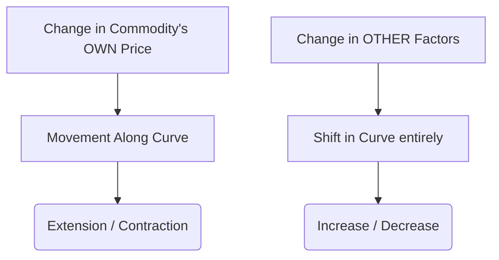

---

### Determinants of Demand (Shift Factors)

| Factor | Effect on Demand |
|--------|-----------------|
| **Income (Normal Good)** | Income ↑ → Demand ↑ (shift right); positive slope |
| **Income (Inferior Good)** | Income ↑ → Demand ↓ (shift left); negative slope |
| **Price of Substitutes** | $P_{sub}$ ↑ → Demand ↑ (shift right); positive cross-demand |
| **Price of Complements** | $P_{comp}$ ↑ → Demand ↓ (shift left); negative cross-demand |
| **Tastes/Preferences** | Favorable change → Demand ↑ |
| **Expectations** | Expect higher future prices → Current demand ↑ |
| **Number of Buyers** | More buyers → Demand ↑ |

- **Substitutes:** Used in place of each other (hot dogs & hamburgers, cinema & streaming)
- **Complements:** Used together (gasoline & automobiles, computers & software)

#### Income-Demand Curves

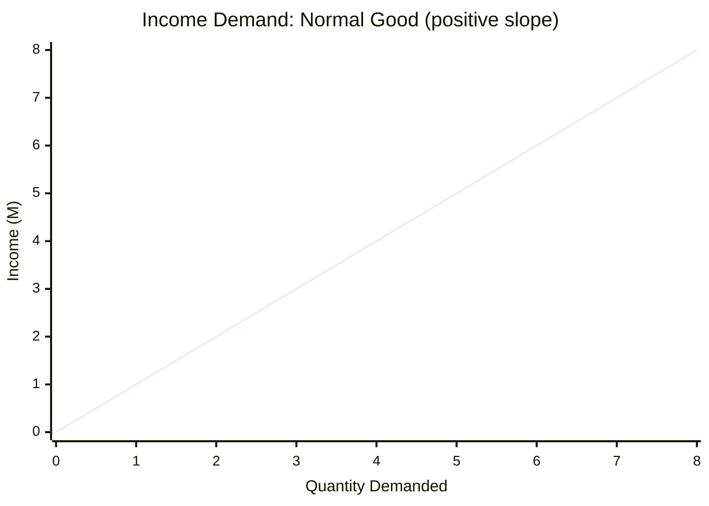

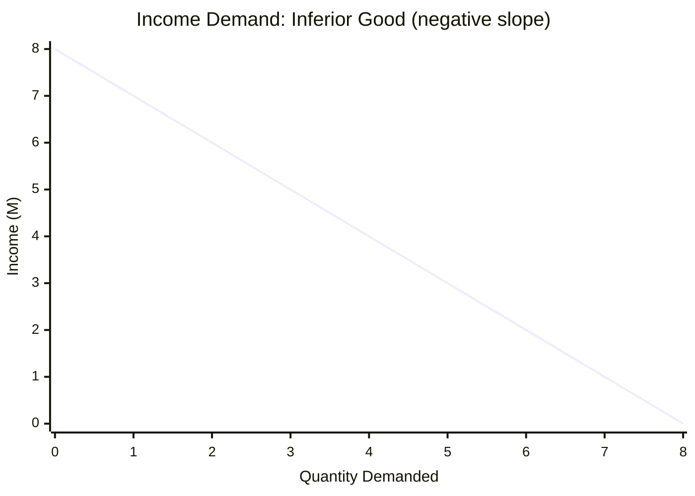

#### Cross-Demand Curves

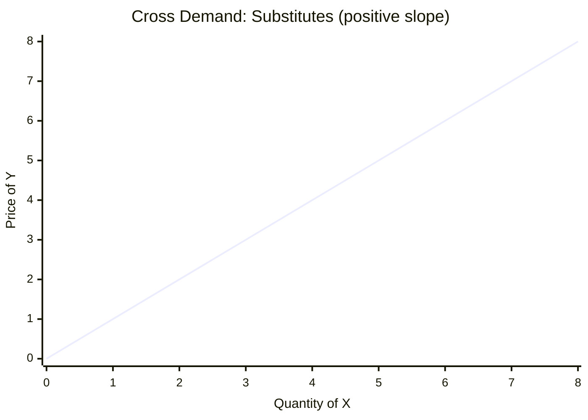

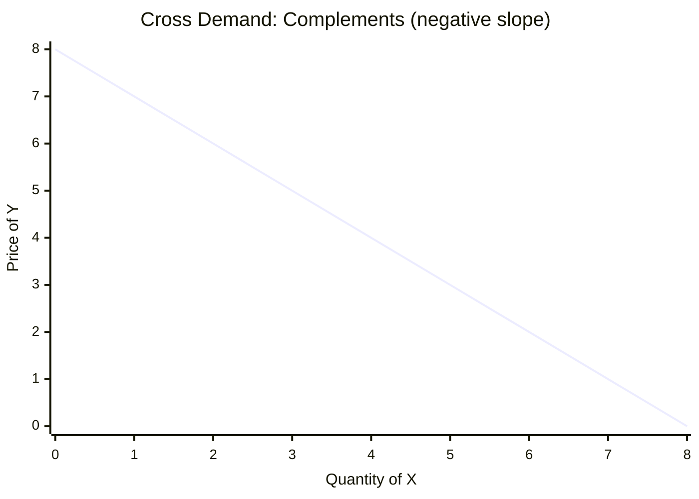

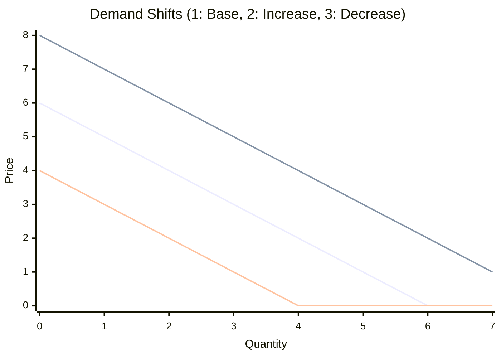

> **Q:** Buyers expect flat prices to rise next year → current demand = **Increases** (rush to buy now) ✓
> **Q:** If price of both a substitute AND a complement for X increases, demand for X = **Any outcome possible** (depends on which effect dominates) ✓

---

### Law of Supply

As the **price increases**, the **quantity supplied increases**, ceteris paribus → **upward-sloping** supply curve

$$Q_s = f(P); \quad f'(P) > 0 \implies \frac{\Delta Q_s}{\Delta P} > 0$$

**Quantity supplied** = amount sellers are **willing and able** to sell at a given price

**Intuition:** Higher prices make it profitable to use less productive resources

#### Linear Supply Function

$$Q_s = c + dP \quad (c > 0, \; d > 0)$$

| Intercept | Value |
|-----------|-------|
| Horizontal ($P = 0$) | $Q_s = c$ |
| Vertical ($Q_s = 0$) | $P = -c/d$ |
| Slope | $\Delta Q_s / \Delta P = +d$ |

```mermaid
xychart-beta
    title "Linear Supply Curve"
    x-axis "Quantity Supplied" [0, 1, 2, 3, 4, 5, 6, 7, 8, 9, 10]
    y-axis "Price" 0 --> 10
    line [0, 1, 2, 3, 4, 5, 6, 7, 8, 9, 10]
```

---

### Movement vs. Shift (Supply)

| Type | Cause | Effect |
|------|-------|--------|
| **Movement along** | Change in **own price** only | Extension ($P\uparrow \to Q\uparrow$) or Contraction ($P\downarrow \to Q\downarrow$) |
| **Shift** | Change in **any other factor** | Rightward (increase) or Leftward (decrease) |

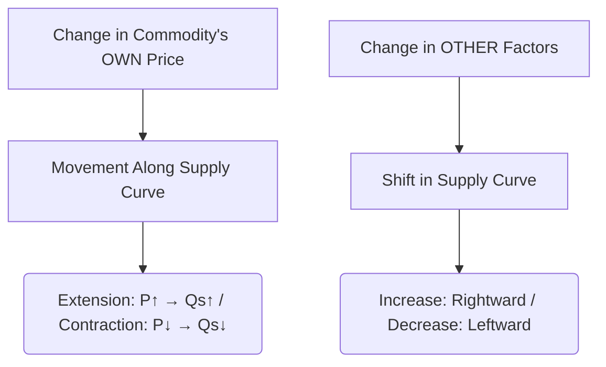

### Determinants of Supply (Shift Factors)

| Factor | Effect on Supply |
|--------|-----------------|
| **Input Prices ↑** | Supply ↓ (shift left) |
| **Technology improves** | Supply ↑ (shift right) |
| **Expect higher future prices** | Current supply ↓ (shift left — hoarding) |
| **More sellers** | Supply ↑ (shift right) |
| **Price of related goods ↑** | May switch production → current supply ↓ |
| **Time (short vs long run)** | Long run → more flexible supply |

> **Q:** Sellers expect flat prices to rise next year → current supply = **Decreases** (hold onto flats) ✓
> **Q:** Sellers hold off selling due to price expectations → short-term = **Shortage, driving up prices** ✓
> **Q:** Growers expect wheat price to increase next month → current supply = **Decreases** ✓

---

## MODULE 2: Equilibrium in a Competitive Market

---

### Market Equilibrium

**Equilibrium Price ($P^*$)** = price where $Q_d = Q_s$ (**market-clearing price**)

| Condition | State | Symptom | Price Pressure |
|-----------|-------|---------|----------------|
| $P > P^*$ | **Surplus** (Excess Supply) | Rising inventories | **Downward** |
| $P < P^*$ | **Shortage** (Excess Demand) | Long queues | **Upward** |

- **Stable equilibrium:** Any disturbance is self-adjusting — market forces restore $P^*$ automatically
- **Invisible Hand:** Prices act as signals coordinating millions of independent decisions without central authority

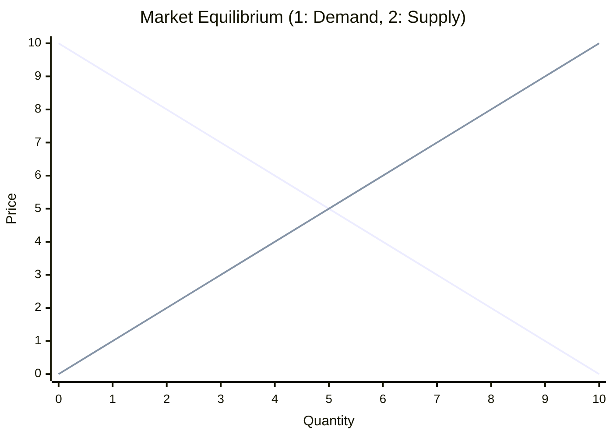

> **Q:** Price falls below equilibrium → **Quantity demanded exceeds quantity supplied** (shortage) ✓
> **Q:** At equilibrium, buyers have **highest** WTP and sellers have **lowest** costs ✓
> **Q:** Competitive equilibrium **maximizes total surplus** ✓
> **Q:** Mars vacation market today → **No equilibrium** (supply curve above demand at all Q; no technology exists) ✓

**Q:** $Q_d = 100 - 10P$; $Q_s = 10 + 20P$. Find equilibrium.

> $100 - 10P = 10 + 20P \implies 30P = 90 \implies P = 3$
> $Q = 100 - 10(3) = 70$
> **P = 3, Q = 70** ✓

---

### Effects of Shifts on Equilibrium

| Shift | $P^*$ | $Q^*$ |
|-------|:-----:|:-----:|
| Demand ↑, Supply unchanged | ↑ | ↑ |
| Demand ↓, Supply unchanged | ↓ | ↓ |
| **Supply ↑, Demand unchanged** | **↓** | **↑** |
| Supply ↓, Demand unchanged | ↑ | ↓ |
| Both D↑ and S↑ | **Uncertain** | ↑ |
| Both D↓ and S↓ | **Uncertain** | ↓ |
| D↑ and S↓ | **↑** | Uncertain |
| D↓ and S↑ | **↓** | Uncertain |

**Four-Step Checklist for Shift Analysis:**
1. Identify the market
2. Determine which curve shifts
3. Identify direction of shift
4. Find new equilibrium

> **Q:** Increase in supply (demand unchanged) → **Lower price, higher quantity** ✓
> **Q:** Both demand ↑ and supply ↓ (expected price rise) → **Price definitely rises** ✓

---

### Practice — Function Calculations

**Q:** Supply of HDTVs: $Q_{sx} = 2000 + 3P_x - 4P_y - P_i$. $P_x = 14000$, $P_y = 10000$, $P_i = 2000$.

> $Q_{sx} = 2000 + 42000 - 40000 - 2000$
> **$Q_{sx} = 2000$ units** ✓

**Q:** Demand: $Q_x = 10200 - 3P_x + 4P_y - I + 0.02A_x$. Are X and Y substitutes or complements?

> Coefficient of $P_y$ is **+4** (positive) → when $P_y$ rises, $Q_x$ rises
> **X and Y are substitutes** ✓

---

### Market Types

| Type | Characteristics |
|------|----------------|
| **Perfectly Competitive** | Many small buyers and sellers; identical goods; no price influence |
| **Oligopoly** | Few large sellers (e.g., satellite launches, insulin market) |
| **Monopoly** | Single seller (e.g., patented medicines, local cable TV) |

---

## Elasticity

---

### Price Elasticity of Demand (PED)

$$\varepsilon_p = \left|\frac{\%\Delta Q_d}{\%\Delta P}\right| = \left|\frac{\Delta Q}{\Delta P} \times \frac{P}{Q}\right|$$

*Always use **absolute value** for comparison*

| Category | $\|\varepsilon_p\|$ | Curve Shape | Meaning |
|:---|:---:|:---|:---|
| **Perfectly Elastic** | $\infty$ | Horizontal | Slightest price change → Q drops to zero |
| **Elastic** | $> 1$ | Relatively flat | Q very responsive to P |
| **Unitary Elastic** | $= 1$ | — | Q changes proportionately with P |
| **Inelastic** | $< 1$ | Relatively steep | Q not very responsive to P |
| **Perfectly Inelastic** | $0$ | **Vertical** | Q never changes regardless of P |

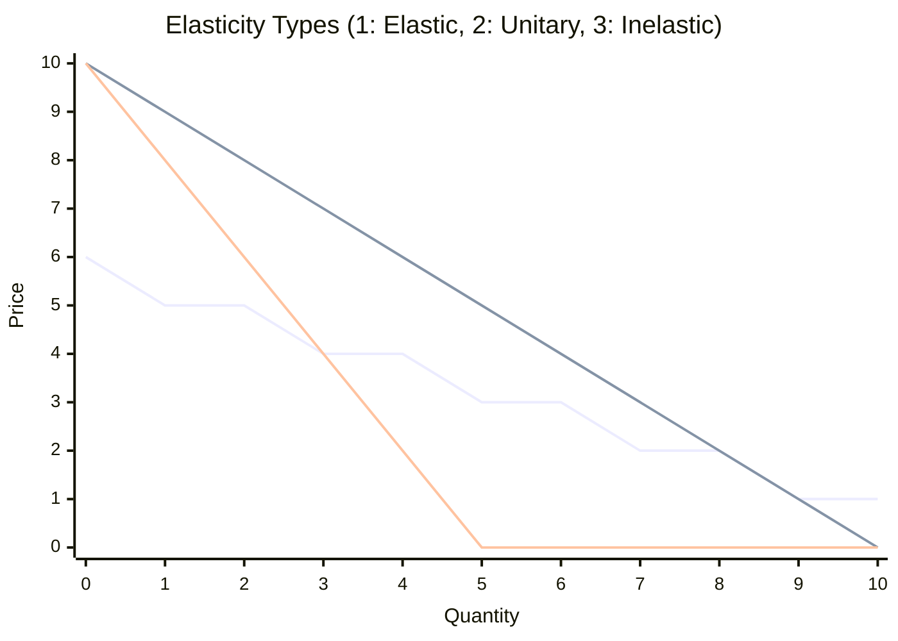

*On a linear demand curve: Upper half = Elastic (|ε| > 1), Midpoint = Unitary (|ε| = 1), Lower half = Inelastic (|ε| < 1)*

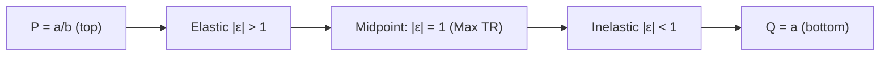

> **Q:** Vertical demand curve = **Perfectly inelastic** ✓
> **Q:** %ΔQ < %ΔP → PED = **Less than 1** (inelastic) ✓
> **Q:** Company raises price 15%, total revenue increases → demand is **Inelastic** ✓

---

### PED on a Linear Demand Curve

For inverse demand $P = A - BQ$:

$$PED = \frac{1}{B} \times \frac{P}{Q}$$

- Elasticity **decreases** as we move **down** the curve (as P falls, Q rises)
- **Upper half** (above midpoint): Elastic ($|\varepsilon| > 1$)
- **Midpoint** ($Q = A/2B$): Unitary elastic ($|\varepsilon| = 1$) → **TR is maximized here**
- **Lower half** (below midpoint): Inelastic ($|\varepsilon| < 1$)

> **Q:** On a linear demand curve, the lower the price → **the less elastic** is demand ✓
> **Q:** Total Revenue is maximized where **|PED| = 1** (unitary elastic; MR = 0) ✓

---

### Determinants of PED

| Factor | More Elastic if... | More Inelastic if... |
|--------|-------------------|---------------------|
| **Substitutes** | Many close substitutes (Crocin) | No close substitutes (patented drug) |
| **Necessity vs. Luxury** | Luxury (Mountain Dew) | Necessity (rice, cigarettes) |
| **Market Definition** | Narrow (Samsung Galaxy) | Broad (all smartphones) |
| **Budget Share** | Large share of income (car) | Small share (stapler pins) |
| **Time Horizon** | Long run (can adjust behavior) | Short run |

---

### Elasticity and Total Revenue

$TR = P \times Q$

| Demand Type | Price ↑ → TR | Price ↓ → TR |
|-------------|:---:|:---:|
| **Inelastic** ($\varepsilon < 1$) | TR ↑ | TR ↓ |
| **Elastic** ($\varepsilon > 1$) | TR ↓ | TR ↑ |
| **Unitary** ($\varepsilon = 1$) | No change | No change |

**Revenue Rule:** Elastic demand → **lower price** to increase TR. Inelastic demand → **raise price**.

**Total Expenditure Method:**
- Price ↓ → Total Expenditure ↑ → Demand is **elastic**
- Price ↓ → Total Expenditure ↓ → Demand is **inelastic**
- Price ↓ → Total Expenditure unchanged → **Unitary elastic**

> **Q:** Increase in supply reduces total producer revenue if demand is **inelastic** ✓
> *(Price falls but quantity rise is proportionately smaller → TR falls)*

---

### Income Elasticity of Demand

$$\varepsilon_M = \frac{\%\Delta Q_d}{\%\Delta M} = \frac{\Delta Q}{\Delta M} \times \frac{M}{Q}$$

| Good Type | $\varepsilon_M$ |
|-----------|:---:|
| **Normal Good** | Positive ($> 0$) |
| **Inferior Good** | Negative ($< 0$) |
| **Luxury** | $> 1$ |
| **Necessity** | $0 < \varepsilon_M < 1$ |

---

### Cross-Price Elasticity of Demand

$$\varepsilon_c^{XY} = \frac{\%\Delta Q_X}{\%\Delta P_Y} = \frac{\Delta Q_X}{\Delta P_Y} \times \frac{P_Y}{Q_X}$$

| Relationship | $\varepsilon_c$ |
|:---:|:---:|
| **Substitutes** | Positive ($> 0$) |
| **Complements** | Negative ($< 0$) |
| **Unrelated** | Zero ($= 0$) |

> **Q:** Positive cross-price elasticity = **Substitutes** ✓

---

### Elasticity — Multi-Segment Market Demand

**Q:** MBA demand: $Q_m = 10 - P$; Undergrad demand: $Q_a = 20 - 4P$ (P in hundreds). Total quantity at Rs 700?

> $P = 7$. $Q_m = 10 - 7 = 3$ thousand.
> $Q_a = 20 - 28 = -8$ → clip to **0** (undergrads priced out when $P > 5$)
> **Total = 3,000 units** ✓

**Q:** At P = Rs 100 (P=1): Is MBA demand more or less elastic than market demand?

> $Q_m = 9$; $\varepsilon_m = 1 \times \frac{1}{9} \approx 0.111$
> $Q_{total} = 30 - 5(1) = 25$; $\varepsilon_{mkt} = 5 \times \frac{1}{25} = 0.200$
> MBA demand is **less elastic** than market demand ✓

---

### Price Elasticity of Supply

$$\varepsilon_s = \left|\frac{\%\Delta Q_s}{\%\Delta P}\right| = \left|\frac{\Delta Q_s}{\Delta P} \times \frac{P}{Q_s}\right|$$

| Category | $\|\varepsilon_s\|$ |
|:---|:---:|
| **Elastic** | $> 1$ |
| **Inelastic** | $< 1$ |
| **Perfectly Elastic** | $\infty$ (Horizontal) |
| **Perfectly Inelastic** | $0$ (Vertical) |

- Depends on **production flexibility** and **time horizon** (supply more elastic in long run)

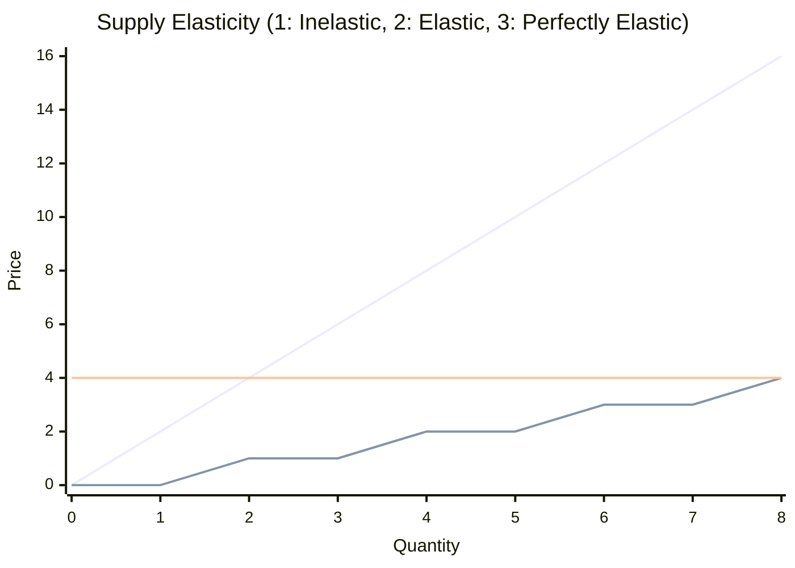

---

## Surplus & Government Intervention

---

### Consumer Surplus (CS)

$$CS = \text{Willingness to Pay (WTP)} - \text{Price Paid}$$

**Graphically:** Area **below the demand curve** and **above the price**

**Q:** Demand: $P = 50 - 0.5Q$. Market price = Rs 30. Find CS.

> At $P = 30$: $Q = 40$; $P_{max} = 50$
> $CS = \frac{1}{2} \times 40 \times (50 - 30) = \frac{1}{2} \times 40 \times 20$
> **CS = Rs 400** ✓

---

### Producer Surplus (PS)

$$PS = \text{Price Received} - \text{Cost of Production}$$

**Graphically:** Area **below the price** and **above the supply curve**

**Q:** Supply: $Q_s = -\frac{4}{3} + \frac{4}{3}P$. Market price $P = 4$. Find PS.

> $P_{min}$ (when $Q_s = 0$): $P = 1$
> $Q$ at $P = 4$: $Q = 4$
> $PS = \frac{1}{2} \times (4 - 1) \times 4 = \frac{1}{2} \times 3 \times 4$
> **PS = 6** ✓

---

### Total Surplus & Efficiency

$$TS = CS + PS = \text{Value to Buyers} - \text{Cost to Sellers}$$

- **Efficiency:** Allocation that maximizes Total Surplus
- Competitive equilibrium is efficient — goods go to highest-WTP buyers; production by lowest-cost sellers
- **No social planner** can improve upon the competitive equilibrium outcome

---

### Tax Incidence

When a specific tax $T$ is imposed: $P_{Buyer} - P_{Seller} = T$

**Burden Rule:** Tax falls more heavily on the **more inelastic** side

$$\text{Consumer's share} = \frac{E_S}{E_S + |E_D|}$$

$$\text{Producer's share} = \frac{|E_D|}{E_S + |E_D|}$$

> **Q:** Government wants to maximize tax revenue → tax goods with **perfectly inelastic demand** ✓
> **Q:** Cigarettes (inelastic demand, |PED| = 0.5) taxed → **Consumers bear larger burden** ✓
> **Q:** Water (highly inelastic demand) taxed → **Consumers** bear most burden ✓
> **Q:** Sellers bear largest tax burden when **supply is relatively more inelastic** than demand ✓
> **Q:** Largest reduction in quantity from tax occurs when **both supply and demand are elastic** ✓

---

### Tax Incidence — E-Scooter Problem

**Given:** $Q_D = 5000 - 250P$; $Q_S = 600 + 150P$ (P in thousands)

**Q:** Find pre-tax equilibrium.

> $5000 - 250P = 600 + 150P \implies 400P = 4400$
> **$P^* = 11$ (Rs 11,000); $Q^* = 2250$ thousand** ✓

**Q:** Tax of Rs 2,000 imposed on producers. Find buyer's price after tax.

> Seller receives $P_b - 2$; New supply: $Q_S = 600 + 150(P_b - 2) = 300 + 150P_b$
> $5000 - 250P_b = 300 + 150P_b \implies 400P_b = 4700$
> **$P_b = 11.75$ (Rs 11,750)** ✓

**Q:** Find producer's price after tax.

> $P_s = P_b - T = 11.75 - 2 = 9.75$
> **$P_s$ = Rs 9,750** ✓
> *(Buyer burden = 750; Seller burden = 1250; Total = 2000)* ✓

**Q:** Fraction of tax passed to buyers?

> $\frac{11750 - 11000}{2000} = \frac{750}{2000}$ = **3/8** ✓

---

### Deadweight Loss (DWL)

- Taxes/monopolies reduce quantity sold → some mutually beneficial trades don't occur
- DWL = fall in Total Surplus from market distortion

$$DWL_{tax} = \frac{1}{2} \times T \times \Delta Q$$

- **More elastic** supply or demand → **larger** DWL

---

### Price Controls

| Control | Binding Condition | Outcome |
|---------|------------------|---------|
| **Price Ceiling** (cap) | Set **below** $P^*$ | **Shortage** (excess demand) |
| **Price Floor** | Set **above** $P^*$ | **Surplus** (excess supply) |

> **Q:** Effective price ceiling creates excess **demand** (shortage), **NOT** excess supply ✓
> *(False: "Effective ceiling creates excess supply")*

---

### Price Floor — Minimum Wage Problem

**Given:** $L^S = 12w$; $L^D = 96 - 12w$

**Q:** Free-market wage and employment?

> $12w = 96 - 12w \implies 24w = 96 \implies w = 4$
> $L = 12(4) = 48$ million hours
> **w = Rs 4/hr, L = 48 million hours** ✓

**Q:** Minimum wage set at Rs 6/hr → employment?

> At $w = 6$: $L^D = 96 - 72 = 24$; $L^S = 72$
> Employment = min(demand, supply) = **24 million hours** ✓
> *(Surplus of labor = 72 − 24 = 48 million hours unemployed)*

**Q:** Subsidy of Rs 2/hr to employers instead → new equilibrium?

> Effective cost to employer = $w - 2$; New demand: $L^D = 96 - 12(w-2) = 120 - 12w$
> $12w = 120 - 12w \implies 24w = 120 \implies w = 5$
> $L = 12(5) = 60$ million hours
> **w = Rs 5/hr, L = 60 million hours** ✓

---

## MODULE 3: Looking inside a Firm

---

### Production Function

$$q = f(L, K)$$

- **Short Run:** At least one input is **fixed** (e.g., capital $\bar{K}$)
- **Long Run:** **All** inputs are variable
- No specific calendar time separates them — case-by-case basis

---

### Marginal & Average Product

$$AP_L = \frac{q}{L} \qquad MP_L = \frac{\Delta q}{\Delta L}$$

#### Law of Diminishing Marginal Returns (Variable Proportions)

As use of one input increases (others fixed), a point is reached where **additions to output decrease**.

- Initially: Specialization → MP rises
- Eventually: Crowding → **MP falls**

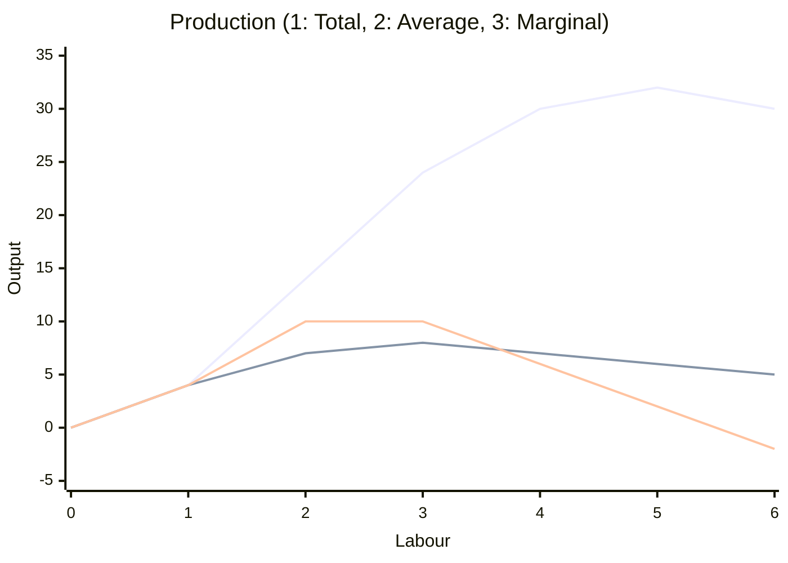

---

### Returns to Scale (Long Run)

| Type | Meaning |
|------|---------|
| **Constant** | Inputs ↑ by $k$ → Output ↑ by exactly $k$ |
| **Increasing** | Inputs ↑ by $k$ → Output ↑ by more than $k$ |
| **Decreasing** | Inputs ↑ by $k$ → Output ↑ by less than $k$ |

---

### Cost Categories

| Type | Definition | Example |
|------|-----------|---------|
| **Explicit (Accounting)** | Actual cash payments | Wages, rent, raw materials |
| **Implicit (Opportunity)** | Foregone returns on own resources | Foregone salary, return on own capital |
| **Economic Cost** | Explicit + Implicit | Full cost for decision-making |
| **Fixed Cost (FC)** | Does **NOT** vary with output | Rent, property tax, license fees |
| **Variable Cost (VC)** | **Changes** with output | Raw materials, hourly labor |
| **Sunk Cost** | Already incurred, **unrecoverable** | R&D, advertising, specialized equipment |
| **Incremental Cost** | Additional cost from a business decision | Changing product line, new clients |

$$\text{Accounting Profit} = TR - \text{Explicit Costs}$$

$$\text{Economic Profit} = TR - (\text{Explicit} + \text{Implicit Costs})$$

- **Normal Profit:** Economic profit = 0 (covers all opportunity costs)
- **Supernormal Profit:** Economic profit > 0
- Economic profit **always ≤** Accounting profit

> **Q:** Workers partly dismissible, partly on contract → total wages are **partly fixed, partly variable** ✓

---

### Short-Run Cost Curves

$$TC = TFC + TVC$$

$$AFC = \frac{TFC}{q} \qquad AVC = \frac{TVC}{q} \qquad ATC = \frac{TC}{q} = AFC + AVC$$

$$MC = \frac{\Delta TC}{\Delta q} = \frac{\Delta TVC}{\Delta q}$$

**Key Relationships:**
- $AFC$ always **declines** as $q$ increases (spreading fixed costs)
- $AVC$ and $ATC$ are **U-shaped**
- **MC intersects AVC and ATC at their minimum points**
- When $MC < ATC$ → ATC is falling; When $MC > ATC$ → ATC is rising
- **Efficient Scale:** Quantity that minimizes ATC (where MC = ATC)
- AVC minimum occurs at a **lower** output than ATC minimum
- MC minimum occurs at a **lower** output than ATC minimum

> **Q:** ATC and AVC reach minimum at same output? → **FALSE** (ATC min at higher Q due to AFC) ✓
> **Q:** ATC and MC reach minimum at same output? → **FALSE** (MC min at lower Q) ✓

---

### Cost Curve Problems

**Ice Cream Production:**

| Q | TC | AFC | AVC | ATC | MC |
|:-:|:--:|:---:|:---:|:---:|:--:|
| 0 | 60 | — | — | — | — |
| 1 | 100 | 60 | 40 | 100 | 40 |
| 2 | 130 | 30 | 35 | 65 | 30 |
| 3 | 170 | 20 | 36.67 | **56.67** | 40 |
| 4 | 230 | 15 | 42.5 | **57.5** | 60 |
| 5 | 310 | 12 | 50 | 62 | 80 |
| 6 | 420 | 10 | 60 | **70** | 110 |

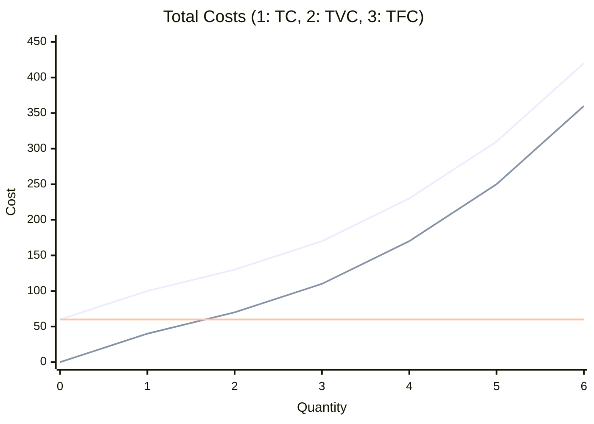

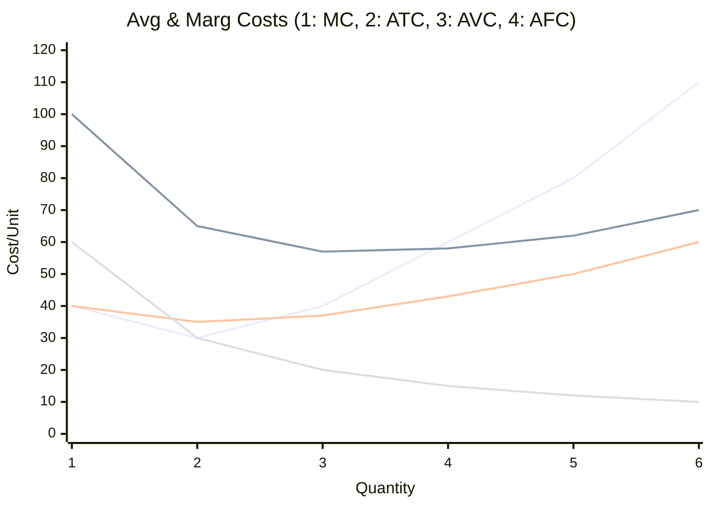

> **Q:** ATC for 6 units = 420/6 = **Rs 70** ✓
> **Q:** MC from 4→5 units = 310 − 230 = **Rs 80** ✓
> **Q:** ATC starts increasing at **4 units** (from 56.67 to 57.5) ✓

**Q:** $TC = 200 + 55q$. Find FC and AVC.

> FC = **200** (constant term, does not vary with q) ✓
> VC = 55q → AVC = 55q/q = **55** (constant at all output levels) ✓

**Q:** License fee of \$1,000/year imposed. Which cost curves shift?

> License fee = fixed cost → **AFC shifts up** and **ATC shifts up** ✓
> *(MC and AVC are unaffected — fee doesn't change with output)*

**Q:** ATC for 100 cookies = \$0.25/cookie. MC = \$0.10 (constant). Find TC at 50 cookies.

> TC(100) = 0.25 × 100 = \$25; TVC(100) = 0.10 × 100 = \$10; FC = 25 − 10 = **\$15**
> TC(50) = 15 + 0.10 × 50 = 15 + 5 = **\$20** ✓

**Q:** At 50 and 100 cookies, is ATC falling or rising?

> MC = \$0.10; ATC(50) = \$0.40; ATC(100) = \$0.25
> Since MC < ATC at both levels → **ATC is falling at both** ✓

---

### Long-Run Costs

- **LAC (Long-Run Average Cost)** = planning curve, tangent to each SAC curve
- LAC is **NOT** tangent to minimum points of SAC curves
- **Economies of Scale:** LAC decreasing as output rises
  - **Internal:** From firm's own large-scale production
  - **External:** From industry-wide factors
- **Diseconomies of Scale:** LAC increasing beyond optimal level

---

## MODULE 4: Perfect Competition vs Monopoly

---

### Characteristics

- **Many** buyers and many sellers
- **Homogeneous** (identical) goods
- **Price Takers** — no single firm can influence market price
- **Free entry and exit** in the long run

---

### Revenue in Perfect Competition

$$TR = P \times Q \qquad AR = \frac{TR}{Q} = P \qquad MR = \frac{\Delta TR}{\Delta Q} = P$$

In perfect competition: **P = AR = MR** (horizontal demand curve for individual firm)

---

### Profit Maximization

$$\text{Profit} = TR - TC$$

**Rule:** Produce where **P = MR = MC** (with MC rising / cutting MR from below)

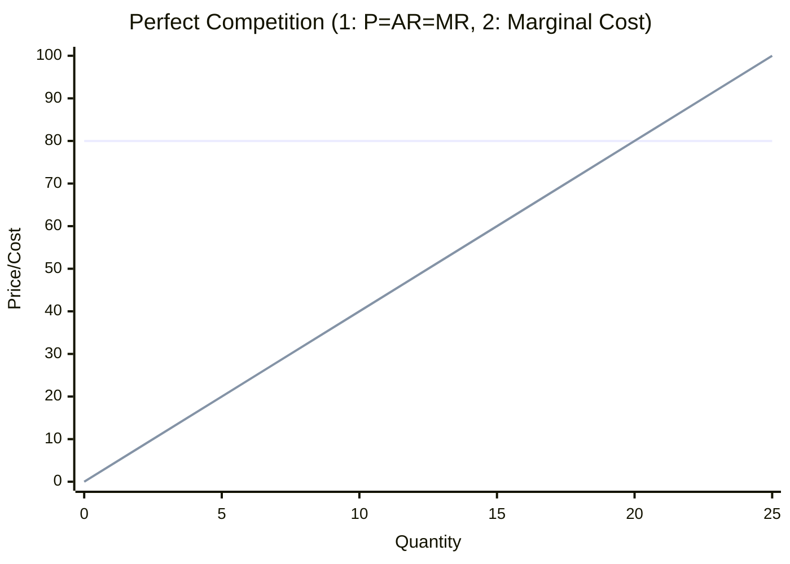

#### Profit/Loss Conditions

| Condition | Outcome |
|-----------|---------|
| $P > ATC$ | **Economic Profit** (supernormal) |
| $P = \min(ATC)$ | **Break-Even** (normal profit) |
| $AVC < P < ATC$ | **Loss**, but continue producing in SR |
| $P = \min(AVC)$ | **Shutdown Point** |
| $P < AVC$ | **Shut down** in SR |
| $P < ATC$ (long run) | **Exit** the industry |

---

### Shutdown vs. Exit

| Decision | Time Frame | Rule |
|----------|-----------|------|
| **Shutdown** | Short Run | $P < \min(AVC)$ |
| **Exit** | Long Run | $P < \min(ATC)$ |
| **Enter** | Long Run | $P > \min(ATC)$ |

- **Short-run Supply Curve** = MC curve **above** min AVC

> **Q:** Competitive firm's SR supply curve = **Marginal cost** curve above **Average variable cost** curve ✓
> **Q:** Firm incurring losses but covering VC → **Continue producing in SR** to minimize losses ✓

**Q:** Firm produces 100 units. ATC = \$8, FC = \$200, AR = \$7. Find AVC and recommendation.

> TC = 8 × 100 = 800; VC = 800 − 200 = 600; **AVC = \$6** ✓
> P(\$7) > AVC(\$6) → **Keep producing in short run** ✓
> P(\$7) < ATC(\$8) → **Exit in the long run** ✓

---

### Long-Run Equilibrium in Perfect Competition

- **Zero economic profit** ($P = \min ATC$)
- All firms produce at **efficient scale**
- Free entry/exit drives price to min ATC

**Q:** $TC = 50 + 0.5Q^2$, $MC = Q$. Market demand $Q = 120 - P$. Find long-run price.

> Min ATC: Set $MC = ATC \implies Q = \frac{50}{Q} + 0.5Q \implies 0.5Q = \frac{50}{Q} \implies Q^2 = 100 \implies Q = 10$
> Min ATC = MC(10) = **10**; Long-run **P = 10** ✓

---

### Competitive Equilibrium — Full Calculation

**Given:** $TC = 100 + 2Q^2$; $MC = 4Q$; $P = 120 - 2Q$

**Q:** Perfect competition equilibrium?

> $P = MC$: $120 - 2Q = 4Q \implies 6Q = 120 \implies Q^* = 20$
> $P^* = 120 - 2(20) = 80$
> **Q = 20, P = 80** ✓

**Q:** Profit under perfect competition?

> $TR = 80 \times 20 = 1600$
> $TC = 100 + 2(400) = 900$
> **Profit = \$700** ✓

---

## Monopoly

---

### Definition & Barriers to Entry

A **single seller** of a product with **no close substitutes** → **Price Maker**

| Barrier Type | Example |
|-------------|---------|
| **Government Regulation** | Patents (AbbVie's Humira — 19 years), copyrights (Microsoft), state monopolies (Indian Railways) |
| **Control of Scarce Resources** | De Beers (80–85% of diamonds) |
| **Natural Monopoly** | High FC, negligible MC → ATC continually decreasing → single firm most efficient |

> **Q:** Natural monopoly exists when **one firm can supply entire market at lower cost** than multiple firms ✓

---

### Monopoly vs. Perfect Competition

| Feature | Perfect Competition | Monopoly |
|---------|:---:|:---:|
| **Price Control** | Price Taker | **Price Maker** |
| **Demand Curve (Firm)** | Horizontal (perfectly elastic) | **Downward-sloping** (market demand) |
| **Marginal Revenue** | $MR = P$ | **$MR < P$** |
| **Long-run Profit** | Zero economic profit | **Positive** (barriers prevent entry) |
| **Social Efficiency** | Efficient (max TS) | **Inefficient** (DWL exists) |

---

### Demand & MR for Monopolist

For linear inverse demand $P = A - BQ$:

$$MR = A - 2BQ$$

MR curve has **same intercept** but **twice the slope** of demand curve

$$MR = AR\left(1 - \frac{1}{\varepsilon_p}\right) \implies MR < AR = P$$

> **Q:** For a single-price monopoly: **P > MR** and **MR = MC** ✓
> **Q:** NOT true for monopoly = **"P = MC at profit-maximizing output"** → False; $P > MC$ ✓

---

### Profit Maximization

**Two-Step Process:**
1. Find $Q_M$ where **MR = MC** (with MC rising / cutting MR from below)
2. Read **$P_M$** from the **demand curve** at $Q_M$

| Condition | Outcome |
|-----------|---------|
| $P > ATC$ | Monopoly **profit** |
| $P = ATC$ | **Break-even** |
| $P < ATC$ | Monopoly **loss** |
| $P = AVC$ | **Shutdown point** |

> **Q:** If monopoly's FC increase → **Price stays the same, profit decreases** ✓
> *(FC doesn't affect MC → MR=MC point unchanged → Q and P unchanged; but TC rises → profit falls)*

---

### Monopoly — Demand Schedule Problem

| P (Rs) | Q | TR | MR | MC |
|:------:|:-:|:--:|:--:|:--:|
| 10 | 1 | 10 | 10 | 6 |
| 9 | 2 | 18 | 8 | 6 |
| **8** | **3** | **24** | **6** | **6** |
| 7 | 4 | 28 | 4 | 6 |
| 6 | 5 | 30 | 2 | 6 |

*(FC = 5, constant MC = 6)*

> **Q:** TR at 3 units = $8 \times 3$ = **Rs 24** ✓
> **Q:** MR from 2→3 units = $24 - 18$ = **Rs 6** ✓
> **Q:** Profit-maximizing Q: MR = MC = 6 at **Q = 3** ✓
> **Q:** Optimal price at Q = 3 → **P = Rs 8** ✓
> **Q:** Max profit = TR − TC = 24 − (5 + 18) = 24 − 23 = **Rs 1** ✓

---

### Monopoly — Full Calculation

**Given:** $TC = 100 + 2Q^2$; $MC = 4Q$; $P = 120 - 2Q$; $MR = 120 - 4Q$

**Q:** Monopoly equilibrium?

> $MR = MC$: $120 - 4Q = 4Q \implies 8Q = 120 \implies Q_M = 15$
> $P_M = 120 - 2(15) = 90$
> **Q = 15, P = 90** ✓

**Q:** Monopoly profit?

> $TR = 90 \times 15 = 1350$
> $TC = 100 + 2(225) = 550$
> **Profit = \$800** ✓

---

### Social Cost of Monopoly — Deadweight Loss

$$DWL = \frac{1}{2} \times (P_M - P^*) \times (Q^* - Q_M)$$

Monopoly produces **less** at a **higher price** → some mutually beneficial trades don't occur

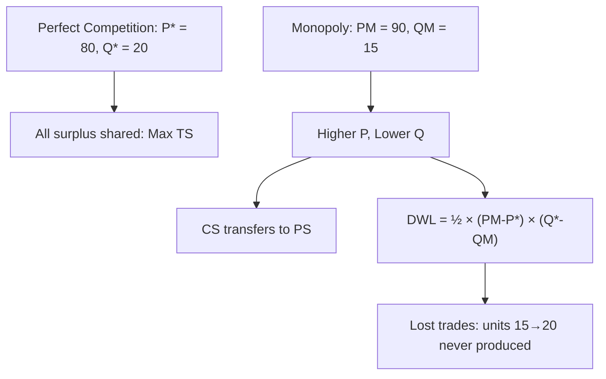

- **Consumer Surplus:** ↓ (transferred to monopolist + lost as DWL)
- **Producer Surplus:** ↑ (gains from higher price)
- **Total Surplus:** ↓ (DWL = net loss to society)

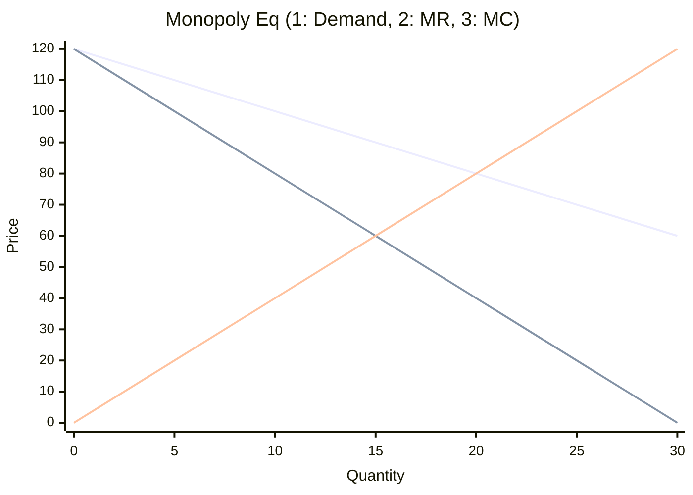

**Q:** DWL from monopoly to competition ($Q_M = 15, P_M = 90$; $Q^* = 20, P^* = 80$)?

> $DWL = \frac{1}{2} \times (90 - 80) \times (20 - 15) = \frac{1}{2} \times 10 \times 5$
> **DWL = \$25** ✓

---

### Lerner Index of Monopoly Power

$$L = \frac{P - MC}{P} = \frac{1}{\varepsilon_p}$$

| Market | $L$ |
|--------|:---:|
| **Perfect Competition** | $L = 0$ ($P = MC$) |
| **Monopoly (low elasticity)** | $L$ is high |

- Higher L = greater monopoly power
- Low elasticity → firm has high degree of monopoly power
- Monopoly power → higher P, lower Q → **↓ CS, DWL exists**

---

### Long-Run Monopoly

- Monopolist can adjust plant size
- **Barriers to entry prevent** pure economic profits from being eliminated
- LR equilibrium: $MR = SMC = LMC$
- If market is too small → monopolist uses sub-optimal plant AND under-utilizes it

---

## Price Discrimination

---

### Definition & Requirements

**Price Discrimination:** Selling the same good at **different prices** to different customers based on their **Willingness to Pay (WTP)**.

**Two Requirements:**
1. **Market Power** (must be a monopolist or have significant control)
2. **Prevention of Arbitrage** (no resale from low-price to high-price market)

> **Q:** PD allows firms to **capture more of the total surplus** ✓
> **Q:** PD successful when firm has **market power and can prevent resale** ✓
> **Q:** Zero marginal cost is **NOT** a necessary condition for PD ✓

---

### Three Degrees of Price Discrimination

| Degree | Method | Key Feature | Equilibrium |
|:------:|--------|-------------|-------------|
| **1st** | Charge each customer their **reservation price** (max WTP) | Extracts ALL consumer surplus | $MR = AR = P = MC$; **No DWL**; TS = PS |
| **2nd** | Different prices for different **quantities** (block pricing) | MR = step function | Electricity, gas, telecom |
| **3rd** | Different prices for different **customer groups** | Separate demand curves per group | $MR_1 = MR_2 = MC$; Higher price in **less elastic** market |

**1st Degree:** Total Surplus = Producer Surplus (consumers get nothing); same outcome as PC in quantity but all surplus to producer

**2nd Degree:** Can make consumers better off by expanding output and lowering costs

**3rd Degree:** Profitable **only if elasticities differ** across sub-markets; **higher price** charged in the market with **lower elasticity**

---

### Barriers to Arbitrage

| Method | Example |
|--------|---------|
| **Social norms / Marketing** | "Pink Tax" — gendered pricing on razors |
| **Damaged goods** | IBM limiting printer speed via chip for low-WTP segment |
| **Screening** | Student IDs for software discounts |
| **Geographic** | Monument entry fees: foreigners vs. locals |
| **Purchase history** | Discounts for first-time buyers |
| **Firm size** | Oracle charging more to large enterprises |
| **Two-Part Tariffs** | Fixed entry fee + per-unit fee (amusement parks) |

---

### Uniform Pricing vs. Price Discrimination

**Setup:** 50 High (WTP=120), 30 Medium (WTP=60), 20 Low (WTP=20). MC = 0.

**Q:** Revenue-maximizing uniform price?

> At P=120: TR = 120 × 50 = **6,000**
> At P=60: TR = 60 × 80 = 4,800
> At P=20: TR = 20 × 100 = 2,000
> **Uniform price = Rs 120, Revenue = 6,000** ✓

**Q:** Can distinguish High from {Medium + Low} but not Medium from Low. Revenue-maximizing prices?

> High: Charge **120** → Revenue = 6,000
> Medium + Low group: At P=60 → only Medium buys → R = 60 × 30 = 1,800
> At P=20 → both buy → R = 20 × 50 = 1,000
> Charge **60** to this group (1,800 > 1,000)
> **Prices: 120 to High, 60 to Medium, 60 to Low** ✓

---

## Quick Reference: Key Formulas

| Formula | Expression |
|---------|-----------|
| **Linear Demand** | $Q_d = a - bP$ |
| **Linear Supply** | $Q_s = c + dP$ |
| **PED** | $\|\frac{\Delta Q}{\Delta P} \times \frac{P}{Q}\|$ |
| **Income Elasticity** | $\frac{\Delta Q}{\Delta M} \times \frac{M}{Q}$ |
| **Cross-Price Elasticity** | $\frac{\Delta Q_X}{\Delta P_Y} \times \frac{P_Y}{Q_X}$ |
| **MR (Monopoly, Linear)** | $MR = A - 2BQ$ |
| **MR-Elasticity** | $MR = P(1 - \frac{1}{\varepsilon_p})$ |
| **Lerner Index** | $L = \frac{P - MC}{P} = \frac{1}{\varepsilon_p}$ |
| **Consumer Surplus** | $\frac{1}{2} \times Q \times (P_{max} - P)$ |
| **Producer Surplus** | $\frac{1}{2} \times Q \times (P - P_{min})$ |
| **DWL (Monopoly)** | $\frac{1}{2} \times (P_M - P^*) \times (Q^* - Q_M)$ |
| **Profit** | $TR - TC = (P - ATC) \times Q$ |
| **MC** | $\frac{\Delta TC}{\Delta Q} = \frac{\Delta TVC}{\Delta Q}$ |
| **ATC** | $\frac{TC}{Q} = AFC + AVC$ |
| **Opportunity Cost** | Explicit Cost + Implicit Cost |

---

## Quick Reference: Which Market / Decision Rule

| Situation | Rule |
|-----------|------|
| Profit maximization (all markets) | $MR = MC$ |
| Perfect competition | $P = MR = MC$ |
| Monopoly pricing | $MR = MC$, then read $P$ from **demand curve** ($P > MC$) |
| SR Shutdown | $P < \min(AVC)$ |
| LR Exit | $P < \min(ATC)$ |
| LR Entry | $P > \min(ATC)$ |
| SR Supply Curve (PC) | MC curve **above** min AVC |
| Tax burden | Falls on **more inelastic** side |
| Price ceiling binding | Must be **below** $P^*$ → shortage |
| Price floor binding | Must be **above** $P^*$ → surplus |
| Elastic demand | Price ↑ → TR ↓ |
| Inelastic demand | Price ↑ → TR ↑ |
| Max TR | At **unit elasticity** ($|\varepsilon_p| = 1$) |
| Normal good | Income ↑ → Demand ↑ |
| Inferior good | Income ↑ → Demand ↓ |
| Substitutes | Positive cross-price elasticity |
| Complements | Negative cross-price elasticity |

---

## Key Decision Rules Summary

| Rule | Detail |
|------|--------|
| **Opportunity Cost** | Explicit + Implicit costs; never ignore it |
| **Sunk Cost** | Already paid & unrecoverable; always ignore in decisions |
| **Marginal Principle** | Optimize where $MB = MC$ |
| **Movement vs. Shift** | Own price change → movement; everything else → shift |
| **Accounting vs. Economic Profit** | Economic includes opportunity costs; always ≤ Accounting |
| **Economic Profit = 0** | Firm is breaking even but covering all opportunity costs |
| **Natural Monopoly** | ATC always decreasing → one firm most efficient |
| **1st Degree PD** | No DWL; all surplus to producer |
| **3rd Degree PD** | Higher price in **less elastic** market |
| **Diminishing Returns** | MP eventually falls as one input increases (others fixed) |
| **Efficient Scale** | $MC = ATC$ → minimum ATC |
| **LR PC Equilibrium** | $P = \min ATC$ → zero economic profit |
| **FC increase (Monopoly)** | Price unchanged; profit decreases |
| **Arbitrage** | Must be blocked for PD to work |

---

## RAPID-FIRE: Most Tested Q&A Patterns

| Question Pattern | Answer |
|-----------------|--------|
| Opportunity cost includes | Explicit + Implicit (foregone earnings) |
| Sunk cost in decisions | Always ignore |
| Vertical demand curve | Perfectly inelastic ($\varepsilon = 0$) |
| Horizontal demand curve | Perfectly elastic ($\varepsilon = \infty$) |
| Price ↑, TR ↑ | Inelastic demand |
| Max total revenue point | Unit elasticity ($|\varepsilon| = 1$) |
| Positive cross-price elasticity | Substitutes |
| Negative cross-price elasticity | Complements |
| Income ↑, demand ↓ | Inferior good |
| Tax revenue maximized on | Perfectly inelastic demand |
| Tax burden falls on | More inelastic side |
| Most DWL from tax when | Both S and D elastic |
| Price below equilibrium | Shortage (excess demand) |
| Supply increases (D fixed) | P↓, Q↑ |
| Expect future price ↑ | D↑ now, S↓ now |
| SR supply curve (PC) | MC above min AVC |
| Shutdown rule (SR) | P < min AVC |
| Exit rule (LR) | P < min ATC |
| FC increase → monopoly price | Unchanged |
| Monopoly: P vs MC | P > MC (always) |
| Monopoly: P vs MR | P > MR (always) |
| Natural monopoly cause | ATC always decreasing |
| PD requirement | Market power + no arbitrage |
| 1st degree PD | No DWL; all surplus to producer |
| 3rd degree PD pricing | Higher price in less elastic market |
| License fee shifts | AFC and ATC (not MC) |
| MC crosses ATC at | ATC minimum |
| Long-run PC profit | Zero economic profit |
| Binding price ceiling | Below equilibrium → shortage |
| Binding price floor | Above equilibrium → surplus |
